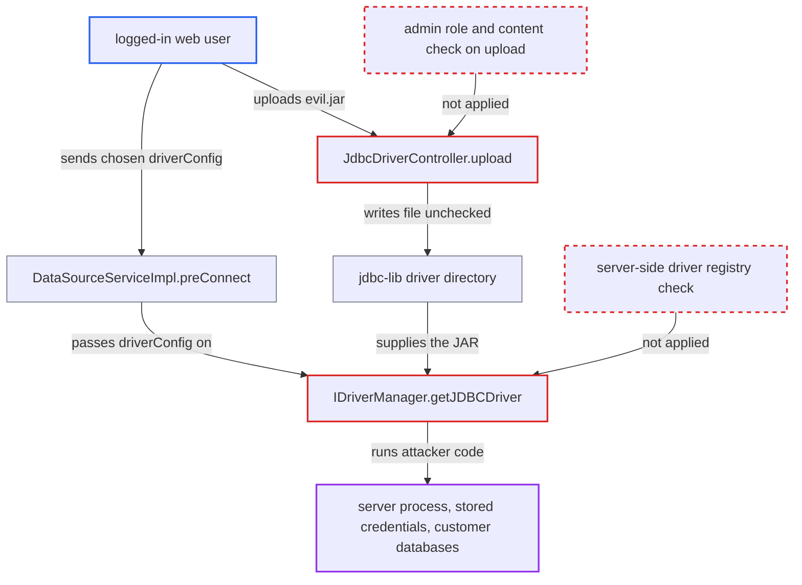

# Any logged-in user can upload a JAR and have it class-loaded as a JDBC driver (RCE)

| Field | Value |
|---|---|
| ID | `find_01VsY2GycJ1yw65M1Fn5yYpG` |
| Severity | **Critical** |
| Status | open |
| CWE | CWE-434 — Unrestricted file upload |
| Created | 2026-10-21T22:44:48.710832Z |
| Claude Security | https://claude.ai/security/findings/find_01VsY2GycJ1yw65M1Fn5yYpG |

## Description

Any logged-in web user can run arbitrary Java code inside the Chat2DB server process. From there they can read the stored datasource credentials and reach the connected databases. The attack needs only a normal login, with no admin role. `JdbcDriverController.upload` accepts any file into the driver directory, and `IDriverManager.getJDBCDriver` loads whatever JAR and class the request names.

1. **authenticated attacker** sends a multipart file `evil.jar` to `POST /api/jdbc/driver/upload`. The JAR holds a class `Evil` whose static block runs a command. Only the login interceptor guards this path, because the ADMIN-role interceptor covers just `/api/admin/**` and `/admin/**`. ([`chat2db-server/chat2db-server-web-start/src/main/java/ai/chat2db/server/web/start/config/config/Chat2dbWebMvcConfigurer.java:132-185`](https://github.com/cx-benchmark/chat2db/blob/43aaee8d48736d74ac888dc4a81ddb50d6550638/chat2db-server/chat2db-server-web-start/src/main/java/ai/chat2db/server/web/start/config/config/Chat2dbWebMvcConfigurer.java#L132-L185))
2. **the handler `JdbcDriverController.upload`** writes the uploaded bytes to `~/.chat2db/jdbc-lib/` under the client's file name. It keeps only the basename through `FilenameUtils.getName`. It checks no role, no content and no extension, and does not stop a name that matches a bundled driver JAR. ([`chat2db-server/chat2db-server-web/chat2db-server-web-api/src/main/java/ai/chat2db/server/web/api/controller/driver/JdbcDriverController.java:68-84`](https://github.com/cx-benchmark/chat2db/blob/43aaee8d48736d74ac888dc4a81ddb50d6550638/chat2db-server/chat2db-server-web/chat2db-server-web-api/src/main/java/ai/chat2db/server/web/api/controller/driver/JdbcDriverController.java#L68-L84))
3. **authenticated attacker** posts to `POST /api/connection/datasource/pre_connect` with `driverConfig` set to `{jdbcDriver: "evil.jar", jdbcDriverClass: "Evil"}`. The body also needs a non-null `ssh` such as `{use:false}`. Otherwise a NullPointerException is caught before any driver loads. ([`chat2db-server/chat2db-server-domain/chat2db-server-domain-core/src/main/java/ai/chat2db/server/domain/core/impl/DataSourceServiceImpl.java:248-265`](https://github.com/cx-benchmark/chat2db/blob/43aaee8d48736d74ac888dc4a81ddb50d6550638/chat2db-server/chat2db-server-domain/chat2db-server-domain-core/src/main/java/ai/chat2db/server/domain/core/impl/DataSourceServiceImpl.java#L248-L265))
4. **the method `DataSourceServiceImpl.preConnect`** uses the caller's `driverConfig` and passes it to `JdbcUtils.testConnect`. This happens whenever `jdbcDriver` and `jdbcDriverClass` are both non-blank. `testConnect` hands it to `IDriverManager.getConnection` with no allow-list check. ([`chat2db-server/chat2db-spi/src/main/java/ai/chat2db/spi/util/JdbcUtils.java:145-165`](https://github.com/cx-benchmark/chat2db/blob/43aaee8d48736d74ac888dc4a81ddb50d6550638/chat2db-server/chat2db-spi/src/main/java/ai/chat2db/spi/util/JdbcUtils.java#L145-L165))
5. **the method `IDriverManager.getJDBCDriver`** builds a `URLClassLoader` over the uploaded JAR and calls `loadClass(...).newInstance()` on the named class. `newInstance()` runs the static initializer and constructor before the cast to `Driver` is checked, so the attacker's code runs in the server process. ([`chat2db-server/chat2db-spi/src/main/java/ai/chat2db/spi/sql/IDriverManager.java:137-193`](https://github.com/cx-benchmark/chat2db/blob/43aaee8d48736d74ac888dc4a81ddb50d6550638/chat2db-server/chat2db-spi/src/main/java/ai/chat2db/spi/sql/IDriverManager.java#L137-L193))

## Assessment

The attacker is any authenticated user of the web-mode deployment, and a default deployment is enough. The only gate on the upload and connection endpoints is the login interceptor. No admin role, datasource grant, second user or victim action is needed. The attacker uploads the JAR, then triggers class loading with `pre_connect`. A second way to trigger the loading is `createWithPermission` for a private datasource, which reaches the same loader through `preWarmingData` and needs no admin role. The attacker can also upload a file named like a legitimate driver, for example `mysql-connector-java-8.0.30.jar`, to overwrite it. Connections of that type, including the admin's, then run the attacker's code on the next class-loader creation, after a restart or a cache miss. That code receives the URL, user name and password of each connection.

Impact: The attacker runs code with the server process's rights, with complete loss of control of the server. That code can read all of `~/.chat2db`, including the H2 metadata DB. Datasource passwords there are only DES-encrypted under the hard-coded `DesUtil.DES_KEY`. It can also read the Sa-Token JWT secret in `config/config_*.json`, which is enough to forge an admin token, and the AI keys. It can change users, roles and other drivers, and stop or hijack the service.

Subsequent-system impact: With the stored credentials and pooled live connections, the attacker can reach every customer database Chat2DB is configured for. A replaced driver JAR also captures other users' credentials as they connect. The report says the code places no limit on this pivot.

## Recommendation

(1) `JdbcDriverController.upload` lets any authenticated user write arbitrary bytes into the directory that JDBC drivers are class-loaded from. It checks no role and no content, and it uses the client's file name, so it can overwrite a bundled driver JAR.

Fix criteria: Only an administrator (or, in desktop mode, the local user) can add driver files. Uploaded content is validated as a JAR and stored under a server-generated name that cannot overwrite bundled drivers. Uploading a JAR as a non-admin user is refused. An admin upload named like a bundled driver does not replace it.

(2) `IDriverManager.getClassLoader` and `getJDBCDriver` load and instantiate whatever JAR and class the request's `driverConfig` names. The caller, not the server, therefore decides what code runs.

Fix criteria: A client-sent `jdbcDriver` or `jdbcDriverClass` is resolved against a server-side registry. The registry holds the plugin `DBConfig` entries and the admin-registered drivers from the `jdbc_driver` table. Anything else is rejected, and request bodies cannot introduce new JAR paths or class names. `pre_connect`, `create` and `update` with an unregistered `jdbcDriver` or `jdbcDriverClass` fail before any class loading.

## Evidence

**https://github.com/cx-benchmark/chat2db**

- [`chat2db-server/chat2db-server-web/chat2db-server-web-api/src/main/java/ai/chat2db/server/web/api/controller/driver/JdbcDriverController.java:68-84`](https://github.com/cx-benchmark/chat2db/blob/43aaee8d48736d74ac888dc4a81ddb50d6550638/chat2db-server/chat2db-server-web/chat2db-server-web-api/src/main/java/ai/chat2db/server/web/api/controller/driver/JdbcDriverController.java#L68-L84)
- [`chat2db-server/chat2db-server-web-start/src/main/java/ai/chat2db/server/web/start/config/config/Chat2dbWebMvcConfigurer.java:132-185`](https://github.com/cx-benchmark/chat2db/blob/43aaee8d48736d74ac888dc4a81ddb50d6550638/chat2db-server/chat2db-server-web-start/src/main/java/ai/chat2db/server/web/start/config/config/Chat2dbWebMvcConfigurer.java#L132-L185)
- [`chat2db-server/chat2db-spi/src/main/java/ai/chat2db/spi/sql/IDriverManager.java:137-193`](https://github.com/cx-benchmark/chat2db/blob/43aaee8d48736d74ac888dc4a81ddb50d6550638/chat2db-server/chat2db-spi/src/main/java/ai/chat2db/spi/sql/IDriverManager.java#L137-L193)
- [`chat2db-server/chat2db-server-domain/chat2db-server-domain-core/src/main/java/ai/chat2db/server/domain/core/impl/DataSourceServiceImpl.java:248-265`](https://github.com/cx-benchmark/chat2db/blob/43aaee8d48736d74ac888dc4a81ddb50d6550638/chat2db-server/chat2db-server-domain/chat2db-server-domain-core/src/main/java/ai/chat2db/server/domain/core/impl/DataSourceServiceImpl.java#L248-L265)
- [`chat2db-server/chat2db-spi/src/main/java/ai/chat2db/spi/util/JdbcUtils.java:145-165`](https://github.com/cx-benchmark/chat2db/blob/43aaee8d48736d74ac888dc4a81ddb50d6550638/chat2db-server/chat2db-spi/src/main/java/ai/chat2db/spi/util/JdbcUtils.java#L145-L165)

