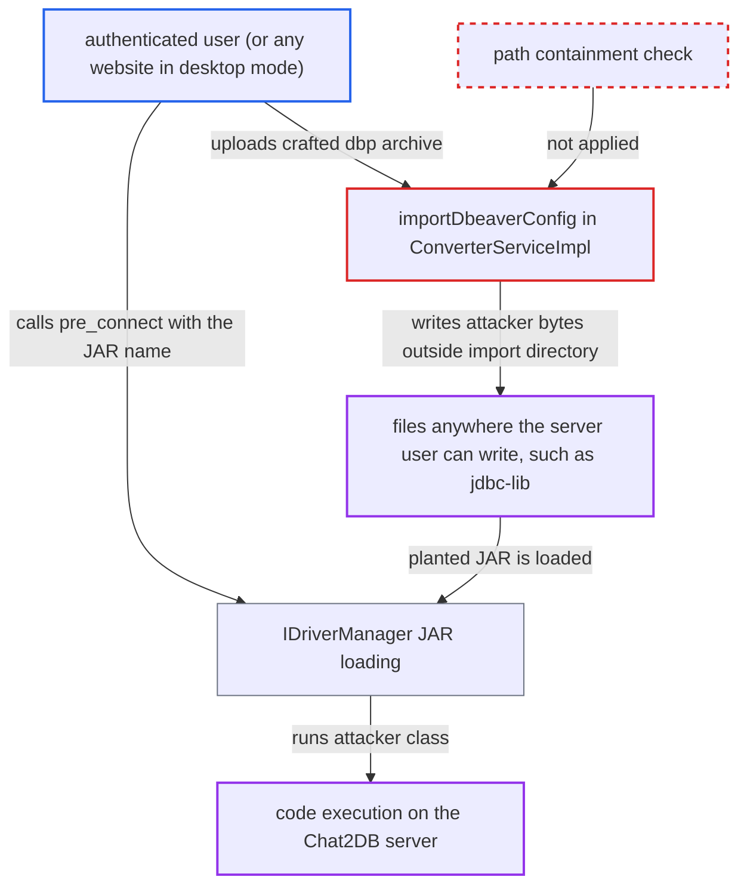

# DBeaver .dbp import extracts archive entries to attacker-chosen paths (zip-slip)

| Field | Value |
|---|---|
| ID | `find_012jE1pVnbfPibRaZor3dnfJ` |
| Severity | **Critical** |
| Status | open |
| CWE | CWE-22 — Path traversal |
| Created | 2026-10-21T22:44:48.769352Z |
| Claude Security | https://claude.ai/security/findings/find_012jE1pVnbfPibRaZor3dnfJ |

## Description

A logged-in user of the web app can write files of their choosing anywhere the server's OS user can write, and then run code on the server. In desktop mode, any website can do the same through a forged request. The cause is `importDbeaverConfig` in `ConverterServiceImpl`. It builds file paths from names in an uploaded `.dbp` archive without checking that they stay inside the import directory.

1. **attacker** posts a crafted `.dbp` zip to `/api/converter/dbp/upload`. The controller only checks that the filename ends in `.dbp`, and the path needs a login only. The attacker writes both `meta.xml` and the zip entries, with `../` in the names. ([`chat2db-server/chat2db-server-web/chat2db-server-web-api/src/main/java/ai/chat2db/server/web/api/controller/ncx/ConverterController.java:55-66`](https://github.com/cx-benchmark/chat2db/blob/43aaee8d48736d74ac888dc4a81ddb50d6550638/chat2db-server/chat2db-server-web/chat2db-server-web-api/src/main/java/ai/chat2db/server/web/api/controller/ncx/ConverterController.java#L55-L66))
2. **the import code in `ConverterServiceImpl`** takes `projectName` from the `<project name>` attribute and builds the base directory from it. The base becomes `CONFIG_BASE_PATH/<projectName>/.dbeaver`, so the attacker also chooses the base. Extraction runs before `data-sources.json` is read, so a later failure does not undo the write. ([`chat2db-server/chat2db-server-web/chat2db-server-web-api/src/main/java/ai/chat2db/server/web/api/controller/ncx/service/impl/ConverterServiceImpl.java:172-186`](https://github.com/cx-benchmark/chat2db/blob/43aaee8d48736d74ac888dc4a81ddb50d6550638/chat2db-server/chat2db-server-web/chat2db-server-web-api/src/main/java/ai/chat2db/server/web/api/controller/ncx/service/impl/ConverterServiceImpl.java#L172-L186))
3. **`importDbeaverConfig`** writes the matching zip entry to `new File(resource.getPath() + File.separator + childName)`. It only checks that a zip entry named `containerPath + childName` exists, and the attacker supplied it. `FileUtil.writeFromStream` then creates missing parent directories and overwrites the target, so `../` segments escape the import directory. ([`chat2db-server/chat2db-server-web/chat2db-server-web-api/src/main/java/ai/chat2db/server/web/api/controller/ncx/service/impl/ConverterServiceImpl.java:258-278`](https://github.com/cx-benchmark/chat2db/blob/43aaee8d48736d74ac888dc4a81ddb50d6550638/chat2db-server/chat2db-server-web/chat2db-server-web-api/src/main/java/ai/chat2db/server/web/api/controller/ncx/service/impl/ConverterServiceImpl.java#L258-L278))
4. **attacker** calls `/api/connection/datasource/pre_connect` with `driverConfig.jdbcDriver` set to the written JAR name. `DataSourceServiceImpl.preConnect` passes the user-supplied `driverConfig` through to the driver loader. ([`chat2db-server/chat2db-spi/src/main/java/ai/chat2db/spi/sql/IDriverManager.java:144-173`](https://github.com/cx-benchmark/chat2db/blob/43aaee8d48736d74ac888dc4a81ddb50d6550638/chat2db-server/chat2db-spi/src/main/java/ai/chat2db/spi/sql/IDriverManager.java#L144-L173))
5. **`IDriverManager`** loads the JAR from `jdbc-lib` with a `URLClassLoader` and calls `newInstance()` on the class the attacker names. The JAR is the one planted in `~/.chat2db/jdbc-lib/`, so the attacker's code runs inside the server. ([`chat2db-server/chat2db-spi/src/main/java/ai/chat2db/spi/sql/IDriverManager.java:144-173`](https://github.com/cx-benchmark/chat2db/blob/43aaee8d48736d74ac888dc4a81ddb50d6550638/chat2db-server/chat2db-spi/src/main/java/ai/chat2db/spi/sql/IDriverManager.java#L144-L173))

## Assessment

In web mode the attacker is any authenticated low-privilege user. `POST /api/converter/dbp/upload` has no admin check, and the admin interceptor covers only `/api/admin/**`. In desktop mode, `Chat2dbWebMvcConfigurer` gives every request the default user, so any website can send the request through CSRF. The attacker crafts a zip whose `meta.xml` names a resource like `../../../../root/.chat2db/jdbc-lib/evil.jar`, plus matching zip entries holding a malicious JAR. They upload it as `file` with a `.dbp` filename. Then they create or connect a datasource with `driverConfig.jdbcDriver=evil.jar`. The shipped `docker/Dockerfile` has no `USER` directive, so the server runs as root with `HOME=/root` and the write can reach anywhere in the container. The report assumes hutool `5.8.20` `FileUtil.writeFromStream(InputStream, File, boolean)` creates parent directories and overwrites without any path check.

Impact: The attacker can write or overwrite any file the server's OS user can write, with content they choose. That includes the application JAR `/app/chat2db-server-web-start.jar`, the H2 database and config under `~/.chat2db`, and shell or startup files. Chained with the driver JAR loading, this gives code execution on the Chat2DB server. The attacker can then read and modify stored datasource credentials, SSH keys, AI keys and the H2 database, and can destroy or backdoor the service.

Subsequent-system impact: With code execution on the server, the attacker obtains the DES-encrypted passwords and SSH credentials of every configured customer database. The DES key is static (`DesUtil.DES_KEY`). The attacker can also use the server's network position to reach those databases.

## Recommendation

(1) Destination paths for extracted members are built by string concatenation from names in the uploaded `meta.xml` (`projectName` and each `<resource name>`). Nothing keeps them inside the intended import directory.

Fix criteria: Every destination path derived from archive content canonicalises to a location strictly inside a per-import staging directory. That directory is fixed or randomly named under `CONFIG_BASE_PATH` and never derived from `projectName`. Names with path separators or `..`, and zip entries that resolve outside the staging directory, are rejected before any write. Importing an archive whose `meta.xml` or entries contain `../` segments creates nothing outside the staging directory, and the import fails.

(2) The import writes attacker-controlled bytes into the same directory tree that `JdbcJarUtils` and `IDriverManager` load code from. It has no size or type limits (`max-file-size: -1`).

Fix criteria: Extracted content is written only to a dedicated staging directory that is never on a class-loading or configuration path. That directory is deleted on both success and failure. Extraction enforces an upper bound on entry count and on total uncompressed size.

## Evidence

**https://github.com/cx-benchmark/chat2db**

- [`chat2db-server/chat2db-server-web/chat2db-server-web-api/src/main/java/ai/chat2db/server/web/api/controller/ncx/service/impl/ConverterServiceImpl.java:258-278`](https://github.com/cx-benchmark/chat2db/blob/43aaee8d48736d74ac888dc4a81ddb50d6550638/chat2db-server/chat2db-server-web/chat2db-server-web-api/src/main/java/ai/chat2db/server/web/api/controller/ncx/service/impl/ConverterServiceImpl.java#L258-L278)
- [`chat2db-server/chat2db-server-web/chat2db-server-web-api/src/main/java/ai/chat2db/server/web/api/controller/ncx/service/impl/ConverterServiceImpl.java:172-186`](https://github.com/cx-benchmark/chat2db/blob/43aaee8d48736d74ac888dc4a81ddb50d6550638/chat2db-server/chat2db-server-web/chat2db-server-web-api/src/main/java/ai/chat2db/server/web/api/controller/ncx/service/impl/ConverterServiceImpl.java#L172-L186)
- [`chat2db-server/chat2db-server-web/chat2db-server-web-api/src/main/java/ai/chat2db/server/web/api/controller/ncx/ConverterController.java:55-66`](https://github.com/cx-benchmark/chat2db/blob/43aaee8d48736d74ac888dc4a81ddb50d6550638/chat2db-server/chat2db-server-web/chat2db-server-web-api/src/main/java/ai/chat2db/server/web/api/controller/ncx/ConverterController.java#L55-L66)
- [`chat2db-server/chat2db-spi/src/main/java/ai/chat2db/spi/sql/IDriverManager.java:144-173`](https://github.com/cx-benchmark/chat2db/blob/43aaee8d48736d74ac888dc4a81ddb50d6550638/chat2db-server/chat2db-spi/src/main/java/ai/chat2db/spi/sql/IDriverManager.java#L144-L173)
- [`docker/Dockerfile:1-12`](https://github.com/cx-benchmark/chat2db/blob/43aaee8d48736d74ac888dc4a81ddb50d6550638/docker/Dockerfile#L1-L12)

