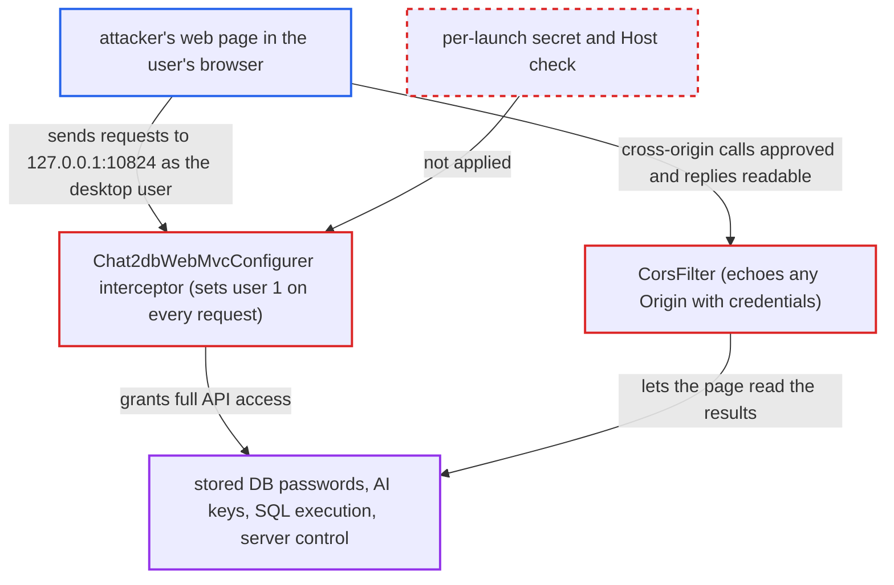

# Desktop localhost API serves any website as the default user (CSRF, cross-origin reads)

| Field | Value |
|---|---|
| ID | `find_01RdhJGSXZwXx8jLEm3JZaHg` |
| Severity | **Critical** |
| Status | open |
| CWE | CWE-352 — Cross-Site Request Forgery |
| Created | 2026-10-21T22:54:01.289608Z |
| Claude Security | https://claude.ai/security/findings/find_01RdhJGSXZwXx8jLEm3JZaHg |

## Description

A web page opened in a browser on the same machine as the Chat2DB desktop app can use the app's whole REST API as the built-in desktop user. It can read stored database passwords, SSH settings and AI keys, run SQL, change settings and stop the server. The attack needs no login, only that the app is running and the user visits the page. The cause is that `Chat2dbWebMvcConfigurer` trusts every request reaching the loopback port, and `CorsFilter` echoes any `Origin`.

1. **attacker** hosts a web page that a Chat2DB desktop user opens while the app is running. No credential is needed, only that the user visits the page.
2. **the page's script** sends requests to the local API at `http://127.0.0.1:10824`. The Electron client starts `chat2db-server-start.jar` on this fixed address, and any browser on the machine can reach it. ([`chat2db-client/src/main/preload.js:19-30`](https://github.com/cx-benchmark/chat2db/blob/43aaee8d48736d74ac888dc4a81ddb50d6550638/chat2db-client/src/main/preload.js#L19-L30))
3. **`CorsFilter`** echoes the page's `Origin` back with credentials allowed. This lets the foreign page read the JSON replies and have its `application/json` preflights approved for `POST`, `PUT` and `DELETE`. ([`chat2db-server/chat2db-server-start/src/main/java/ai/chat2db/server/start/config/interceptor/CorsFilter.java:32-37`](https://github.com/cx-benchmark/chat2db/blob/43aaee8d48736d74ac888dc4a81ddb50d6550638/chat2db-server/chat2db-server-start/src/main/java/ai/chat2db/server/start/config/interceptor/CorsFilter.java#L32-L37))
4. **the interceptor in `Chat2dbWebMvcConfigurer`** treats every request as the DESKTOP user with id `1`. It checks no secret, `Origin`, `Referer` or `Host`, and it always lets the request through. ([`chat2db-server/chat2db-server-start/src/main/java/ai/chat2db/server/start/config/config/Chat2dbWebMvcConfigurer.java:63-110`](https://github.com/cx-benchmark/chat2db/blob/43aaee8d48736d74ac888dc4a81ddb50d6550638/chat2db-server/chat2db-server-start/src/main/java/ai/chat2db/server/start/config/config/Chat2dbWebMvcConfigurer.java#L63-L110))
5. **the page's script** reads stored datasource passwords and SSH settings from `/api/connection/datasource/list`. This is a simple `GET` that needs no preflight, and the passwords come back decrypted. ([`chat2db-server/chat2db-server-web/chat2db-server-web-api/src/main/java/ai/chat2db/server/web/api/controller/data/source/DataSourceController.java:171-177`](https://github.com/cx-benchmark/chat2db/blob/43aaee8d48736d74ac888dc4a81ddb50d6550638/chat2db-server/chat2db-server-web/chat2db-server-web-api/src/main/java/ai/chat2db/server/web/api/controller/data/source/DataSourceController.java#L171-L177))
6. **the page's script** posts SQL to `/api/rdb/dml/execute`. The server connects with the stored credentials, and the permission check passes because every desktop datasource belongs to user `1`. ([`chat2db-server/chat2db-server-web/chat2db-server-web-api/src/main/java/ai/chat2db/server/web/api/controller/rdb/RdbDmlController.java:47-76`](https://github.com/cx-benchmark/chat2db/blob/43aaee8d48736d74ac888dc4a81ddb50d6550638/chat2db-server/chat2db-server-web/chat2db-server-web-api/src/main/java/ai/chat2db/server/web/api/controller/rdb/RdbDmlController.java#L47-L76))
7. **the page's script** reads AI keys from `/api/config/system_config/ai`, rewrites config, or stops the server. The `POST /api/config/system_config*` endpoints rewrite settings, and `/api/system/stop` accepts any method, so even an `` tag can shut the server down. ([`chat2db-server/chat2db-server-web/chat2db-server-web-api/src/main/java/ai/chat2db/server/web/api/controller/system/SystemController.java:139-152`](https://github.com/cx-benchmark/chat2db/blob/43aaee8d48736d74ac888dc4a81ddb50d6550638/chat2db-server/chat2db-server-web/chat2db-server-web-api/src/main/java/ai/chat2db/server/web/api/controller/system/SystemController.java#L139-L152))

## Assessment

The attacker only needs to get a Chat2DB desktop user to open a web page while the app runs. The script on the page calls `fetch('http://127.0.0.1:10824/api/connection/datasource/list')`, and no credential is needed. This assumes a browser that does not block public-to-loopback requests. Chromium's Local Network Access prompt would block them. DNS rebinding is an alternative route that does not depend on CORS, because `Host` is not validated. A plain cross-site `GET` such as an `` tag is enough to stop the server through `/api/system/stop`. The `update_desktop_version` endpoint in the same controller is reachable the same way. The report records its code-execution consequence separately.

Impact: The page acts as the desktop user. It can read all stored datasource passwords, SSH settings and AI keys, and run arbitrary SQL with the stored credentials. It can also create, edit or delete datasources and system config, and stop the server.

Subsequent-system impact: SQL runs on every database the desktop user has configured, using the stored accounts, and the results go back to the page. Within those accounts' privileges, the attacker can read, change or drop customer data. The stolen passwords also allow direct logins to those databases outside Chat2DB.

## Recommendation

(1) `Chat2dbWebMvcConfigurer` treats every request that reaches the loopback port as the DESKTOP user. Nothing proves the request comes from the Electron client, and the `Host` header is not checked, so DNS rebinding also works.

Fix criteria: Every desktop API request must prove it comes from the Electron client, for example with a per-launch secret generated at spawn and required in a request header. Requests whose `Host` is not `127.0.0.1` or `localhost:<port>` are rejected. A `fetch` from a foreign origin, and a request over a rebound hostname, to `/api/connection/datasource/list`, `/api/rdb/dml/execute` and `/api/system/stop` each return an error and no data.

(2) The desktop `CorsFilter` reflects every `Origin` with `Access-Control-Allow-Credentials: true`. This lets hostile pages read API responses and pass preflights.

Fix criteria: No `Access-Control-Allow-Origin` header is sent for origins other than the app's own, and foreign-origin preflights are answered without approval. A request carrying `Origin: https://evil.example` gets no ACAO header, and the browser blocks the page from reading the response.

## Evidence

**https://github.com/cx-benchmark/chat2db**

- [`chat2db-server/chat2db-server-start/src/main/java/ai/chat2db/server/start/config/config/Chat2dbWebMvcConfigurer.java:63-110`](https://github.com/cx-benchmark/chat2db/blob/43aaee8d48736d74ac888dc4a81ddb50d6550638/chat2db-server/chat2db-server-start/src/main/java/ai/chat2db/server/start/config/config/Chat2dbWebMvcConfigurer.java#L63-L110)
- [`chat2db-server/chat2db-server-start/src/main/java/ai/chat2db/server/start/config/interceptor/CorsFilter.java:32-37`](https://github.com/cx-benchmark/chat2db/blob/43aaee8d48736d74ac888dc4a81ddb50d6550638/chat2db-server/chat2db-server-start/src/main/java/ai/chat2db/server/start/config/interceptor/CorsFilter.java#L32-L37)
- [`chat2db-server/chat2db-server-web/chat2db-server-web-api/src/main/java/ai/chat2db/server/web/api/controller/data/source/DataSourceController.java:171-177`](https://github.com/cx-benchmark/chat2db/blob/43aaee8d48736d74ac888dc4a81ddb50d6550638/chat2db-server/chat2db-server-web/chat2db-server-web-api/src/main/java/ai/chat2db/server/web/api/controller/data/source/DataSourceController.java#L171-L177)
- [`chat2db-server/chat2db-server-web/chat2db-server-web-api/src/main/java/ai/chat2db/server/web/api/controller/rdb/RdbDmlController.java:47-76`](https://github.com/cx-benchmark/chat2db/blob/43aaee8d48736d74ac888dc4a81ddb50d6550638/chat2db-server/chat2db-server-web/chat2db-server-web-api/src/main/java/ai/chat2db/server/web/api/controller/rdb/RdbDmlController.java#L47-L76)
- [`chat2db-server/chat2db-server-web/chat2db-server-web-api/src/main/java/ai/chat2db/server/web/api/controller/config/ConfigController.java:289-320`](https://github.com/cx-benchmark/chat2db/blob/43aaee8d48736d74ac888dc4a81ddb50d6550638/chat2db-server/chat2db-server-web/chat2db-server-web-api/src/main/java/ai/chat2db/server/web/api/controller/config/ConfigController.java#L289-L320)
- [`chat2db-client/src/main/preload.js:19-30`](https://github.com/cx-benchmark/chat2db/blob/43aaee8d48736d74ac888dc4a81ddb50d6550638/chat2db-client/src/main/preload.js#L19-L30)
- [`chat2db-server/chat2db-server-web/chat2db-server-web-api/src/main/java/ai/chat2db/server/web/api/controller/system/SystemController.java:139-152`](https://github.com/cx-benchmark/chat2db/blob/43aaee8d48736d74ac888dc4a81ddb50d6550638/chat2db-server/chat2db-server-web/chat2db-server-web-api/src/main/java/ai/chat2db/server/web/api/controller/system/SystemController.java#L139-L152)

