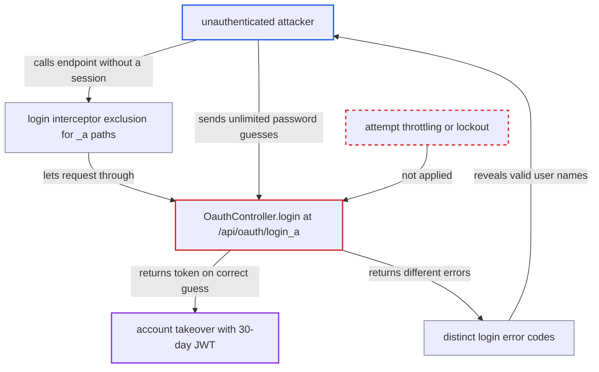

# Login endpoint has no brute-force protection (unlimited password attempts)

| Field | Value |
|---|---|
| ID | `find_01DR7fnAmKX7adP4RThGbDf1` |
| Severity | **Critical** |
| Status | open |
| CWE | CWE-307 — Improper Restriction of Excessive Authentication Attempts |
| Created | 2026-10-21T23:03:28.401934Z |
| Claude Security | https://claude.ai/security/findings/find_01DR7fnAmKX7adP4RThGbDf1 |

## Description

An unauthenticated attacker over the network can guess passwords for the administrator or any other account without limit. A correct guess gives control of that account, including the administrator's. Success needs a guessable password. The login handler `OauthController.login` at `POST /api/oauth/login_a` has no throttling or lockout. It also returns different errors for unknown users and wrong passwords.

1. **attacker** reaches the login endpoint without a session. The login interceptor excludes `/**/*_a`, so `POST /api/oauth/login_a` is open to anyone. ([`chat2db-server/chat2db-server-web-start/src/main/java/ai/chat2db/server/web/start/config/config/Chat2dbWebMvcConfigurer.java:161-168`](https://github.com/cx-benchmark/chat2db/blob/43aaee8d48736d74ac888dc4a81ddb50d6550638/chat2db-server/chat2db-server-web-start/src/main/java/ai/chat2db/server/web/start/config/config/Chat2dbWebMvcConfigurer.java#L161-L168))
2. **attacker** collects valid user names. The error codes `oauth.userNameNotExits`, `oauth.invalidUserName` and `oauth.passwordIncorrect` are returned to the client as they are. The administrator's name is already known, because it defaults to `chat2db` and cannot be changed. ([`chat2db-server/chat2db-server-web-start/src/main/java/ai/chat2db/server/web/start/exception/convertor/BusinessExceptionConvertor.java:16-19`](https://github.com/cx-benchmark/chat2db/blob/43aaee8d48736d74ac888dc4a81ddb50d6550638/chat2db-server/chat2db-server-web-start/src/main/java/ai/chat2db/server/web/start/exception/convertor/BusinessExceptionConvertor.java#L16-L19))
3. **the handler `OauthController.login`** looks up the user and checks the password with `DigestUtil.bcryptCheck`. Nothing counts failures, delays, locks the account or asks for a CAPTCHA, so every attempt is handled like the first. ([`chat2db-server/chat2db-server-web-start/src/main/java/ai/chat2db/server/web/start/controller/oauth/OauthController.java:44-60`](https://github.com/cx-benchmark/chat2db/blob/43aaee8d48736d74ac888dc4a81ddb50d6550638/chat2db-server/chat2db-server-web-start/src/main/java/ai/chat2db/server/web/start/controller/oauth/OauthController.java#L44-L60))
4. **attacker** repeats dictionary guesses for each known name. The only limit is how long the server takes to verify each bcrypt hash. The report assumes hutool's default cost of 10.
5. **attacker** receives a stateless Sa-Token JWT on a correct guess. The token is valid for 30 days (`application.yml:56`).

## Assessment

The attacker is an unauthenticated internet user who can reach the web service, for example the Docker deployment. They need no account. They try the fixed administrator name `chat2db`, or names confirmed through the error-code differences, with common passwords. The attack works only if the target's password is guessable. The report says no password policy exists, since `UserCreateRequest` only requires `@NotNull`. The report notes a separate default-admin password bypass at `OauthController.java:51-53` that needs no guessing.

Impact: The attacker takes over any account with a guessable password. For the administrator, that means managing users, teams and datasource grants under `/api/admin/**`, running SQL, and changing system and AI config. They can read and alter all Chat2DB data and disable or delete users, but cannot take the service down entirely.

Subsequent-system impact: A taken-over account can run arbitrary SQL against the customer databases it may use, with Chat2DB's stored credentials. That allows reading, changing or dropping the data in those databases.

## Recommendation

Authentication accepts unlimited attempts per account and per source. It also reveals whether a user name exists, through different error codes for unknown user and wrong password.

Fix criteria: Failed logins are throttled or locked per account and per IP, with exponential delay or temporary lockout. The error for an unknown user and for a wrong password is identical. After N failures, further attempts for that account are rejected or delayed whether or not the password is correct, and a test confirms this.

## Evidence

**https://github.com/cx-benchmark/chat2db**

- [`chat2db-server/chat2db-server-web-start/src/main/java/ai/chat2db/server/web/start/controller/oauth/OauthController.java:44-60`](https://github.com/cx-benchmark/chat2db/blob/43aaee8d48736d74ac888dc4a81ddb50d6550638/chat2db-server/chat2db-server-web-start/src/main/java/ai/chat2db/server/web/start/controller/oauth/OauthController.java#L44-L60)
- [`chat2db-server/chat2db-server-web-start/src/main/java/ai/chat2db/server/web/start/controller/oauth/OauthController.java:67-77`](https://github.com/cx-benchmark/chat2db/blob/43aaee8d48736d74ac888dc4a81ddb50d6550638/chat2db-server/chat2db-server-web-start/src/main/java/ai/chat2db/server/web/start/controller/oauth/OauthController.java#L67-L77)
- [`chat2db-server/chat2db-server-web-start/src/main/java/ai/chat2db/server/web/start/config/config/Chat2dbWebMvcConfigurer.java:161-168`](https://github.com/cx-benchmark/chat2db/blob/43aaee8d48736d74ac888dc4a81ddb50d6550638/chat2db-server/chat2db-server-web-start/src/main/java/ai/chat2db/server/web/start/config/config/Chat2dbWebMvcConfigurer.java#L161-L168)
- [`chat2db-server/chat2db-server-domain/chat2db-server-domain-api/src/main/java/ai/chat2db/server/domain/api/enums/RoleCodeEnum.java:21-22`](https://github.com/cx-benchmark/chat2db/blob/43aaee8d48736d74ac888dc4a81ddb50d6550638/chat2db-server/chat2db-server-domain/chat2db-server-domain-api/src/main/java/ai/chat2db/server/domain/api/enums/RoleCodeEnum.java#L21-L22)
- [`chat2db-server/chat2db-server-domain/chat2db-server-domain-core/src/main/java/ai/chat2db/server/domain/core/impl/UserServiceImpl.java:129-133`](https://github.com/cx-benchmark/chat2db/blob/43aaee8d48736d74ac888dc4a81ddb50d6550638/chat2db-server/chat2db-server-domain/chat2db-server-domain-core/src/main/java/ai/chat2db/server/domain/core/impl/UserServiceImpl.java#L129-L133)
- [`chat2db-server/chat2db-server-web-start/src/main/java/ai/chat2db/server/web/start/exception/convertor/BusinessExceptionConvertor.java:16-19`](https://github.com/cx-benchmark/chat2db/blob/43aaee8d48736d74ac888dc4a81ddb50d6550638/chat2db-server/chat2db-server-web-start/src/main/java/ai/chat2db/server/web/start/exception/convertor/BusinessExceptionConvertor.java#L16-L19)

