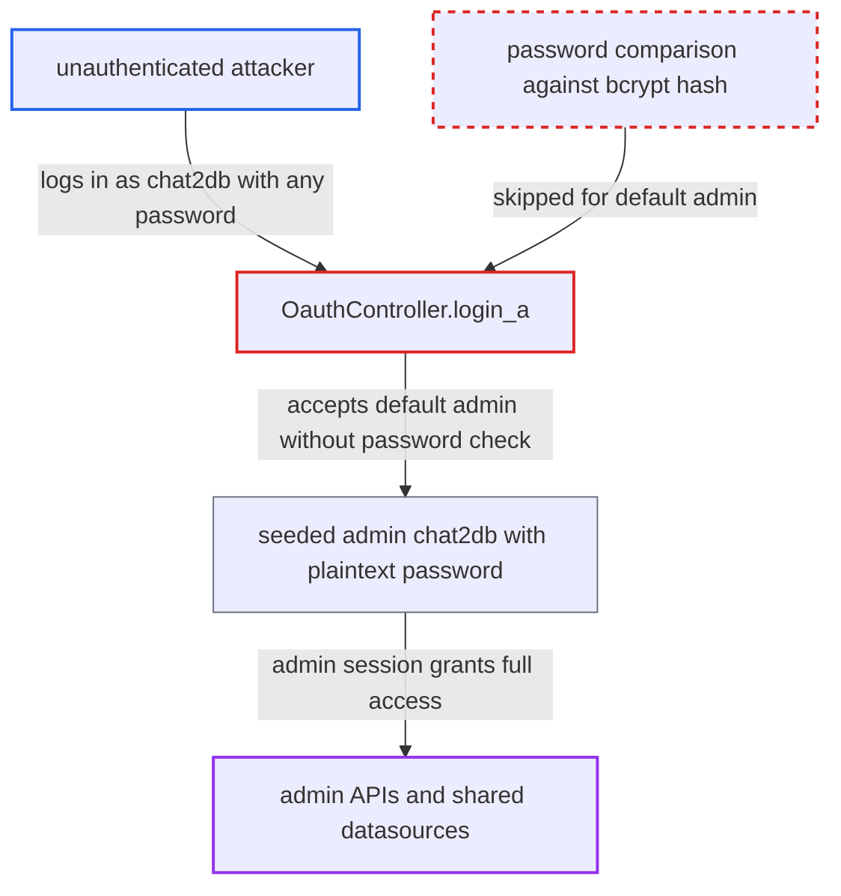

# Seeded default admin chat2db logs in with any password until changed

| Field | Value |
|---|---|
| ID | `find_015xtGZZpu4ueAKk1zVzV2VP` |
| Severity | **Critical** |
| Status | open |
| CWE | CWE-1392 — Default credentials |
| Created | 2026-10-21T22:46:05.871254Z |
| Claude Security | https://claude.ai/security/findings/find_015xtGZZpu4ueAKk1zVzV2VP |

## Description

An unauthenticated attacker who can reach the Chat2DB web server (including the Docker image) can log in as the built-in administrator `chat2db` and take full control of the server. On an unmodified install, any password is accepted. The migration seeds this admin with the plaintext password `chat2db`, and `OauthController.login_a` skips the password comparison while that default is still stored.

1. **Flyway migration** creates the admin account on first start. The migration inserts user `chat2db` with role `ADMIN` and the plaintext password `chat2db`, which becomes row id 2 on a fresh database. ([`chat2db-server/chat2db-server-domain/chat2db-server-domain-repository/src/main/resources/db/migration/V2_1_0__支持环境、用户权限.sql:47-50`](https://github.com/cx-benchmark/chat2db/blob/43aaee8d48736d74ac888dc4a81ddb50d6550638/chat2db-server/chat2db-server-domain/chat2db-server-domain-repository/src/main/resources/db/migration/V2_1_0__%E6%94%AF%E6%8C%81%E7%8E%AF%E5%A2%83%E3%80%81%E7%94%A8%E6%88%B7%E6%9D%83%E9%99%90.sql#L47-L50))
2. **Docker image** starts the server in login-required web mode with the default credential active. The image sets neither `chat2db.mode` nor `ADMIN_PASSWORD`, so the expected admin password stays `chat2db`. ([`docker/Dockerfile:6-12`](https://github.com/cx-benchmark/chat2db/blob/43aaee8d48736d74ac888dc4a81ddb50d6550638/docker/Dockerfile#L6-L12))
3. **attacker** sends `POST /api/oauth/login_a` with user name `chat2db` and any password. The `_a` suffix matches the `/**/*_a` exclusion, so no login is needed to call it. ([`chat2db-server/chat2db-server-web-start/src/main/java/ai/chat2db/server/web/start/controller/oauth/OauthController.java:44-65`](https://github.com/cx-benchmark/chat2db/blob/43aaee8d48736d74ac888dc4a81ddb50d6550638/chat2db-server/chat2db-server-web-start/src/main/java/ai/chat2db/server/web/start/controller/oauth/OauthController.java#L44-L65))
4. **the handler `OauthController.login_a`** calls `validateAdmin` before any password check and logs the user in. `validateAdmin` is true when the user id is 2 and the stored password equals `RoleCodeEnum.ADMIN.getPassword()`. Both are `chat2db` by default, so `StpUtil.login(2)` runs and the submitted password is never compared. ([`chat2db-server/chat2db-server-web-start/src/main/java/ai/chat2db/server/web/start/controller/oauth/OauthController.java:44-65`](https://github.com/cx-benchmark/chat2db/blob/43aaee8d48736d74ac888dc4a81ddb50d6550638/chat2db-server/chat2db-server-web-start/src/main/java/ai/chat2db/server/web/start/controller/oauth/OauthController.java#L44-L65))
5. **the web interceptor** marks the session as admin. It sets `admin=true` for any logged-in row with `ROLE_CODE='ADMIN'`, and that flag is the only gate on `/api/admin/**`. ([`chat2db-server/chat2db-server-web-start/src/main/java/ai/chat2db/server/web/start/config/config/Chat2dbWebMvcConfigurer.java:99-104`](https://github.com/cx-benchmark/chat2db/blob/43aaee8d48736d74ac888dc4a81ddb50d6550638/chat2db-server/chat2db-server-web-start/src/main/java/ai/chat2db/server/web/start/config/config/Chat2dbWebMvcConfigurer.java#L99-L104))
6. **attacker** uses the admin session on the admin APIs and shared datasources. `checkPermission` approves every SHARED datasource for an admin. ([`chat2db-server/chat2db-server-domain/chat2db-server-domain-core/src/main/java/ai/chat2db/server/domain/core/impl/DataSourceAccessBusinessServiceImpl.java:46-49`](https://github.com/cx-benchmark/chat2db/blob/43aaee8d48736d74ac888dc4a81ddb50d6550638/chat2db-server/chat2db-server-domain/chat2db-server-domain-core/src/main/java/ai/chat2db/server/domain/core/impl/DataSourceAccessBusinessServiceImpl.java#L46-L49))

## Assessment

The attacker needs only network access to a web or Docker deployment that still has the shipped defaults. The report treats this server as internet-facing, and the login page displays the default credential. No victim action is needed. The attack stops working once the admin password is changed through `/api/admin/user/update`, because `UserServiceImpl.update` bcrypt-hashes it and `validateAdmin` becomes false. Setting `ADMIN_PASSWORD` does not rewrite the stored row. It only makes `validateAdmin` false, and then `DigestUtil.bcryptCheck` runs against the non-hash string `chat2db`. The report assumes this never accepts the login, given Hutool 5.8.20. The same login code exists in the desktop module `chat2db-server-start`, where login is not used.

Impact: The attacker gets full administrative control of the Chat2DB server. They can list, create, update, disable and delete users and teams, reset passwords, add admins, manage datasource grants, and create, update or delete shared datasources.

Subsequent-system impact: Because `checkPermission` approves every SHARED datasource for an admin, the attacker can open consoles and run arbitrary SQL with the stored credentials against every shared database the instance is configured for. They can read, modify or drop its data. Other users' PRIVATE datasources stay denied by `checkPermission`.

## Recommendation

(1) The migration seeds a fixed, plaintext, publicly advertised administrator password, and nothing requires changing it. Every fresh web deployment starts with a known admin credential.

Fix criteria: A fresh install accepts no credential known in advance. The initial admin secret is unique per install and stored only as a bcrypt hash, or the operator supplies it before first login, or the first login forces a change before any other API works. On a clean instance, `chat2db`/`chat2db` at `POST /api/oauth/login_a` does not yield a usable admin session.

(2) `OauthController.validateAdmin` logs in the default admin without comparing the submitted password while the stored password equals the configured default. This turns a default credential into a login that needs no password.

Fix criteria: Every login, including the built-in admin, checks the submitted password against the stored bcrypt hash. No code path reaches `StpUtil.login` without that check succeeding. On an unmodified database, `chat2db` with a wrong password is rejected.

## Evidence

**https://github.com/cx-benchmark/chat2db**

- [`chat2db-server/chat2db-server-domain/chat2db-server-domain-repository/src/main/resources/db/migration/V2_1_0__支持环境、用户权限.sql:47-50`](https://github.com/cx-benchmark/chat2db/blob/43aaee8d48736d74ac888dc4a81ddb50d6550638/chat2db-server/chat2db-server-domain/chat2db-server-domain-repository/src/main/resources/db/migration/V2_1_0__支持环境、用户权限.sql#L47-L50)
- [`chat2db-server/chat2db-server-web-start/src/main/java/ai/chat2db/server/web/start/controller/oauth/OauthController.java:44-65`](https://github.com/cx-benchmark/chat2db/blob/43aaee8d48736d74ac888dc4a81ddb50d6550638/chat2db-server/chat2db-server-web-start/src/main/java/ai/chat2db/server/web/start/controller/oauth/OauthController.java#L44-L65)
- [`chat2db-server/chat2db-server-domain/chat2db-server-domain-api/src/main/java/ai/chat2db/server/domain/api/enums/RoleCodeEnum.java:21-22`](https://github.com/cx-benchmark/chat2db/blob/43aaee8d48736d74ac888dc4a81ddb50d6550638/chat2db-server/chat2db-server-domain/chat2db-server-domain-api/src/main/java/ai/chat2db/server/domain/api/enums/RoleCodeEnum.java#L21-L22)
- [`chat2db-server/chat2db-server-domain/chat2db-server-domain-repository/src/main/java/ai/chat2db/server/domain/repository/Dbutils.java:103-121`](https://github.com/cx-benchmark/chat2db/blob/43aaee8d48736d74ac888dc4a81ddb50d6550638/chat2db-server/chat2db-server-domain/chat2db-server-domain-repository/src/main/java/ai/chat2db/server/domain/repository/Dbutils.java#L103-L121)
- [`docker/Dockerfile:6-12`](https://github.com/cx-benchmark/chat2db/blob/43aaee8d48736d74ac888dc4a81ddb50d6550638/docker/Dockerfile#L6-L12)
- [`chat2db-server/chat2db-server-web-start/src/main/java/ai/chat2db/server/web/start/config/config/Chat2dbWebMvcConfigurer.java:99-104`](https://github.com/cx-benchmark/chat2db/blob/43aaee8d48736d74ac888dc4a81ddb50d6550638/chat2db-server/chat2db-server-web-start/src/main/java/ai/chat2db/server/web/start/config/config/Chat2dbWebMvcConfigurer.java#L99-L104)
- [`chat2db-server/chat2db-server-domain/chat2db-server-domain-core/src/main/java/ai/chat2db/server/domain/core/impl/DataSourceAccessBusinessServiceImpl.java:46-49`](https://github.com/cx-benchmark/chat2db/blob/43aaee8d48736d74ac888dc4a81ddb50d6550638/chat2db-server/chat2db-server-domain/chat2db-server-domain-core/src/main/java/ai/chat2db/server/domain/core/impl/DataSourceAccessBusinessServiceImpl.java#L46-L49)
- [`chat2db-client/src/i18n/en-us/login.ts:12`](https://github.com/cx-benchmark/chat2db/blob/43aaee8d48736d74ac888dc4a81ddb50d6550638/chat2db-client/src/i18n/en-us/login.ts#L12)

