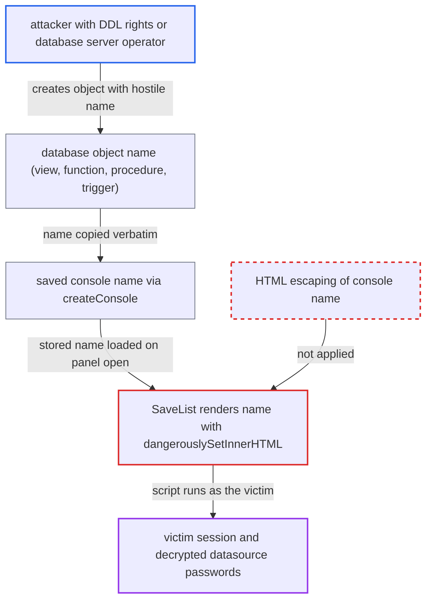

# Stored XSS: saved-console names derived from DB object names rendered as raw HTML

| Field | Value |
|---|---|
| ID | `find_01YBJo3xXGCucbmW2kqq5HSX` |
| Severity | **Critical** |
| Status | open |
| CWE | CWE-79 — Cross-site scripting |
| Created | 2026-10-21T22:46:05.934878Z |
| Claude Security | https://claude.ai/security/findings/find_01YBJo3xXGCucbmW2kqq5HSX |

## Description

A user with DDL rights on a shared datasource, or the operator of a database server that Chat2DB connects to, can run script in another user's session. They do it by naming a database object with HTML. The script can read decrypted datasource passwords and call APIs as the victim, and as admin APIs if the victim is an admin. The cause is `SaveList/index.tsx:163`, which renders saved console names with `dangerouslySetInnerHTML`.

1. **attacker** creates a view whose name is HTML with a script handler. The attacker is a team member with DDL rights on a shared datasource, or the operator of the database server; an example name is ``.
2. **the tree in `treeConfig.tsx`** lists the view under the name the database returned. The name comes unchanged from `/api/rdb/view/list`, which returns JDBC `getTables` names, and nothing escapes it. ([`chat2db-client/src/blocks/Tree/treeConfig.tsx:336-355`](https://github.com/cx-benchmark/chat2db/blob/43aaee8d48736d74ac888dc4a81ddb50d6550638/chat2db-client/src/blocks/Tree/treeConfig.tsx#L336-L355))
3. **victim** opens the view from the object tree, which creates a console with that name. `openAsyncSql.ts` calls `createConsole({ name: treeNodeData.name, ... })`, and `createConsole` saves it through `POST /api/operation/saved/create`, where the server stores the name unchanged. ([`chat2db-client/src/blocks/Tree/functions/openAsyncSql.ts:10-14`](https://github.com/cx-benchmark/chat2db/blob/43aaee8d48736d74ac888dc4a81ddb50d6550638/chat2db-client/src/blocks/Tree/functions/openAsyncSql.ts#L10-L14))
4. **victim** saves the console with Ctrl+S or the save button. `useSaveEditorData.saveConsole` sets the status to `RELEASE`, so `getSavedConsoleList` returns the console from then on. ([`chat2db-client/src/components/ConsoleEditor/hooks/useSaveEditorData.ts:26-43`](https://github.com/cx-benchmark/chat2db/blob/43aaee8d48736d74ac888dc4a81ddb50d6550638/chat2db-client/src/components/ConsoleEditor/hooks/useSaveEditorData.ts#L26-L43))
5. **victim** opens the Saved console panel. `WorkspaceExtendBody` mounts `SaveList`, which fetches the saved list when it mounts. ([`chat2db-client/src/pages/main/workspace/components/WorkspaceExtend/WorkspaceExtendBody/index.tsx:6-17`](https://github.com/cx-benchmark/chat2db/blob/43aaee8d48736d74ac888dc4a81ddb50d6550638/chat2db-client/src/pages/main/workspace/components/WorkspaceExtend/WorkspaceExtendBody/index.tsx#L6-L17))
6. **`SaveList`** writes each console name into the page as raw HTML. `dangerouslySetInnerHTML={{ __html: t.name }}` makes the injected script run in the Chat2DB origin with the victim's session, and it runs again every time the panel opens. ([`chat2db-client/src/pages/main/workspace/components/SaveList/index.tsx:163`](https://github.com/cx-benchmark/chat2db/blob/43aaee8d48736d74ac888dc4a81ddb50d6550638/chat2db-client/src/pages/main/workspace/components/SaveList/index.tsx#L163))

## Assessment

The attacker must be able to create or rename objects in a database that a Chat2DB datasource points at. That means a team member with DDL rights on a shared datasource, or whoever runs the database server. Writing directly to another user's saved consoles is blocked, because `PermissionUtils.checkOperationPermission` guards update and delete, so the database metadata is the route. The victim must open the hostile view, function, procedure or trigger from the object tree and then save the console. This is a deliberate step. A plain query console is a second way in: `createConsole` defaults its name to `untitled-${databaseName||schemaName} (${dataSourceName})`, which embeds a database or schema name from the database. After that the victim only has to open the Saved console panel. The payload still fires if the hostile object, or the victim's access to its datasource, is later gone. The name is rendered as HTML because `approximateList` in `utils/index.ts` adds `` markup for search highlighting. The object-tree label at `Tree/index.tsx:430` is a separate sink with its own fix. While it is unfixed the name already fires in the tree, and this sink adds persistence in the victim's account. Once the tree is fixed, this sink is still exploitable on its own.

Impact: The attacker runs script in the victim's browser, in the Chat2DB origin and with the victim's session. It can call any API as the victim, including `/api/connection/datasource/list`, which returns decrypted passwords for every datasource the victim can see. If the victim is an admin it can also call `/api/admin/**`, for example to create users or grant datasource access. It can run SQL through the victim's datasources, and it can delete datasources or saved items.

Subsequent-system impact: Stolen datasource credentials and SQL run through the victim's session reach the customer databases behind Chat2DB. This includes datasources the attacker was never granted access to.

## Recommendation

(1) `SaveList/index.tsx:163` renders each saved console name as HTML with `dangerouslySetInnerHTML`. The name can hold database-derived text.

Fix criteria: Console names are rendered as text in the Saved console panel. Open a view named ``, save the console, and open the Saved console panel with and without a search term. The name must display literally and no script may run.

(2) `approximateList` in `utils/index.ts` builds an HTML string by joining the name, the search term and markup. This forces callers to render raw HTML.

Fix criteria: The highlighter returns structured match ranges or React nodes, so no caller needs `dangerouslySetInnerHTML`. A name or search term containing markup renders as literal text.

## Evidence

**https://github.com/cx-benchmark/chat2db**

- [`chat2db-client/src/pages/main/workspace/components/SaveList/index.tsx:163`](https://github.com/cx-benchmark/chat2db/blob/43aaee8d48736d74ac888dc4a81ddb50d6550638/chat2db-client/src/pages/main/workspace/components/SaveList/index.tsx#L163)
- [`chat2db-client/src/blocks/Tree/functions/openAsyncSql.ts:10-14`](https://github.com/cx-benchmark/chat2db/blob/43aaee8d48736d74ac888dc4a81ddb50d6550638/chat2db-client/src/blocks/Tree/functions/openAsyncSql.ts#L10-L14)
- [`chat2db-client/src/blocks/Tree/treeConfig.tsx:336-355`](https://github.com/cx-benchmark/chat2db/blob/43aaee8d48736d74ac888dc4a81ddb50d6550638/chat2db-client/src/blocks/Tree/treeConfig.tsx#L336-L355)
- [`chat2db-client/src/pages/main/workspace/store/console.ts:59-77`](https://github.com/cx-benchmark/chat2db/blob/43aaee8d48736d74ac888dc4a81ddb50d6550638/chat2db-client/src/pages/main/workspace/store/console.ts#L59-L77)
- [`chat2db-server/chat2db-server-domain/chat2db-server-domain-core/src/main/java/ai/chat2db/server/domain/core/impl/OperationServiceImpl.java:61-66`](https://github.com/cx-benchmark/chat2db/blob/43aaee8d48736d74ac888dc4a81ddb50d6550638/chat2db-server/chat2db-server-domain/chat2db-server-domain-core/src/main/java/ai/chat2db/server/domain/core/impl/OperationServiceImpl.java#L61-L66)
- [`chat2db-client/src/components/ConsoleEditor/hooks/useSaveEditorData.ts:26-43`](https://github.com/cx-benchmark/chat2db/blob/43aaee8d48736d74ac888dc4a81ddb50d6550638/chat2db-client/src/components/ConsoleEditor/hooks/useSaveEditorData.ts#L26-L43)
- [`chat2db-client/src/pages/main/workspace/components/WorkspaceExtend/WorkspaceExtendBody/index.tsx:6-17`](https://github.com/cx-benchmark/chat2db/blob/43aaee8d48736d74ac888dc4a81ddb50d6550638/chat2db-client/src/pages/main/workspace/components/WorkspaceExtend/WorkspaceExtendBody/index.tsx#L6-L17)
- [`chat2db-client/src/utils/index.ts:93-118`](https://github.com/cx-benchmark/chat2db/blob/43aaee8d48736d74ac888dc4a81ddb50d6550638/chat2db-client/src/utils/index.ts#L93-L118)

