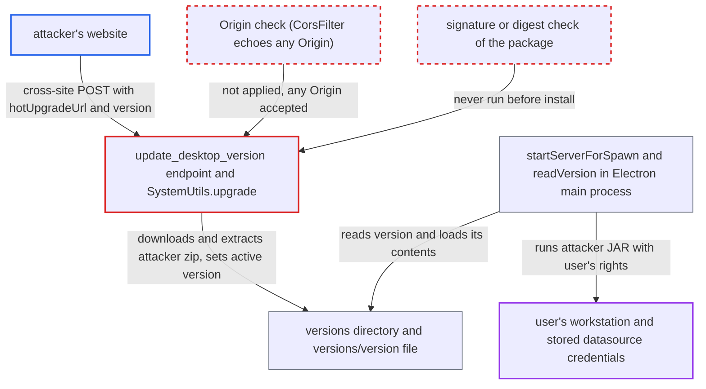

# Unauthenticated desktop update endpoint installs and runs an attacker-hosted package

| Field | Value |
|---|---|
| ID | `find_01BNmTQzXPtii391HvwR8cas` |
| Severity | **Critical** |
| Status | open |
| CWE | CWE-494 — Download of code without integrity check |
| Created | 2026-10-21T22:45:36.099022Z |
| Claude Security | https://claude.ai/security/findings/find_01BNmTQzXPtii391HvwR8cas |

## Description

A website can make a visitor's Chat2DB desktop app install and later run attacker code. The code runs with the desktop user's privileges. The attack needs the user to visit the site while the app is running. The cause is `SystemUtils.upgrade()`, which downloads a package from a caller-supplied `hotUpgradeUrl` and never checks it. The endpoint has no login, CSRF or Origin check.

1. **attacker's web page** sends a cross-site POST to the local server. The request goes to `http://127.0.0.1:10824/api/system/update_desktop_version` with a JSON body holding `version` and `hotUpgradeUrl`. `CorsFilter` echoes any `Origin` with credentials allowed, so the preflight passes. ([`chat2db-server/chat2db-server-start/src/main/java/ai/chat2db/server/start/config/interceptor/CorsFilter.java:32-36`](https://github.com/cx-benchmark/chat2db/blob/43aaee8d48736d74ac888dc4a81ddb50d6550638/chat2db-server/chat2db-server-start/src/main/java/ai/chat2db/server/start/config/interceptor/CorsFilter.java#L32-L36))
2. **desktop server interceptor** admits the request as the default `DESKTOP` user. The only interceptor attaches that user to every request and always returns `true`, so no login is needed. ([`chat2db-server/chat2db-server-start/src/main/java/ai/chat2db/server/start/config/config/Chat2dbWebMvcConfigurer.java:63-110`](https://github.com/cx-benchmark/chat2db/blob/43aaee8d48736d74ac888dc4a81ddb50d6550638/chat2db-server/chat2db-server-start/src/main/java/ai/chat2db/server/start/config/config/Chat2dbWebMvcConfigurer.java#L63-L110))
3. **the handler for `POST /api/system/update_desktop_version`** binds the body to `AppVersionVO` and calls `SystemUtils.upgrade` on a new thread. The handler has no mode check, authorization, CSRF check or Origin check. ([`chat2db-server/chat2db-server-web/chat2db-server-web-api/src/main/java/ai/chat2db/server/web/api/controller/system/SystemController.java:97-103`](https://github.com/cx-benchmark/chat2db/blob/43aaee8d48736d74ac888dc4a81ddb50d6550638/chat2db-server/chat2db-server-web/chat2db-server-web-api/src/main/java/ai/chat2db/server/web/api/controller/system/SystemController.java#L97-L103))
4. **`SystemUtils.upgrade()`** downloads the attacker's zip, extracts it and records the version. It saves the zip to `<app>/versions/<version>.zip`, extracts it to `<app>/versions/<version>/` and writes `<version>` into `<app>/versions/version`. There is no host allow-list, signature or digest check, and `version` goes into the path unsanitised. ([`chat2db-server/chat2db-server-web/chat2db-server-web-api/src/main/java/ai/chat2db/server/web/api/controller/system/util/SystemUtils.java:56-77`](https://github.com/cx-benchmark/chat2db/blob/43aaee8d48736d74ac888dc4a81ddb50d6550638/chat2db-server/chat2db-server-web/chat2db-server-web-api/src/main/java/ai/chat2db/server/web/api/controller/system/util/SystemUtils.java#L56-L77))
5. **`ConfigUtils.updateVersion`** overwrites the `versions/version` file. This is the file the Electron main process reads to decide which version to load and run. ([`chat2db-server/chat2db-server-tools/chat2db-server-tools-common/src/main/java/ai/chat2db/server/tools/common/util/ConfigUtils.java:56-63`](https://github.com/cx-benchmark/chat2db/blob/43aaee8d48736d74ac888dc4a81ddb50d6550638/chat2db-server/chat2db-server-tools/chat2db-server-tools-common/src/main/java/ai/chat2db/server/tools/common/util/ConfigUtils.java#L56-L63))
6. **Electron main process** loads and runs the planted package on the next launch or restart. `readVersion()` trusts `versions/version`. `startServerForSpawn()` runs `versions/<v>/static/chat2db-server-start.jar` with the bundled JRE and `-noverify`. The planted `dist/index.html` loads in a renderer with `nodeIntegration:true` and `webSecurity:false`. ([`chat2db-client/src/main/preload.js:8-30`](https://github.com/cx-benchmark/chat2db/blob/43aaee8d48736d74ac888dc4a81ddb50d6550638/chat2db-client/src/main/preload.js#L8-L30))

## Assessment

The attacker runs a website and needs a Chat2DB desktop user to visit it while the app is running. No login or other access is needed. The request can also come from DNS rebinding, because the Host header is not checked. The planted code runs on the next app launch or restart, and no further attacker action is needed. The attack assumes the browser does not block requests from public sites to loopback addresses. The web/Docker build is not affected. There `-Dproject.path` is unset, `ConfigUtils.APP_PATH` is null and `upgrade()` returns early. The in-app update UI (`UpdateDetection.checkUpdate`) is commented out in this snapshot, so direct or cross-site requests are the only way the endpoint is called.

Impact: The attacker gets arbitrary code execution on the workstation with the desktop user's privileges. That includes reading and writing everything the user owns, such as `~/.chat2db` and the H2 database of stored datasources. It also includes replacing or disabling the application.

Subsequent-system impact: The planted code can reach the client's stored datasource credentials and SSH tunnel keys. It can open the same connections the client uses. With them the attacker reaches every database the client is configured for, with whatever rights those accounts hold.

## Recommendation

(1) `SystemUtils.upgrade()` downloads and installs code from a caller-supplied `hotUpgradeUrl` with no integrity or origin check. It also puts `version` into a filesystem path.

Fix criteria: The server fetches update packages only from a fixed, TLS-protected vendor origin that it chooses itself, never from the request body. It verifies a signature or pinned digest of the archive before extraction. It rejects any `version` that is not a plain dotted version string. Posting an `AppVersionVO` with a foreign `hotUpgradeUrl` and a traversal `version` writes nothing under `versions/`.

(2) `POST /api/system/update_desktop_version` can be called in desktop mode with no authorization, CSRF protection or Origin/Host validation. `CorsFilter` also reflects any Origin with credentials allowed.

Fix criteria: State-changing desktop endpoints can be called only by the Electron renderer. That means a per-launch secret passed from main to renderer and sent in a header. At minimum, requests whose `Origin`/`Referer` is not the app's own origin are rejected. `CorsFilter` no longer reflects arbitrary Origins with credentials. A cross-site `fetch` to the endpoint from a browser is refused.

(3) The Electron main process (`readVersion` in `utils.js`, `startServerForSpawn` in `preload.js`) loads and runs whatever package `versions/version` names, without verifying it.

Fix criteria: Before loading `versions/<v>/dist` or spawning `versions/<v>/static/*.jar`, the main process verifies the package against a vendor signature or manifest shipped with the app. On failure it falls back to the bundled version. `-noverify` is dropped. Hand-editing `versions/version` to point at an unsigned directory makes the app refuse to run it.

## Evidence

**https://github.com/cx-benchmark/chat2db**

- [`chat2db-server/chat2db-server-web/chat2db-server-web-api/src/main/java/ai/chat2db/server/web/api/controller/system/util/SystemUtils.java:56-77`](https://github.com/cx-benchmark/chat2db/blob/43aaee8d48736d74ac888dc4a81ddb50d6550638/chat2db-server/chat2db-server-web/chat2db-server-web-api/src/main/java/ai/chat2db/server/web/api/controller/system/util/SystemUtils.java#L56-L77)
- [`chat2db-server/chat2db-server-web/chat2db-server-web-api/src/main/java/ai/chat2db/server/web/api/controller/system/SystemController.java:97-103`](https://github.com/cx-benchmark/chat2db/blob/43aaee8d48736d74ac888dc4a81ddb50d6550638/chat2db-server/chat2db-server-web/chat2db-server-web-api/src/main/java/ai/chat2db/server/web/api/controller/system/SystemController.java#L97-L103)
- [`chat2db-server/chat2db-server-start/src/main/java/ai/chat2db/server/start/config/config/Chat2dbWebMvcConfigurer.java:63-110`](https://github.com/cx-benchmark/chat2db/blob/43aaee8d48736d74ac888dc4a81ddb50d6550638/chat2db-server/chat2db-server-start/src/main/java/ai/chat2db/server/start/config/config/Chat2dbWebMvcConfigurer.java#L63-L110)
- [`chat2db-server/chat2db-server-start/src/main/java/ai/chat2db/server/start/config/interceptor/CorsFilter.java:32-36`](https://github.com/cx-benchmark/chat2db/blob/43aaee8d48736d74ac888dc4a81ddb50d6550638/chat2db-server/chat2db-server-start/src/main/java/ai/chat2db/server/start/config/interceptor/CorsFilter.java#L32-L36)
- [`chat2db-server/chat2db-server-tools/chat2db-server-tools-common/src/main/java/ai/chat2db/server/tools/common/util/ConfigUtils.java:56-63`](https://github.com/cx-benchmark/chat2db/blob/43aaee8d48736d74ac888dc4a81ddb50d6550638/chat2db-server/chat2db-server-tools/chat2db-server-tools-common/src/main/java/ai/chat2db/server/tools/common/util/ConfigUtils.java#L56-L63)
- [`chat2db-client/src/main/preload.js:8-30`](https://github.com/cx-benchmark/chat2db/blob/43aaee8d48736d74ac888dc4a81ddb50d6550638/chat2db-client/src/main/preload.js#L8-L30)
- [`chat2db-client/src/main/utils.js:14-42`](https://github.com/cx-benchmark/chat2db/blob/43aaee8d48736d74ac888dc4a81ddb50d6550638/chat2db-client/src/main/utils.js#L14-L42)
- [`chat2db-client/src/hooks/usePollRequestService.ts:27-31`](https://github.com/cx-benchmark/chat2db/blob/43aaee8d48736d74ac888dc4a81ddb50d6550638/chat2db-client/src/hooks/usePollRequestService.ts#L27-L31)

