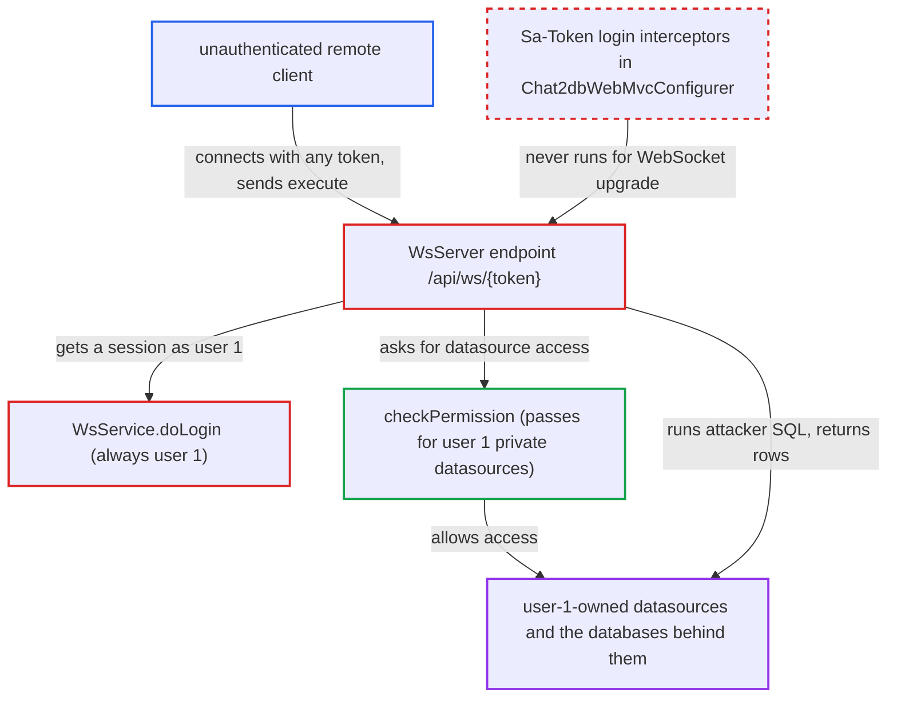

# Unauthenticated WebSocket /api/ws/{token} acts as built-in user 1 and runs SQL on its datasources

| Field | Value |
|---|---|
| ID | `find_01L1i1pyWhpSovD2Fg2bhtQH` |
| Severity | **Critical** |
| Status | open |
| CWE | CWE-306 — Missing Authentication |
| Created | 2026-10-21T22:50:08.929200Z |
| Claude Security | https://claude.ai/security/findings/find_01L1i1pyWhpSovD2Fg2bhtQH |

## Description

An unauthenticated attacker who can reach the server port can act as the built-in user 1 over a WebSocket. They can then run arbitrary SQL on every private datasource owned by user 1, using the stored database credentials. This only pays off on instances that hold such datasources. The cause is `WsService.doLogin`, which ignores the token it receives and always returns user 1.

1. **attacker** opens a WebSocket to `/api/ws/{token}` with any token value. The endpoint is registered through `ServerEndpointExporter`, so Tomcat handles the upgrade before `DispatcherServlet`. The Sa-Token interceptors never run for it. ([`chat2db-server/chat2db-server-web/chat2db-server-web-api/src/main/java/ai/chat2db/server/web/api/ws/WsConfig.java:8-15`](https://github.com/cx-benchmark/chat2db/blob/43aaee8d48736d74ac888dc4a81ddb50d6550638/chat2db-server/chat2db-server-web/chat2db-server-web-api/src/main/java/ai/chat2db/server/web/api/ws/WsConfig.java#L8-L15))
2. **the endpoint `WsServer`** accepts the connection in `@OnOpen` and calls `WsService.doLogin(token)`. No Origin check and no Sa-Token check exist on this path, and no servlet filter authenticates. ([`chat2db-server/chat2db-server-web/chat2db-server-web-api/src/main/java/ai/chat2db/server/web/api/ws/WsServer.java:36-92`](https://github.com/cx-benchmark/chat2db/blob/43aaee8d48736d74ac888dc4a81ddb50d6550638/chat2db-server/chat2db-server-web/chat2db-server-web-api/src/main/java/ai/chat2db/server/web/api/ws/WsServer.java#L36-L92))
3. **`WsService.doLogin`** returns a `LoginUser` for user `1` without reading `token`. It uses the DESKTOP default user id and checks neither the mode, a Sa-Token login nor the user status. The socket now has a session as user 1. ([`chat2db-server/chat2db-server-web/chat2db-server-web-api/src/main/java/ai/chat2db/server/web/api/ws/WsService.java:62-81`](https://github.com/cx-benchmark/chat2db/blob/43aaee8d48736d74ac888dc4a81ddb50d6550638/chat2db-server/chat2db-server-web/chat2db-server-web-api/src/main/java/ai/chat2db/server/web/api/ws/WsService.java#L62-L81))
4. **attacker** sends an `execute` message with a chosen `dataSourceId`, `databaseName`, `consoleId` and `sql`. `onMessage` sets user 1 as the request context. It then builds a `ConnectInfo` through `wsService.toInfo`. ([`chat2db-server/chat2db-server-web/chat2db-server-web-api/src/main/java/ai/chat2db/server/web/api/ws/WsServer.java:135-177`](https://github.com/cx-benchmark/chat2db/blob/43aaee8d48736d74ac888dc4a81ddb50d6550638/chat2db-server/chat2db-server-web/chat2db-server-web-api/src/main/java/ai/chat2db/server/web/api/ws/WsServer.java#L135-L177))
5. **`WsService.toInfo` and `checkPermission`** load the datasource and approve access as user 1. For a `PRIVATE` datasource the check passes when the caller's id equals the datasource's `user_id`. Every private datasource owned by user 1 therefore passes. ([`chat2db-server/chat2db-server-domain/chat2db-server-domain-core/src/main/java/ai/chat2db/server/domain/core/impl/DataSourceAccessBusinessServiceImpl.java:35-44`](https://github.com/cx-benchmark/chat2db/blob/43aaee8d48736d74ac888dc4a81ddb50d6550638/chat2db-server/chat2db-server-domain/chat2db-server-domain-core/src/main/java/ai/chat2db/server/domain/core/impl/DataSourceAccessBusinessServiceImpl.java#L35-L44))
6. **`WsServer.onMessage`** runs the attacker's `sql` with the stored decrypted password and SSH settings and sends the rows back. The statement runs through `wsService.execute` and the result goes back on the same socket. ([`chat2db-server/chat2db-server-web/chat2db-server-web-api/src/main/java/ai/chat2db/server/web/api/ws/WsServer.java:135-177`](https://github.com/cx-benchmark/chat2db/blob/43aaee8d48736d74ac888dc4a81ddb50d6550638/chat2db-server/chat2db-server-web/chat2db-server-web-api/src/main/java/ai/chat2db/server/web/api/ws/WsServer.java#L135-L177))

## Assessment

The attacker is anyone who can reach the server port, for example over the internet. They need no credential and no victim action. They open `ws://host:10824/api/ws/x` and send `execute` messages for `dataSourceId` values 1 to n. The attack works in web mode too. It pays off only where user-1-owned datasources exist. That happens when the instance's H2 data predates `V2_1_0`, which reassigns all existing datasources to user 1. It also happens when the web server shares the `~/.chat2db/db/chat2db` file that the desktop app fills as user 1. A fresh web or Docker install has none, because user 1 cannot log in through `OauthController.validateUser` and datasource creation stamps the logged-in user's id. On any instance, the attacker can tell existing datasource ids from missing ones by the error returned. In desktop mode the REST API already treats every caller as user 1, so the endpoint adds nothing there. The shipped frontend never opens this socket.

Impact: The attacker gets a Chat2DB session as user 1 and can use the stored database passwords, SSH tunnels and live connections of every user-1-owned datasource. They can also map which datasource ids exist. Chat2DB's own metadata changes only by operation-log entries, and the host is not directly affected.

Subsequent-system impact: The attacker's SQL runs on the customer databases behind Chat2DB with the stored credentials, and the results come back to the attacker. Within those credentials' privileges, they can read, modify or drop that data.

## Recommendation

(1) `WsService.doLogin` does no authentication. It discards the caller's token and returns the DESKTOP default identity (user 1) in every mode. This breaks web mode's rule that every caller is a logged-in Sa-Token principal and that nobody acts as user 1.

Fix criteria: In web mode the handshake is rejected unless the token validates as a current Sa-Token/JWT login for a VALID user, and the session acts as that user, never as user 1. Connecting with a missing or garbage token yields `LOGIN_FAIL` and a closed session. An `execute` message on such a socket is never processed. Desktop-mode behaviour may stay tied to an explicit DESKTOP mode check.

(2) The WebSocket handshake has no `Origin` validation. If the fix authenticates from the `CHAT2DB` cookie instead of an explicit token, any web page could drive an authenticated victim's socket (cross-site WebSocket hijacking).

Fix criteria: Either the credential is one a cross-site page cannot supply (an explicit bearer token, not an ambient cookie), or the handshake refuses Origins other than the application's own. A handshake with a foreign `Origin` and only the victim's cookie is refused.

## Evidence

**https://github.com/cx-benchmark/chat2db**

- [`chat2db-server/chat2db-server-web/chat2db-server-web-api/src/main/java/ai/chat2db/server/web/api/ws/WsService.java:62-81`](https://github.com/cx-benchmark/chat2db/blob/43aaee8d48736d74ac888dc4a81ddb50d6550638/chat2db-server/chat2db-server-web/chat2db-server-web-api/src/main/java/ai/chat2db/server/web/api/ws/WsService.java#L62-L81)
- [`chat2db-server/chat2db-server-web/chat2db-server-web-api/src/main/java/ai/chat2db/server/web/api/ws/WsServer.java:36-92`](https://github.com/cx-benchmark/chat2db/blob/43aaee8d48736d74ac888dc4a81ddb50d6550638/chat2db-server/chat2db-server-web/chat2db-server-web-api/src/main/java/ai/chat2db/server/web/api/ws/WsServer.java#L36-L92)
- [`chat2db-server/chat2db-server-web/chat2db-server-web-api/src/main/java/ai/chat2db/server/web/api/ws/WsServer.java:135-177`](https://github.com/cx-benchmark/chat2db/blob/43aaee8d48736d74ac888dc4a81ddb50d6550638/chat2db-server/chat2db-server-web/chat2db-server-web-api/src/main/java/ai/chat2db/server/web/api/ws/WsServer.java#L135-L177)
- [`chat2db-server/chat2db-server-web/chat2db-server-web-api/src/main/java/ai/chat2db/server/web/api/ws/WsConfig.java:8-15`](https://github.com/cx-benchmark/chat2db/blob/43aaee8d48736d74ac888dc4a81ddb50d6550638/chat2db-server/chat2db-server-web/chat2db-server-web-api/src/main/java/ai/chat2db/server/web/api/ws/WsConfig.java#L8-L15)
- [`chat2db-server/chat2db-server-web-start/src/main/java/ai/chat2db/server/web/start/config/config/Chat2dbWebMvcConfigurer.java:69-185`](https://github.com/cx-benchmark/chat2db/blob/43aaee8d48736d74ac888dc4a81ddb50d6550638/chat2db-server/chat2db-server-web-start/src/main/java/ai/chat2db/server/web/start/config/config/Chat2dbWebMvcConfigurer.java#L69-L185)
- [`chat2db-server/chat2db-server-web/chat2db-server-web-api/src/main/java/ai/chat2db/server/web/api/ws/WsService.java:84-97`](https://github.com/cx-benchmark/chat2db/blob/43aaee8d48736d74ac888dc4a81ddb50d6550638/chat2db-server/chat2db-server-web/chat2db-server-web-api/src/main/java/ai/chat2db/server/web/api/ws/WsService.java#L84-L97)
- [`chat2db-server/chat2db-server-domain/chat2db-server-domain-core/src/main/java/ai/chat2db/server/domain/core/impl/DataSourceAccessBusinessServiceImpl.java:35-44`](https://github.com/cx-benchmark/chat2db/blob/43aaee8d48736d74ac888dc4a81ddb50d6550638/chat2db-server/chat2db-server-domain/chat2db-server-domain-core/src/main/java/ai/chat2db/server/domain/core/impl/DataSourceAccessBusinessServiceImpl.java#L35-L44)
- [`chat2db-server/chat2db-server-domain/chat2db-server-domain-repository/src/main/resources/db/migration/V2_1_0__支持环境、用户权限.sql:26-49`](https://github.com/cx-benchmark/chat2db/blob/43aaee8d48736d74ac888dc4a81ddb50d6550638/chat2db-server/chat2db-server-domain/chat2db-server-domain-repository/src/main/resources/db/migration/V2_1_0__支持环境、用户权限.sql#L26-L49)
- [`chat2db-server/chat2db-server-web-start/src/main/java/ai/chat2db/server/web/start/controller/oauth/OauthController.java:67-76`](https://github.com/cx-benchmark/chat2db/blob/43aaee8d48736d74ac888dc4a81ddb50d6550638/chat2db-server/chat2db-server-web-start/src/main/java/ai/chat2db/server/web/start/controller/oauth/OauthController.java#L67-L76)

