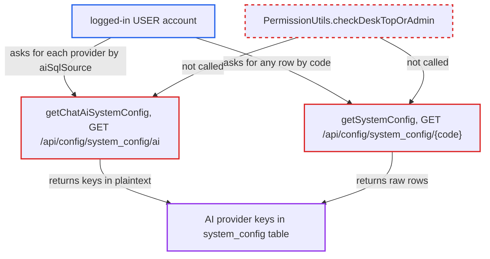

# AI provider API keys readable by any logged-in user via /api/config GET endpoints

| Field | Value |
|---|---|
| ID | `find_01BiPJXMWF7XkQyZ8NUbTU6x` |
| Severity | **High** |
| Status | open |
| CWE | CWE-862 — Missing Authorization |
| Created | 2026-10-21T22:45:29.380346Z |
| Claude Security | https://claude.ai/security/findings/find_01BiPJXMWF7XkQyZ8NUbTU6x |

## Description

Any logged-in web-mode user can read the AI provider API keys, secrets and tokens that an administrator stored. These are the credentials the client hides from `USER`-role accounts. `getChatAiSystemConfig` and `getSystemConfig` in `ConfigController` return the stored values in plaintext and never call `PermissionUtils`.

1. **the attacker** logs in to the web server as an ordinary team user. No administrator role is needed. A normal `CHAT2DB` session is enough.
2. **the login interceptor** lets the request through because a session exists. In the web start used by the Docker image, the only role-enforcing interceptor is bound to `/api/admin/**` and `/admin/**`, so `/api/config/**` needs only a login. ([`chat2db-server/chat2db-server-web-start/src/main/java/ai/chat2db/server/web/start/config/config/Chat2dbWebMvcConfigurer.java:170-184`](https://github.com/cx-benchmark/chat2db/blob/43aaee8d48736d74ac888dc4a81ddb50d6550638/chat2db-server/chat2db-server-web-start/src/main/java/ai/chat2db/server/web/start/config/config/Chat2dbWebMvcConfigurer.java#L170-L184))
3. **the attacker** calls `GET /api/config/system_config/ai` once per provider, setting `aiSqlSource` each time. The handler `getChatAiSystemConfig` has no permission check. It copies `apiKey`, `secretKey`, host, proxy and model from the `system_config` table for the chosen provider into the response. ([`chat2db-server/chat2db-server-web/chat2db-server-web-api/src/main/java/ai/chat2db/server/web/api/controller/config/ConfigController.java:289-388`](https://github.com/cx-benchmark/chat2db/blob/43aaee8d48736d74ac888dc4a81ddb50d6550638/chat2db-server/chat2db-server-web/chat2db-server-web-api/src/main/java/ai/chat2db/server/web/api/controller/config/ConfigController.java#L289-L388))
4. **the attacker** calls `GET /api/config/system_config/{code}` with a key such as `chatgpt.apiKey`. The handler `getSystemConfig` returns the raw row for any `code`, with no permission check. This works for `azure.chatgpt.apiKey`, `baichuan.chatgpt.secretKey`, `wenxin.access.token` and `claude.sessionKey` too. ([`chat2db-server/chat2db-server-web/chat2db-server-web-api/src/main/java/ai/chat2db/server/web/api/controller/config/ConfigController.java:278-282`](https://github.com/cx-benchmark/chat2db/blob/43aaee8d48736d74ac888dc4a81ddb50d6550638/chat2db-server/chat2db-server-web/chat2db-server-web-api/src/main/java/ai/chat2db/server/web/api/controller/config/ConfigController.java#L278-L282))
5. **the attacker** reads the plaintext keys from the JSON responses. `ConfigServiceImpl.find` does no masking or decryption, and `ConfigConverter` is a plain copy.
6. **the attacker** uses the stolen keys directly against the AI providers and the Chat2DB gateway. The keys work against the providers as they are. `chat2db.apiKey` also identifies the instance to the vendor gateway.

## Assessment

The attacker is a low-privilege team user of an internet-facing web or Docker server who has a normal login session. They send `GET /api/config/system_config/ai?aiSqlSource=OPENAI` and repeat it for `AZUREAI`, `CHAT2DBAI`, `RESTAI`, `FASTCHATAI`, `WENXINAI`, `BAICHUANAI`, `TONGYIQIANWENAI` and `ZHIPUAI`. Alternatively, they call `GET /api/config/system_config/chatgpt.apiKey` or another key. Without a crafted request, the client already calls `getAiSystemConfig({})` on load for every logged-in user. The active provider's plaintext key therefore sits in each user's browser state.

Impact: The attacker obtains every stored AI provider credential and any other row of the `system_config` table. The read changes no Chat2DB data and does not affect availability. Datasource credentials are not stored in this table.

Subsequent-system impact: The stolen keys authenticate the organisation to third-party AI services (OpenAI, Azure OpenAI, Baichuan, Zhipu, Tongyi, Wenxin and the Chat2DB gateway). The attacker can spend the organisation's paid quota, read account-scoped data reachable with a key, and exhaust limits the instance relies on. They can also act on gateway schema vectors under the instance's `chat2db.apiKey`. They do not gain control of the provider accounts themselves.

## Recommendation

`getChatAiSystemConfig` and `getSystemConfig` in `ConfigController` return stored provider secrets without checking that the caller is an administrator or the desktop default user. The write endpoint and the client UI both assume AI configuration is admin-only.

Fix criteria: A `USER`-role web-mode account gets no key, secret or token, whole or partial, from either endpoint for any `aiSqlSource` or `code`. Admin-only reads require `checkDeskTopOrAdmin()`. Any view that non-admins still need, such as `aiSqlSource` or a 'key configured' flag for the client's Chat2DB AI checks, contains no secret. `/system_config/{code}` is limited to an allowlist of non-secret codes for non-admins. Sending both requests as a `USER` account confirms all of this.

## Evidence

**https://github.com/cx-benchmark/chat2db**

- [`chat2db-server/chat2db-server-web/chat2db-server-web-api/src/main/java/ai/chat2db/server/web/api/controller/config/ConfigController.java:289-388`](https://github.com/cx-benchmark/chat2db/blob/43aaee8d48736d74ac888dc4a81ddb50d6550638/chat2db-server/chat2db-server-web/chat2db-server-web-api/src/main/java/ai/chat2db/server/web/api/controller/config/ConfigController.java#L289-L388)
- [`chat2db-server/chat2db-server-web/chat2db-server-web-api/src/main/java/ai/chat2db/server/web/api/controller/config/ConfigController.java:278-282`](https://github.com/cx-benchmark/chat2db/blob/43aaee8d48736d74ac888dc4a81ddb50d6550638/chat2db-server/chat2db-server-web/chat2db-server-web-api/src/main/java/ai/chat2db/server/web/api/controller/config/ConfigController.java#L278-L282)
- [`chat2db-server/chat2db-server-web/chat2db-server-web-api/src/main/java/ai/chat2db/server/web/api/controller/config/ConfigController.java:64-66`](https://github.com/cx-benchmark/chat2db/blob/43aaee8d48736d74ac888dc4a81ddb50d6550638/chat2db-server/chat2db-server-web/chat2db-server-web-api/src/main/java/ai/chat2db/server/web/api/controller/config/ConfigController.java#L64-L66)
- [`chat2db-server/chat2db-server-web-start/src/main/java/ai/chat2db/server/web/start/config/config/Chat2dbWebMvcConfigurer.java:170-184`](https://github.com/cx-benchmark/chat2db/blob/43aaee8d48736d74ac888dc4a81ddb50d6550638/chat2db-server/chat2db-server-web-start/src/main/java/ai/chat2db/server/web/start/config/config/Chat2dbWebMvcConfigurer.java#L170-L184)
- [`chat2db-client/src/blocks/Setting/AiSetting/index.tsx:39-42`](https://github.com/cx-benchmark/chat2db/blob/43aaee8d48736d74ac888dc4a81ddb50d6550638/chat2db-client/src/blocks/Setting/AiSetting/index.tsx#L39-L42)
- [`chat2db-client/src/blocks/Setting/index.tsx:43-53`](https://github.com/cx-benchmark/chat2db/blob/43aaee8d48736d74ac888dc4a81ddb50d6550638/chat2db-client/src/blocks/Setting/index.tsx#L43-L53)
- [`chat2db-client/src/components/ConsoleEditor/index.tsx:188`](https://github.com/cx-benchmark/chat2db/blob/43aaee8d48736d74ac888dc4a81ddb50d6550638/chat2db-client/src/components/ConsoleEditor/index.tsx#L188)

