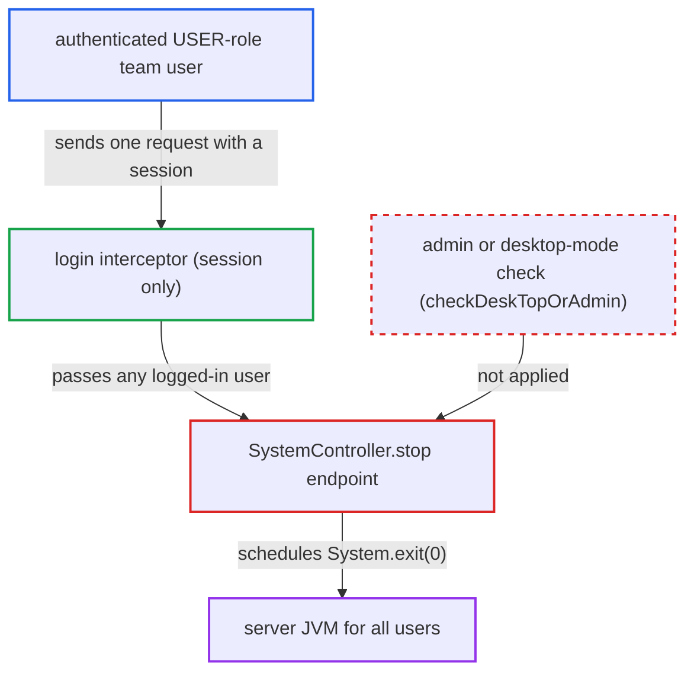

# Any authenticated user can shut down the server via /api/system/stop

| Field | Value |
|---|---|
| ID | `find_01TwPaQQgrJ9cWXL64txgzax` |
| Severity | **High** |
| Status | open |
| CWE | CWE-862 — Missing Authorization |
| Created | 2026-10-21T22:45:03.680073Z |
| Claude Security | https://claude.ai/security/findings/find_01TwPaQQgrJ9cWXL64txgzax |

## Description

Any logged-in team user, even one with the plain USER role, can shut down the whole Chat2DB server for every user with one request. It stays down until an operator restarts it. The handler `SystemController.stop(boolean forceQuit)` is a desktop-only endpoint with no admin or desktop-mode check, and the web login check only asks for a session.

1. **attacker with a USER-role account** sends one `GET` or `POST` request to `/api/system/stop` with their `CHAT2DB` cookie or header. The handler is mapped with `@RequestMapping("/stop")`, so it accepts any HTTP method. ([`chat2db-server/chat2db-server-web/chat2db-server-web-api/src/main/java/ai/chat2db/server/web/api/controller/system/SystemController.java:139-153`](https://github.com/cx-benchmark/chat2db/blob/43aaee8d48736d74ac888dc4a81ddb50d6550638/chat2db-server/chat2db-server-web/chat2db-server-web-api/src/main/java/ai/chat2db/server/web/api/controller/system/SystemController.java#L139-L153))
2. **login interceptor in `Chat2dbWebMvcConfigurer`** lets the request through because a session exists. `/api/system/stop` is not in `FRONT_PERMIT_ALL`, so it goes through the login check, which only rejects requests with no login context. ([`chat2db-server/chat2db-server-web-start/src/main/java/ai/chat2db/server/web/start/config/config/Chat2dbWebMvcConfigurer.java:133-185`](https://github.com/cx-benchmark/chat2db/blob/43aaee8d48736d74ac888dc4a81ddb50d6550638/chat2db-server/chat2db-server-web-start/src/main/java/ai/chat2db/server/web/start/config/config/Chat2dbWebMvcConfigurer.java#L133-L185))
3. **role interceptor** does not apply to the path. It is registered only for `/api/admin/**` and `/admin/**`, so no role check runs for `/api/system/stop`. ([`chat2db-server/chat2db-server-web-start/src/main/java/ai/chat2db/server/web/start/config/config/Chat2dbWebMvcConfigurer.java:58-59`](https://github.com/cx-benchmark/chat2db/blob/43aaee8d48736d74ac888dc4a81ddb50d6550638/chat2db-server/chat2db-server-web-start/src/main/java/ai/chat2db/server/web/start/config/config/Chat2dbWebMvcConfigurer.java#L58-L59))
4. **the handler `SystemController.stop(boolean forceQuit)`** calls the private `stop()` whatever `forceQuit` is, without any permission or mode check. Both branches call `stop()`, so the flag changes nothing, and `PermissionUtils.checkDeskTopOrAdmin()` is never called. ([`chat2db-server/chat2db-server-web/chat2db-server-web-api/src/main/java/ai/chat2db/server/web/api/controller/system/SystemController.java:139-153`](https://github.com/cx-benchmark/chat2db/blob/43aaee8d48736d74ac888dc4a81ddb50d6550638/chat2db-server/chat2db-server-web/chat2db-server-web-api/src/main/java/ai/chat2db/server/web/api/controller/system/SystemController.java#L139-L153))
5. **the private `stop()` method** starts a background thread that ends the JVM about 200 ms later. The thread runs `SSHManager.close()`, `SpringApplication.exit(applicationContext)`, `CacheManage.close()` and then `System.exit(0)`. ([`chat2db-server/chat2db-server-web/chat2db-server-web-api/src/main/java/ai/chat2db/server/web/api/controller/system/SystemController.java:155-179`](https://github.com/cx-benchmark/chat2db/blob/43aaee8d48736d74ac888dc4a81ddb50d6550638/chat2db-server/chat2db-server-web/chat2db-server-web-api/src/main/java/ai/chat2db/server/web/api/controller/system/SystemController.java#L155-L179))
6. **the Docker deployment** leaves the container stopped. The shipped `docker/docker-compose.yml`, `docker/docker-start.sh` and the README `docker run` command set no restart policy. ([`docker/docker-compose.yml:1-9`](https://github.com/cx-benchmark/chat2db/blob/43aaee8d48736d74ac888dc4a81ddb50d6550638/docker/docker-compose.yml#L1-L9))

## Assessment

The attacker needs only a valid login on the multi-user web server (the `chat2db-server-web-start` jar that the Docker image runs). A non-admin USER-role account is enough. The image is started without `-Dchat2db.mode`, so `Chat2dbProperties.getMode()` is not `DESKTOP` and the web-mode interceptors apply. No victim action is needed. The endpoint exists so the Electron desktop client can shut down its embedded server, but the same controller is component-scanned into the web jar through `@ComponentScan("ai.chat2db.server")`.

Impact: The attacker ends the server process for every user. SSH tunnels and live database connections are closed, and in-flight queries and exports are aborted. The service stays down until an operator restarts it. No data is disclosed or modified.

## Recommendation

A desktop-only lifecycle endpoint that ends the JVM is exposed in web mode to every authenticated user, with no administrator or desktop-mode check.

Fix criteria: In web/team mode `/api/system/stop` is unavailable to non-admin users. Ideally it is unavailable entirely: it is honoured only when `chat2db.mode` is `DESKTOP`, or it requires `checkDeskTopOrAdmin()`. Calling the endpoint as a USER-role account returns a permission error and the process keeps running.

## Evidence

**https://github.com/cx-benchmark/chat2db**

- [`chat2db-server/chat2db-server-web/chat2db-server-web-api/src/main/java/ai/chat2db/server/web/api/controller/system/SystemController.java:139-153`](https://github.com/cx-benchmark/chat2db/blob/43aaee8d48736d74ac888dc4a81ddb50d6550638/chat2db-server/chat2db-server-web/chat2db-server-web-api/src/main/java/ai/chat2db/server/web/api/controller/system/SystemController.java#L139-L153)
- [`chat2db-server/chat2db-server-web/chat2db-server-web-api/src/main/java/ai/chat2db/server/web/api/controller/system/SystemController.java:155-179`](https://github.com/cx-benchmark/chat2db/blob/43aaee8d48736d74ac888dc4a81ddb50d6550638/chat2db-server/chat2db-server-web/chat2db-server-web-api/src/main/java/ai/chat2db/server/web/api/controller/system/SystemController.java#L155-L179)
- [`chat2db-server/chat2db-server-web-start/src/main/java/ai/chat2db/server/web/start/config/config/Chat2dbWebMvcConfigurer.java:133-185`](https://github.com/cx-benchmark/chat2db/blob/43aaee8d48736d74ac888dc4a81ddb50d6550638/chat2db-server/chat2db-server-web-start/src/main/java/ai/chat2db/server/web/start/config/config/Chat2dbWebMvcConfigurer.java#L133-L185)
- [`chat2db-server/chat2db-server-web-start/src/main/java/ai/chat2db/server/web/start/config/config/Chat2dbWebMvcConfigurer.java:58-59`](https://github.com/cx-benchmark/chat2db/blob/43aaee8d48736d74ac888dc4a81ddb50d6550638/chat2db-server/chat2db-server-web-start/src/main/java/ai/chat2db/server/web/start/config/config/Chat2dbWebMvcConfigurer.java#L58-L59)
- [`docker/Dockerfile:6-14`](https://github.com/cx-benchmark/chat2db/blob/43aaee8d48736d74ac888dc4a81ddb50d6550638/docker/Dockerfile#L6-L14)
- [`docker/docker-compose.yml:1-9`](https://github.com/cx-benchmark/chat2db/blob/43aaee8d48736d74ac888dc4a81ddb50d6550638/docker/docker-compose.yml#L1-L9)

