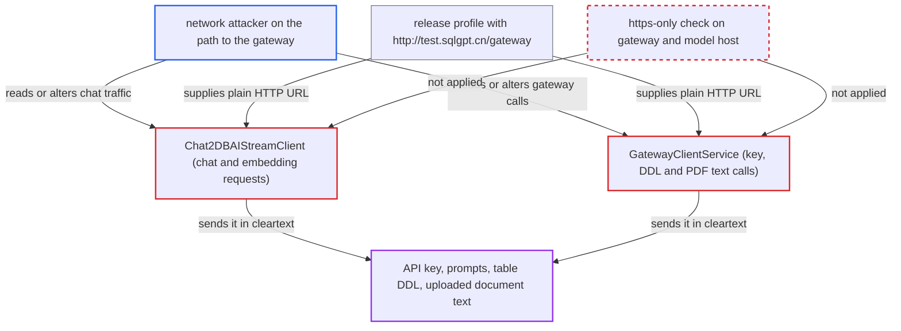

# Chat2DB AI key, prompts and schema DDL sent over cleartext HTTP gateway

| Field | Value |
|---|---|
| ID | `find_01CQpuNXk5T8K3rpAPnK9zvH` |
| Severity | **High** |
| Status | open |
| CWE | CWE-319 — Cleartext transmission |
| Created | 2026-10-21T22:47:45.484075Z |
| Claude Security | https://claude.ai/security/findings/find_01CQpuNXk5T8K3rpAPnK9zvH |

## Description

Someone on the network path between a Chat2DB server (or desktop machine) and the AI gateway can read the Chat2DB AI API key, the users' prompts and the table DDL of queried databases. An active attacker can also alter AI SQL suggestions and gateway responses. The shipped `release` configuration uses `http://test.sqlgpt.cn/gateway`, and no client code refuses a non-TLS endpoint.

1. **the shipped `release` profile** sets the gateway and model base URLs to plain HTTP. `chat2db.gateway.base-url` and `model-base-url` are `http://test.sqlgpt.cn/gateway`. The Docker image activates this profile and nothing in the repository overrides it. ([`chat2db-server/chat2db-server-web-start/src/main/resources/application-release.yml:11-13`](https://github.com/cx-benchmark/chat2db/blob/43aaee8d48736d74ac888dc4a81ddb50d6550638/chat2db-server/chat2db-server-web-start/src/main/resources/application-release.yml#L11-L13))
2. **the desktop server's `release` profile** ships the same plaintext gateway URL. The desktop client picks this profile through `chat2db-client/src/main/preload.js:21`. ([`chat2db-server/chat2db-server-start/src/main/resources/application-release.yml:11-13`](https://github.com/cx-benchmark/chat2db/blob/43aaee8d48736d74ac888dc4a81ddb50d6550638/chat2db-server/chat2db-server-start/src/main/resources/application-release.yml#L11-L13))
3. **`AiConfigController.getLoginStatus`** saves an HTTP model address as `chat2db.apiHost`. After a QR login it stores the model base URL plus `/model`, which is `http://test.sqlgpt.cn/gateway/model`. The AI settings dialog does the same by hard-coding `http://test.sqlgpt.cn/gateway/model/` for `ConfigController.saveChat2dbAIConfig`. ([`chat2db-server/chat2db-server-web/chat2db-server-web-api/src/main/java/ai/chat2db/server/web/api/controller/ai/AiConfigController.java:84-93`](https://github.com/cx-benchmark/chat2db/blob/43aaee8d48736d74ac888dc4a81ddb50d6550638/chat2db-server/chat2db-server-web/chat2db-server-web-api/src/main/java/ai/chat2db/server/web/api/controller/ai/AiConfigController.java#L84-L93))
4. **`Chat2DBAIStreamClient`** posts each chat and embedding request over HTTP. The body holds the user's question plus the `CREATE TABLE` DDL of the chosen tables, and nothing checks for an `https` scheme. ([`chat2db-server/chat2db-server-web/chat2db-server-web-api/src/main/java/ai/chat2db/server/web/api/controller/ai/chat2db/client/Chat2DBAIStreamClient.java:205-214`](https://github.com/cx-benchmark/chat2db/blob/43aaee8d48736d74ac888dc4a81ddb50d6550638/chat2db-server/chat2db-server-web/chat2db-server-web-api/src/main/java/ai/chat2db/server/web/api/controller/ai/chat2db/client/Chat2DBAIStreamClient.java#L205-L214))
5. **`Chat2dbHeaderAuthorizationInterceptor`** adds the API key to every one of those requests. It sets `Authorization: Bearer <chat2db.apiKey>`, so the account credential travels in cleartext with the data. ([`chat2db-server/chat2db-server-web/chat2db-server-web-api/src/main/java/ai/chat2db/server/web/api/controller/ai/chat2db/interceptor/Chat2dbHeaderAuthorizationInterceptor.java:36-44`](https://github.com/cx-benchmark/chat2db/blob/43aaee8d48736d74ac888dc4a81ddb50d6550638/chat2db-server/chat2db-server-web/chat2db-server-web-api/src/main/java/ai/chat2db/server/web/api/controller/ai/chat2db/interceptor/Chat2dbHeaderAuthorizationInterceptor.java#L36-L44))
6. **`GatewayClientService`** calls the same HTTP base URL for key-bearing and data-bearing requests. `remaininguses/<apiKey>` has the key in the path and `inviteQrCode?apiKey=` has it in the query string. `milvus/schema/save` sends the key and table DDL, and `milvus/knowledge/save` sends uploaded PDF text. ([`chat2db-server/chat2db-server-web/chat2db-server-web-api/src/main/java/ai/chat2db/server/web/api/http/GatewayClientService.java:67-130`](https://github.com/cx-benchmark/chat2db/blob/43aaee8d48736d74ac888dc4a81ddb50d6550638/chat2db-server/chat2db-server-web/chat2db-server-web-api/src/main/java/ai/chat2db/server/web/api/http/GatewayClientService.java#L67-L130))
7. **network attacker** reads or rewrites the traffic. A passive observer captures the key, prompts, DDL and document text. An active one can change AI responses and gateway responses, including the QR-login `apiKey` that `getLoginStatus` writes into system config.

## Assessment

The attacker needs no Chat2DB account. They need a position on the network path between the Chat2DB server (or desktop machine) and `test.sqlgpt.cn`, which they do not control. A user then only has to use the product normally: AI chat, the datasource-embedding feature (the explicit `/api/ai/embedding/datasource` endpoint) or knowledge upload. The settings store also calls `remaininguses` routinely when Chat2DB AI is the configured source. Both the web/Docker and desktop configurations are affected. The URL is set by the `release` profile and also by the QR-login and settings-dialog paths. The automatic schema sync in `TableController.java:71-72` is commented out, so it does not send data.

Impact: A passive attacker can read the organisation's Chat2DB AI API key, the prompts, the schema of the queried databases and uploaded knowledge documents. An active attacker can also rewrite AI SQL suggestions the user is invited to run, and gateway responses such as the QR-login `apiKey`. The report notes no availability impact beyond what any on-path attacker could cause.

## Recommendation

(1) The shipped gateway URLs use `http://`, and neither `Chat2DBAIStreamClient` nor `GatewayClientService` refuses a non-TLS endpoint. Credentials and LLM payloads therefore travel without protection.

Fix criteria: The gateway and model base URLs in every shipped profile are `https://` endpoints with valid certificates. The clients reject, or at minimum refuse by default, a non-`https` gateway or model host. With the release profile, a packet capture of an AI chat, a datasource embedding and a knowledge upload shows only TLS traffic to the gateway. Configuring an `http://` gateway host fails.

(2) The API key is placed in URL paths and query strings (`remaininguses/<key>`, `inviteQrCode?apiKey=`). Proxies and access logs can see it even after TLS is enforced.

Fix criteria: The API key is sent only in an `Authorization` header or the request body, never in the URL. No gateway request URL contains the key.

## Evidence

**https://github.com/cx-benchmark/chat2db**

- [`chat2db-server/chat2db-server-web-start/src/main/resources/application-release.yml:11-13`](https://github.com/cx-benchmark/chat2db/blob/43aaee8d48736d74ac888dc4a81ddb50d6550638/chat2db-server/chat2db-server-web-start/src/main/resources/application-release.yml#L11-L13)
- [`chat2db-server/chat2db-server-start/src/main/resources/application-release.yml:11-13`](https://github.com/cx-benchmark/chat2db/blob/43aaee8d48736d74ac888dc4a81ddb50d6550638/chat2db-server/chat2db-server-start/src/main/resources/application-release.yml#L11-L13)
- [`chat2db-server/chat2db-server-web/chat2db-server-web-api/src/main/java/ai/chat2db/server/web/api/controller/ai/AiConfigController.java:84-93`](https://github.com/cx-benchmark/chat2db/blob/43aaee8d48736d74ac888dc4a81ddb50d6550638/chat2db-server/chat2db-server-web/chat2db-server-web-api/src/main/java/ai/chat2db/server/web/api/controller/ai/AiConfigController.java#L84-L93)
- [`chat2db-client/src/blocks/Setting/AiSetting/index.tsx:60-62`](https://github.com/cx-benchmark/chat2db/blob/43aaee8d48736d74ac888dc4a81ddb50d6550638/chat2db-client/src/blocks/Setting/AiSetting/index.tsx#L60-L62)
- [`chat2db-server/chat2db-server-web/chat2db-server-web-api/src/main/java/ai/chat2db/server/web/api/controller/ai/chat2db/client/Chat2DBAIStreamClient.java:205-214`](https://github.com/cx-benchmark/chat2db/blob/43aaee8d48736d74ac888dc4a81ddb50d6550638/chat2db-server/chat2db-server-web/chat2db-server-web-api/src/main/java/ai/chat2db/server/web/api/controller/ai/chat2db/client/Chat2DBAIStreamClient.java#L205-L214)
- [`chat2db-server/chat2db-server-web/chat2db-server-web-api/src/main/java/ai/chat2db/server/web/api/controller/ai/chat2db/interceptor/Chat2dbHeaderAuthorizationInterceptor.java:36-44`](https://github.com/cx-benchmark/chat2db/blob/43aaee8d48736d74ac888dc4a81ddb50d6550638/chat2db-server/chat2db-server-web/chat2db-server-web-api/src/main/java/ai/chat2db/server/web/api/controller/ai/chat2db/interceptor/Chat2dbHeaderAuthorizationInterceptor.java#L36-L44)
- [`chat2db-server/chat2db-server-web/chat2db-server-web-api/src/main/java/ai/chat2db/server/web/api/http/GatewayClientService.java:67-130`](https://github.com/cx-benchmark/chat2db/blob/43aaee8d48736d74ac888dc4a81ddb50d6550638/chat2db-server/chat2db-server-web/chat2db-server-web-api/src/main/java/ai/chat2db/server/web/api/http/GatewayClientService.java#L67-L130)

