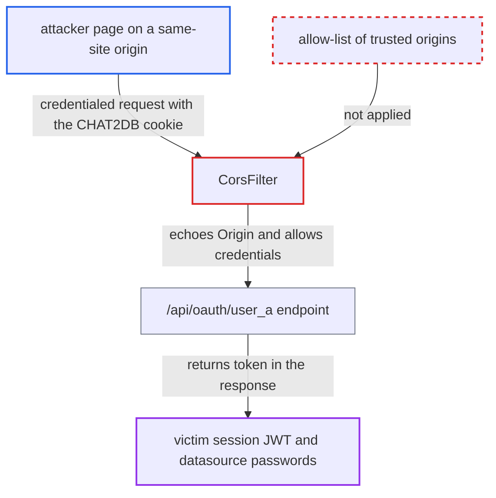

# Credentialed CORS reflects any Origin, letting foreign pages read API responses and session token

| Field | Value |
|---|---|
| ID | `find_01QwVGe41CcTejaKsGd4WP4g` |
| Severity | **High** |
| Status | open |
| CWE | CWE-942 — Permissive CORS policy |
| Created | 2026-10-21T22:52:10.121976Z |
| Claude Security | https://claude.ai/security/findings/find_01QwVGe41CcTejaKsGd4WP4g |

## Description

A page on a same-site origin can read authenticated Chat2db API responses from a logged-in victim's browser. That includes the 30-day session token, which gives full account takeover, admin if the victim is an admin. It needs a script on a sibling subdomain or another port or service on the same host, or a browser with cookie protections off. The cause is `CorsFilter`, which echoes any `Origin` and allows credentials.

1. **attacker** gets a script running on an origin that is same-site with the Chat2DB deployment. This can be a sibling subdomain or another port or service on the same host or IP, for example through XSS or hosted content there.
2. **logged-in victim's browser** runs the attacker's `fetch('/api/oauth/user_a', {credentials:'include'})` against Chat2DB. The shipped web UI also sends its requests with `credentials: 'include'`, and in web mode the `CHAT2DB` cookie carries the session. ([`chat2db-client/src/service/base.ts:86-117`](https://github.com/cx-benchmark/chat2db/blob/43aaee8d48736d74ac888dc4a81ddb50d6550638/chat2db-client/src/service/base.ts#L86-L117))
3. **browser** attaches the `CHAT2DB` cookie to the cross-origin request. No `same-site`, `http-only` or `secure` setting is configured for the cookie, and same-site requests still carry it under default browser protections. ([`chat2db-server/chat2db-server-web-start/src/main/resources/application.yml:53-65`](https://github.com/cx-benchmark/chat2db/blob/43aaee8d48736d74ac888dc4a81ddb50d6550638/chat2db-server/chat2db-server-web-start/src/main/resources/application.yml#L53-L65))
4. **the filter `CorsFilter`** copies the request's `Origin` into `Access-Control-Allow-Origin` and sets `Access-Control-Allow-Credentials: true`. It has no allow-list, so the browser lets the foreign page read the response. ([`chat2db-server/chat2db-server-web-start/src/main/java/ai/chat2db/server/web/start/config/interceptor/CorsFilter.java:28-33`](https://github.com/cx-benchmark/chat2db/blob/43aaee8d48736d74ac888dc4a81ddb50d6550638/chat2db-server/chat2db-server-web-start/src/main/java/ai/chat2db/server/web/start/config/interceptor/CorsFilter.java#L28-L33))
5. **the interceptor in `Chat2dbWebMvcConfigurer`** writes the caller's raw session JWT into `loginUser.token`. The interceptor runs on `/**`, which covers `/api/oauth/user_a`. ([`chat2db-server/chat2db-server-web-start/src/main/java/ai/chat2db/server/web/start/config/config/Chat2dbWebMvcConfigurer.java:109-131`](https://github.com/cx-benchmark/chat2db/blob/43aaee8d48736d74ac888dc4a81ddb50d6550638/chat2db-server/chat2db-server-web-start/src/main/java/ai/chat2db/server/web/start/config/config/Chat2dbWebMvcConfigurer.java#L109-L131))
6. **the endpoint `/api/oauth/user_a`** returns the `LoginUser` as JSON, `token` field included. `token` is a plain property with no `@JsonIgnore`, so it is serialised. ([`chat2db-server/chat2db-server-web-start/src/main/java/ai/chat2db/server/web/start/controller/oauth/OauthController.java:100-117`](https://github.com/cx-benchmark/chat2db/blob/43aaee8d48736d74ac888dc4a81ddb50d6550638/chat2db-server/chat2db-server-web-start/src/main/java/ai/chat2db/server/web/start/controller/oauth/OauthController.java#L100-L117))
7. **attacker** replays the stolen token in the `CHAT2DB` header from anywhere. `StpLogicJwtForStateless` makes the token a stateless JWT, so logout cannot revoke it and it stays valid for 30 days. ([`chat2db-server/chat2db-server-web-start/src/main/java/ai/chat2db/server/web/start/config/oauth/SaTokenConfigure.java:16-19`](https://github.com/cx-benchmark/chat2db/blob/43aaee8d48736d74ac888dc4a81ddb50d6550638/chat2db-server/chat2db-server-web-start/src/main/java/ai/chat2db/server/web/start/config/oauth/SaTokenConfigure.java#L16-L19))

## Assessment

The attacker needs no Chat2DB account. They need a page on an origin that is same-site with the deployment, such as a sibling subdomain or another port or service on the same host or IP, for example through XSS or hosted content there. Alternatively, the victim's browser must have its cookie protections off, because the `CHAT2DB` cookie has no `SameSite` attribute. Default Chromium, Firefox and Safari settings keep an unrelated internet site from getting the cookie attached. A logged-in user then opens the attacker's page. Other readable responses include `GET /api/connection/datasource/{id}`, which carries stored DB passwords, and the admin APIs when the victim is an admin. In desktop mode no cookie is needed, because every request is served as the default user. Any page that can reach `127.0.0.1:10824` can therefore read the local API's responses, such as datasource passwords.

Impact: The attacker gets the victim's full Chat2DB identity, admin included if the victim is an admin. They can read stored datasource passwords and AI keys, run SQL, and change configuration, users and grants. The stolen token survives logout. The report says the defect gives no broader availability impact than deleting the victim's own objects.

Subsequent-system impact: The datasource passwords read through `DataSourceVO.password`, and the SQL the hijacked session can run, reach the customer databases Chat2DB is configured for. The attacker gets whatever rights those database accounts hold.

## Recommendation

(1) `CorsFilter`, in both `chat2db-server-web-start` and `chat2db-server-start`, reflects any `Origin` with `Access-Control-Allow-Credentials: true`. Every origin can therefore make credentialed reads of the cookie-authenticated and default-user APIs.

Fix criteria: Credentialed CORS is granted only to an explicit, operator-configured allow-list of trusted origins, or is disabled because the web UI is served same-origin. An origin not on the list gets no `Access-Control-Allow-Origin` header. A request with `Origin: https://evil.example` gets no ACAO or ACAC headers. The same holds for a request from a sibling subdomain. The browser then blocks the read of `/api/oauth/user_a`.

(2) The raw session token is echoed in `LoginUser` responses. The `CHAT2DB` cookie has no `HttpOnly`, `SameSite` or `Secure` attribute. Any cross-origin read or script injection therefore becomes durable session theft.

Fix criteria: `LoginUser` responses do not include the session token, and the `/api/oauth/user_a` body has no `token`. The `CHAT2DB` cookie is issued with `HttpOnly`, an explicit `SameSite=Lax` or `Strict`, and `Secure` when served over TLS. This is visible in the `Set-Cookie` header of the login response.

## Evidence

**https://github.com/cx-benchmark/chat2db**

- [`chat2db-server/chat2db-server-web-start/src/main/java/ai/chat2db/server/web/start/config/interceptor/CorsFilter.java:28-33`](https://github.com/cx-benchmark/chat2db/blob/43aaee8d48736d74ac888dc4a81ddb50d6550638/chat2db-server/chat2db-server-web-start/src/main/java/ai/chat2db/server/web/start/config/interceptor/CorsFilter.java#L28-L33)
- [`chat2db-server/chat2db-server-web-start/src/main/java/ai/chat2db/server/web/start/controller/oauth/OauthController.java:100-117`](https://github.com/cx-benchmark/chat2db/blob/43aaee8d48736d74ac888dc4a81ddb50d6550638/chat2db-server/chat2db-server-web-start/src/main/java/ai/chat2db/server/web/start/controller/oauth/OauthController.java#L100-L117)
- [`chat2db-server/chat2db-server-web-start/src/main/java/ai/chat2db/server/web/start/config/config/Chat2dbWebMvcConfigurer.java:109-131`](https://github.com/cx-benchmark/chat2db/blob/43aaee8d48736d74ac888dc4a81ddb50d6550638/chat2db-server/chat2db-server-web-start/src/main/java/ai/chat2db/server/web/start/config/config/Chat2dbWebMvcConfigurer.java#L109-L131)
- [`chat2db-server/chat2db-server-tools/chat2db-server-tools-common/src/main/java/ai/chat2db/server/tools/common/model/LoginUser.java:49`](https://github.com/cx-benchmark/chat2db/blob/43aaee8d48736d74ac888dc4a81ddb50d6550638/chat2db-server/chat2db-server-tools/chat2db-server-tools-common/src/main/java/ai/chat2db/server/tools/common/model/LoginUser.java#L49)
- [`chat2db-server/chat2db-server-web-start/src/main/resources/application.yml:53-65`](https://github.com/cx-benchmark/chat2db/blob/43aaee8d48736d74ac888dc4a81ddb50d6550638/chat2db-server/chat2db-server-web-start/src/main/resources/application.yml#L53-L65)
- [`chat2db-server/chat2db-server-web-start/src/main/java/ai/chat2db/server/web/start/config/oauth/SaTokenConfigure.java:16-19`](https://github.com/cx-benchmark/chat2db/blob/43aaee8d48736d74ac888dc4a81ddb50d6550638/chat2db-server/chat2db-server-web-start/src/main/java/ai/chat2db/server/web/start/config/oauth/SaTokenConfigure.java#L16-L19)
- [`chat2db-client/src/service/base.ts:86-117`](https://github.com/cx-benchmark/chat2db/blob/43aaee8d48736d74ac888dc4a81ddb50d6550638/chat2db-client/src/service/base.ts#L86-L117)
- [`chat2db-server/chat2db-server-web/chat2db-server-web-api/src/main/java/ai/chat2db/server/web/api/controller/data/source/DataSourceController.java:185-196`](https://github.com/cx-benchmark/chat2db/blob/43aaee8d48736d74ac888dc4a81ddb50d6550638/chat2db-server/chat2db-server-web/chat2db-server-web-api/src/main/java/ai/chat2db/server/web/api/controller/data/source/DataSourceController.java#L185-L196)
- [`chat2db-server/chat2db-server-start/src/main/java/ai/chat2db/server/start/config/interceptor/CorsFilter.java:32-37`](https://github.com/cx-benchmark/chat2db/blob/43aaee8d48736d74ac888dc4a81ddb50d6550638/chat2db-server/chat2db-server-start/src/main/java/ai/chat2db/server/start/config/interceptor/CorsFilter.java#L32-L37)
- [`chat2db-server/chat2db-server-start/src/main/java/ai/chat2db/server/start/config/config/Chat2dbWebMvcConfigurer.java:66-97`](https://github.com/cx-benchmark/chat2db/blob/43aaee8d48736d74ac888dc4a81ddb50d6550638/chat2db-server/chat2db-server-start/src/main/java/ai/chat2db/server/start/config/config/Chat2dbWebMvcConfigurer.java#L66-L97)

