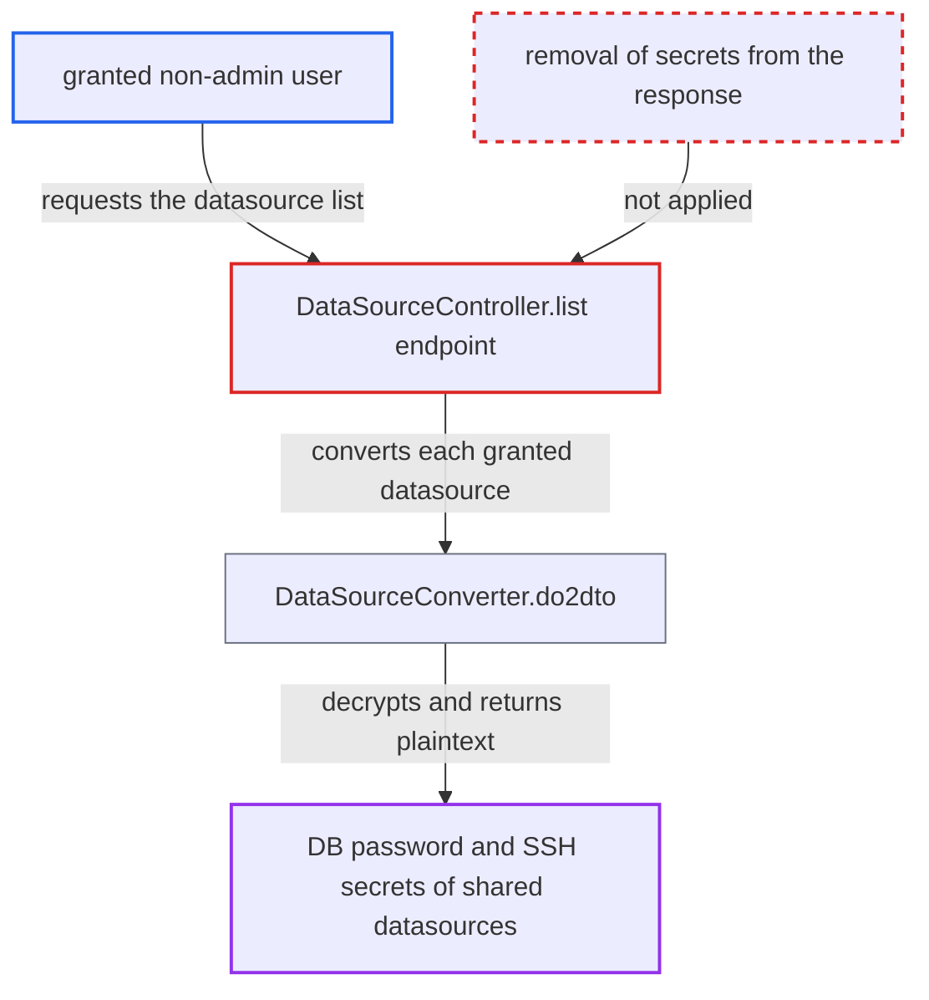

# Datasource list returns decrypted DB and SSH secrets of shared datasources to granted non-admin users

| Field | Value |
|---|---|
| ID | `find_01LemZZGC1YXG7bMAM1HNs3p` |
| Severity | **High** |
| Status | open |
| CWE | CWE-201 — Sensitive information exposure |
| Created | 2026-10-21T22:47:13.833028Z |
| Claude Security | https://claude.ai/security/findings/find_01LemZZGC1YXG7bMAM1HNs3p |

## Description

A logged-in non-admin user who has been granted a shared datasource can read its plaintext database password and SSH password or key passphrase. The user only has to call the datasource list endpoint. The cause is `DataSourceController.list`, which returns a `DataSourceVO` built from the decrypted stored secrets for every datasource the caller may use, with no redaction.

1. **granted non-admin user** sends a list request with their own login token. The request is `GET /api/connection/datasource/list?pageNo=1&pageSize=1000`. The endpoint needs a login but has no admin check. ([`chat2db-server/chat2db-server-web/chat2db-server-web-api/src/main/java/ai/chat2db/server/web/api/controller/data/source/DataSourceController.java:171-177`](https://github.com/cx-benchmark/chat2db/blob/43aaee8d48736d74ac888dc4a81ddb50d6550638/chat2db-server/chat2db-server-web/chat2db-server-web-api/src/main/java/ai/chat2db/server/web/api/controller/data/source/DataSourceController.java#L171-L177))
2. **`queryPageWithPermission`** returns the user's own datasources plus those granted to them. The query includes admin-owned `SHARED` datasources reached through a `DATA_SOURCE_ACCESS` grant of type `USER` or through a valid `TEAM`. Nothing clears `password` or `ssh` for datasources the caller does not own. ([`chat2db-server/chat2db-server-domain/chat2db-server-domain-repository/src/main/resources/mapper/DataSourceCustomMapper.xml:13-30`](https://github.com/cx-benchmark/chat2db/blob/43aaee8d48736d74ac888dc4a81ddb50d6550638/chat2db-server/chat2db-server-domain/chat2db-server-domain-repository/src/main/resources/mapper/DataSourceCustomMapper.xml#L13-L30))
3. **`do2dto` in `DataSourceConverter`** decrypts the stored password and parses the stored SSH settings. `password` is set through `decryptString`, so it holds plaintext. The `ssh` JSON is parsed back into `SSHInfo` with its `password` and `passphrase`. ([`chat2db-server/chat2db-server-domain/chat2db-server-domain-core/src/main/java/ai/chat2db/server/domain/core/converter/DataSourceConverter.java:105-184`](https://github.com/cx-benchmark/chat2db/blob/43aaee8d48736d74ac888dc4a81ddb50d6550638/chat2db-server/chat2db-server-domain/chat2db-server-domain-core/src/main/java/ai/chat2db/server/domain/core/converter/DataSourceConverter.java#L105-L184))
4. **`dto2vo` in `DataSourceWebConverter`** copies the secrets into the response object. It only renames `userName` to `user`. `password` and `ssh` are mapped by name, so they are copied unchanged. ([`chat2db-server/chat2db-server-web/chat2db-server-web-api/src/main/java/ai/chat2db/server/web/api/controller/data/source/converter/DataSourceWebConverter.java:71-82`](https://github.com/cx-benchmark/chat2db/blob/43aaee8d48736d74ac888dc4a81ddb50d6550638/chat2db-server/chat2db-server-web/chat2db-server-web-api/src/main/java/ai/chat2db/server/web/api/controller/data/source/converter/DataSourceWebConverter.java#L71-L82))
5. **`DataSourceController.list`** serializes the `DataSourceVO` list to JSON for the caller. `DataSourceVO` has `password` and `ssh` fields, and the default Jackson converter has no field filter, so the secrets are in the response. ([`chat2db-server/chat2db-server-web/chat2db-server-web-api/src/main/java/ai/chat2db/server/web/api/controller/data/source/vo/DataSourceVO.java:38-72`](https://github.com/cx-benchmark/chat2db/blob/43aaee8d48736d74ac888dc4a81ddb50d6550638/chat2db-server/chat2db-server-web/chat2db-server-web-api/src/main/java/ai/chat2db/server/web/api/controller/data/source/vo/DataSourceVO.java#L38-L72))

## Assessment

The attacker is an authenticated, low-privilege web-mode user. Their user or team holds a `DataSourceAccess` grant on an admin-owned `SHARED` datasource, which is the normal team setup. They call the list endpoint with their own `CHAT2DB` token. No victim action is needed. The report says the instance is internet-facing. A second route is the client's connections page, which loads `/api/connection/datasource/{id}` for any listed connection and pre-fills the password field. That detail endpoint and its missing access check are covered by a separate finding. Removing secrets from the read model closes both routes.

Impact: The user learns the plaintext DB password and the SSH password or key passphrase of every shared datasource granted to them. `keyFile` is only a server-side path. This defeats the documented team-mode guarantee that members can use production connections without knowing the database password. The read changes no Chat2DB data and does not affect its availability.

Subsequent-system impact: With the raw credentials the user can log in to the shared databases and SSH tunnel hosts directly, or re-enter them as a new `PRIVATE` datasource, which any user may create with any URL. They keep the stored account's full rights even after the admin revokes the grant. SSH login goes beyond the port forwarding that Chat2DB itself performs.

## Recommendation

The datasource read model (`DataSource` to `DataSourceVO`) carries the decrypted DB `password` and the `SSHInfo` secrets on every read path. Permission to use a shared connection therefore also discloses its credentials.

Fix criteria: Responses of `/api/connection/datasource/list` and `/api/connection/datasource/{id}` contain no stored DB password, SSH password or passphrase, at least for callers who are not the datasource's owner or an admin. Preferably they contain none for anyone, with an update sentinel that keeps the existing secret. A test as a non-admin holding a USER or TEAM grant on an admin-created shared datasource shows no plaintext secret from either endpoint. The same user can still open consoles and run SQL on it.

## Evidence

**https://github.com/cx-benchmark/chat2db**

- [`chat2db-server/chat2db-server-web/chat2db-server-web-api/src/main/java/ai/chat2db/server/web/api/controller/data/source/DataSourceController.java:171-177`](https://github.com/cx-benchmark/chat2db/blob/43aaee8d48736d74ac888dc4a81ddb50d6550638/chat2db-server/chat2db-server-web/chat2db-server-web-api/src/main/java/ai/chat2db/server/web/api/controller/data/source/DataSourceController.java#L171-L177)
- [`chat2db-server/chat2db-server-domain/chat2db-server-domain-core/src/main/java/ai/chat2db/server/domain/core/impl/DataSourceServiceImpl.java:214-228`](https://github.com/cx-benchmark/chat2db/blob/43aaee8d48736d74ac888dc4a81ddb50d6550638/chat2db-server/chat2db-server-domain/chat2db-server-domain-core/src/main/java/ai/chat2db/server/domain/core/impl/DataSourceServiceImpl.java#L214-L228)
- [`chat2db-server/chat2db-server-domain/chat2db-server-domain-repository/src/main/resources/mapper/DataSourceCustomMapper.xml:13-30`](https://github.com/cx-benchmark/chat2db/blob/43aaee8d48736d74ac888dc4a81ddb50d6550638/chat2db-server/chat2db-server-domain/chat2db-server-domain-repository/src/main/resources/mapper/DataSourceCustomMapper.xml#L13-L30)
- [`chat2db-server/chat2db-server-domain/chat2db-server-domain-core/src/main/java/ai/chat2db/server/domain/core/converter/DataSourceConverter.java:105-184`](https://github.com/cx-benchmark/chat2db/blob/43aaee8d48736d74ac888dc4a81ddb50d6550638/chat2db-server/chat2db-server-domain/chat2db-server-domain-core/src/main/java/ai/chat2db/server/domain/core/converter/DataSourceConverter.java#L105-L184)
- [`chat2db-server/chat2db-server-web/chat2db-server-web-api/src/main/java/ai/chat2db/server/web/api/controller/data/source/converter/DataSourceWebConverter.java:71-82`](https://github.com/cx-benchmark/chat2db/blob/43aaee8d48736d74ac888dc4a81ddb50d6550638/chat2db-server/chat2db-server-web/chat2db-server-web-api/src/main/java/ai/chat2db/server/web/api/controller/data/source/converter/DataSourceWebConverter.java#L71-L82)
- [`chat2db-server/chat2db-server-web/chat2db-server-web-api/src/main/java/ai/chat2db/server/web/api/controller/data/source/vo/DataSourceVO.java:38-72`](https://github.com/cx-benchmark/chat2db/blob/43aaee8d48736d74ac888dc4a81ddb50d6550638/chat2db-server/chat2db-server-web/chat2db-server-web-api/src/main/java/ai/chat2db/server/web/api/controller/data/source/vo/DataSourceVO.java#L38-L72)
- [`CHANGELOG.md:257-258`](https://github.com/cx-benchmark/chat2db/blob/43aaee8d48736d74ac888dc4a81ddb50d6550638/CHANGELOG.md#L257-L258)

