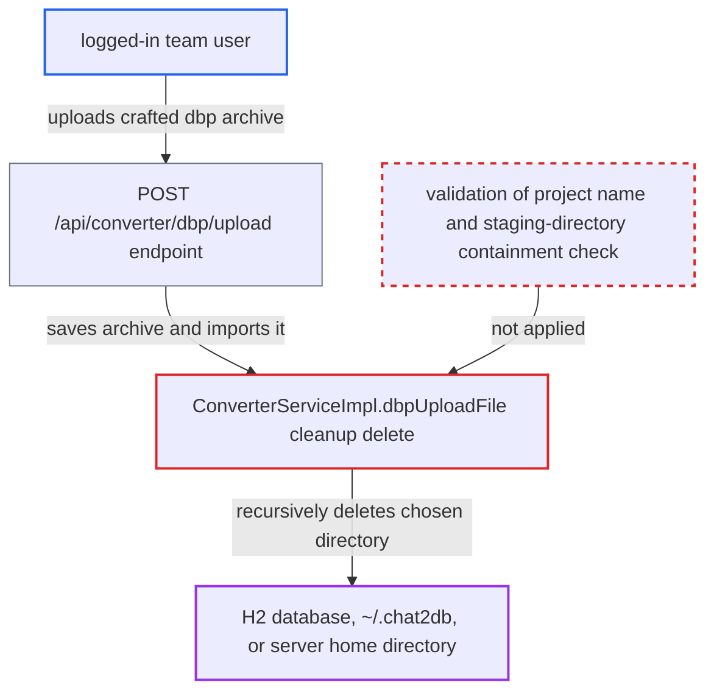

# DBeaver .dbp import recursively deletes a directory named by the uploaded meta.xml

| Field | Value |
|---|---|
| ID | `find_01Lo3Q7DDnwZ36Wxi8DKpoBF` |
| Severity | **High** |
| Status | open |
| CWE | CWE-22 — Path traversal |
| Created | 2026-10-21T22:44:56.586601Z |
| Claude Security | https://claude.ai/security/findings/find_01Lo3Q7DDnwZ36Wxi8DKpoBF |

## Description

A logged-in low-privilege team user can make the server recursively delete a directory of their choice, using one crafted `.dbp` upload. Targets include the H2 database with all users, teams and stored datasource credentials, or the server account's home directory. The cause is `ConverterServiceImpl.dbpUploadFile`. It builds its cleanup delete path from the unvalidated `name` attribute of `<project>` in the archive's `meta.xml`.

1. **attacker (team user)** posts a crafted `x.dbp` to `/api/converter/dbp/upload`. The endpoint only checks that the file name ends in `.dbp`, then saves the upload under `CONFIG_BASE_PATH` and calls `dbpUploadFile`. ([`chat2db-server/chat2db-server-web/chat2db-server-web-api/src/main/java/ai/chat2db/server/web/api/controller/ncx/ConverterController.java:56-66`](https://github.com/cx-benchmark/chat2db/blob/43aaee8d48736d74ac888dc4a81ddb50d6550638/chat2db-server/chat2db-server-web/chat2db-server-web-api/src/main/java/ai/chat2db/server/web/api/controller/ncx/ConverterController.java#L56-L66))
2. **login interceptor** lets any logged-in user through to the endpoint. The admin-role check applies only to `/api/admin/**`, so a normal team user is enough. ([`chat2db-server/chat2db-server-web-start/src/main/java/ai/chat2db/server/web/start/config/config/Chat2dbWebMvcConfigurer.java:134-168`](https://github.com/cx-benchmark/chat2db/blob/43aaee8d48736d74ac888dc4a81ddb50d6550638/chat2db-server/chat2db-server-web-start/src/main/java/ai/chat2db/server/web/start/config/config/Chat2dbWebMvcConfigurer.java#L134-L168))
3. **`dbpUploadFile`** reads the project name from `meta.xml` as it is. The `name` attribute of `<project>` is used verbatim to build the config path and is added to the `projects` list that drives the delete loop. Nothing validates it. ([`chat2db-server/chat2db-server-web/chat2db-server-web-api/src/main/java/ai/chat2db/server/web/api/controller/ncx/service/impl/ConverterServiceImpl.java:174-183`](https://github.com/cx-benchmark/chat2db/blob/43aaee8d48736d74ac888dc4a81ddb50d6550638/chat2db-server/chat2db-server-web/chat2db-server-web-api/src/main/java/ai/chat2db/server/web/api/controller/ncx/service/impl/ConverterServiceImpl.java#L174-L183))
4. **`importDbeaverConfig`** writes the attacker's own `projects/<projectName>/data-sources.json` entry to `config/data-sources.json`. This happens because the `meta.xml` declares `<resource name="data-sources.json"/>` under the project, and it creates the file that the next step reads. ([`chat2db-server/chat2db-server-web/chat2db-server-web-api/src/main/java/ai/chat2db/server/web/api/controller/ncx/service/impl/ConverterServiceImpl.java:258-276`](https://github.com/cx-benchmark/chat2db/blob/43aaee8d48736d74ac888dc4a81ddb50d6550638/chat2db-server/chat2db-server-web/chat2db-server-web-api/src/main/java/ai/chat2db/server/web/api/controller/ncx/service/impl/ConverterServiceImpl.java#L258-L276))
5. **`dbpUploadFile`** parses `config/data-sources.json` and finishes without an exception. The file holds `{"connections":{}}`, so the connection loop is empty and the method reaches the cleanup code. ([`chat2db-server/chat2db-server-web/chat2db-server-web-api/src/main/java/ai/chat2db/server/web/api/controller/ncx/service/impl/ConverterServiceImpl.java:184-188`](https://github.com/cx-benchmark/chat2db/blob/43aaee8d48736d74ac888dc4a81ddb50d6550638/chat2db-server/chat2db-server-web/chat2db-server-web-api/src/main/java/ai/chat2db/server/web/api/controller/ncx/service/impl/ConverterServiceImpl.java#L184-L188))
6. **`dbpUploadFile` cleanup** recursively deletes `ConfigUtils.CONFIG_BASE_PATH + File.separator + projectName`. `com.alibaba.excel.util.FileUtils.delete(File)` is called with no canonicalisation or containment check, so `db`, `.` or `..` as the name deletes the H2 database, all of `~/.chat2db`, or the home directory. ([`chat2db-server/chat2db-server-web/chat2db-server-web-api/src/main/java/ai/chat2db/server/web/api/controller/ncx/service/impl/ConverterServiceImpl.java:253`](https://github.com/cx-benchmark/chat2db/blob/43aaee8d48736d74ac888dc4a81ddb50d6550638/chat2db-server/chat2db-server-web/chat2db-server-web-api/src/main/java/ai/chat2db/server/web/api/controller/ncx/service/impl/ConverterServiceImpl.java#L253))

## Assessment

The attacker is an authenticated low-privilege team user of the web or Docker server. The report says the Docker server is meant to be internet-facing. One request is enough and no victim action is needed. The archive's `meta.xml` is `<archive><projects><project name="db"><resource name="data-sources.json"/></project></projects></archive>`. It ships the entry `projects/db/data-sources.json` containing `{"connections":{}}`. The names `db` and `.` need no traversal, so filtering `..` alone does not stop the attack. Using `..` targets `$HOME`, and deeper `..` sequences go further up the filesystem. The report assumes, without a jar to check, that EasyExcel `3.3.2` `FileUtils.delete` removes a directory by deleting its children recursively. The archive-entry write in the same method is a separate flaw, and fixing its paths does not remove this delete.

Impact: The attacker deletes a directory of their choice with the server's OS rights, which are root in the shipped Docker image. This can destroy the H2 database with every tenant's users, teams, datasources and stored credentials, all of `~/.chat2db`, or `$HOME` and above, and the service then fails. The sink only deletes and discloses nothing.

## Recommendation

The import cleanup recursively deletes a path built from the attacker-supplied `<project name>` in `meta.xml`. A low-privilege user can therefore have the server delete any directory under or above `CONFIG_BASE_PATH`, not just the import's own temporary files.

Fix criteria: Cleanup deletes only a staging directory the server generated for this request, for example a random name under a dedicated import root. No deleted path contains an archive-derived name. Before any recursive delete, the canonical target is verified to lie strictly inside that staging root. Test by importing archives with `<project name>` set to `db`, `.` and `..`. Nothing outside the per-request staging directory is removed, and `~/.chat2db/db` is still intact.

## Evidence

**https://github.com/cx-benchmark/chat2db**

- [`chat2db-server/chat2db-server-web/chat2db-server-web-api/src/main/java/ai/chat2db/server/web/api/controller/ncx/service/impl/ConverterServiceImpl.java:253`](https://github.com/cx-benchmark/chat2db/blob/43aaee8d48736d74ac888dc4a81ddb50d6550638/chat2db-server/chat2db-server-web/chat2db-server-web-api/src/main/java/ai/chat2db/server/web/api/controller/ncx/service/impl/ConverterServiceImpl.java#L253)
- [`chat2db-server/chat2db-server-web/chat2db-server-web-api/src/main/java/ai/chat2db/server/web/api/controller/ncx/service/impl/ConverterServiceImpl.java:174-183`](https://github.com/cx-benchmark/chat2db/blob/43aaee8d48736d74ac888dc4a81ddb50d6550638/chat2db-server/chat2db-server-web/chat2db-server-web-api/src/main/java/ai/chat2db/server/web/api/controller/ncx/service/impl/ConverterServiceImpl.java#L174-L183)
- [`chat2db-server/chat2db-server-web/chat2db-server-web-api/src/main/java/ai/chat2db/server/web/api/controller/ncx/service/impl/ConverterServiceImpl.java:184-188`](https://github.com/cx-benchmark/chat2db/blob/43aaee8d48736d74ac888dc4a81ddb50d6550638/chat2db-server/chat2db-server-web/chat2db-server-web-api/src/main/java/ai/chat2db/server/web/api/controller/ncx/service/impl/ConverterServiceImpl.java#L184-L188)
- [`chat2db-server/chat2db-server-web/chat2db-server-web-api/src/main/java/ai/chat2db/server/web/api/controller/ncx/service/impl/ConverterServiceImpl.java:258-276`](https://github.com/cx-benchmark/chat2db/blob/43aaee8d48736d74ac888dc4a81ddb50d6550638/chat2db-server/chat2db-server-web/chat2db-server-web-api/src/main/java/ai/chat2db/server/web/api/controller/ncx/service/impl/ConverterServiceImpl.java#L258-L276)
- [`chat2db-server/chat2db-server-web/chat2db-server-web-api/src/main/java/ai/chat2db/server/web/api/controller/ncx/ConverterController.java:56-66`](https://github.com/cx-benchmark/chat2db/blob/43aaee8d48736d74ac888dc4a81ddb50d6550638/chat2db-server/chat2db-server-web/chat2db-server-web-api/src/main/java/ai/chat2db/server/web/api/controller/ncx/ConverterController.java#L56-L66)
- [`chat2db-server/chat2db-server-web-start/src/main/java/ai/chat2db/server/web/start/config/config/Chat2dbWebMvcConfigurer.java:134-168`](https://github.com/cx-benchmark/chat2db/blob/43aaee8d48736d74ac888dc4a81ddb50d6550638/chat2db-server/chat2db-server-web-start/src/main/java/ai/chat2db/server/web/start/config/config/Chat2dbWebMvcConfigurer.java#L134-L168)
- [`chat2db-server/chat2db-server-domain/chat2db-server-domain-repository/src/main/java/ai/chat2db/server/domain/repository/Dbutils.java:148`](https://github.com/cx-benchmark/chat2db/blob/43aaee8d48736d74ac888dc4a81ddb50d6550638/chat2db-server/chat2db-server-domain/chat2db-server-domain-repository/src/main/java/ai/chat2db/server/domain/repository/Dbutils.java#L148)
- [`docker/Dockerfile:1-12`](https://github.com/cx-benchmark/chat2db/blob/43aaee8d48736d74ac888dc4a81ddb50d6550638/docker/Dockerfile#L1-L12)

