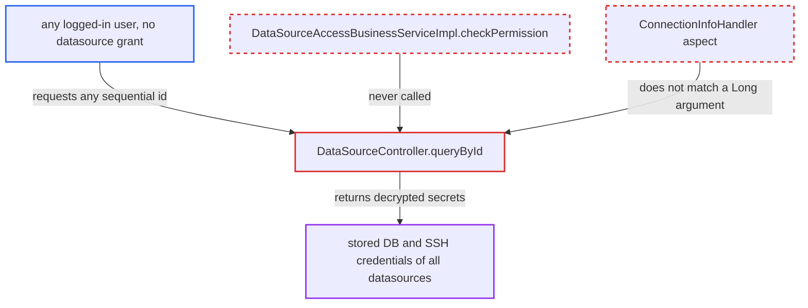

# GET /api/connection/datasource/{id} returns any user's datasource with decrypted DB and SSH secrets, no access check

| Field | Value |
|---|---|
| ID | `find_01TJ9kzJCWyJoJEmpmoh74AV` |
| Severity | **High** |
| Status | open |
| CWE | CWE-639 — Insecure direct object reference |
| Created | 2026-10-21T22:46:12.050845Z |
| Claude Security | https://claude.ai/security/findings/find_01TJ9kzJCWyJoJEmpmoh74AV |

## Description

Any logged-in user of the web/team server can read the stored database and SSH credentials of every datasource on the instance. This includes other users' PRIVATE datasources and SHARED ones they were never granted. The handler `DataSourceController.queryById` loads a datasource by the id in the URL and never checks owner, kind or access grant. It then returns the secrets decrypted.

1. **attacker** logs in to the web/team server as an ordinary user. Under `/api/connection/**` the server only requires a logged-in session, and the admin-role interceptor covers only `/api/admin/**` and `/admin/**`. ([`chat2db-server/chat2db-server-web-start/src/main/java/ai/chat2db/server/web/start/config/config/Chat2dbWebMvcConfigurer.java:134-184`](https://github.com/cx-benchmark/chat2db/blob/43aaee8d48736d74ac888dc4a81ddb50d6550638/chat2db-server/chat2db-server-web-start/src/main/java/ai/chat2db/server/web/start/config/config/Chat2dbWebMvcConfigurer.java#L134-L184))
2. **attacker** sends `GET /api/connection/datasource/1` with their own `CHAT2DB` token. The handler `queryById` takes a bare `@PathVariable Long id` and, unlike `update`, `delete` and `clone`, calls no permission check. ([`chat2db-server/chat2db-server-web/chat2db-server-web-api/src/main/java/ai/chat2db/server/web/api/controller/data/source/DataSourceController.java:185-197`](https://github.com/cx-benchmark/chat2db/blob/43aaee8d48736d74ac888dc4a81ddb50d6550638/chat2db-server/chat2db-server-web/chat2db-server-web-api/src/main/java/ai/chat2db/server/web/api/controller/data/source/DataSourceController.java#L185-L197))
3. **the aspect `ConnectionInfoHandler`** lets the call through without any datasource authorization. It only checks arguments of type `DataSourceBaseRequest`, `DataSourceConsoleRequestInfo` or `DataSourceBaseRequestInfo`, and a `Long` matches none of them. ([`chat2db-server/chat2db-server-web/chat2db-server-web-api/src/main/java/ai/chat2db/server/web/api/aspect/ConnectionInfoHandler.java:38-76`](https://github.com/cx-benchmark/chat2db/blob/43aaee8d48736d74ac888dc4a81ddb50d6550638/chat2db-server/chat2db-server-web/chat2db-server-web-api/src/main/java/ai/chat2db/server/web/api/aspect/ConnectionInfoHandler.java#L38-L76))
4. **the service `DataSourceServiceImpl`** loads the datasource row for the given id through `queryExistent`. `queryById` is a plain `selectById`, and `queryExistent` only throws `DataNotFoundException` when the row is missing, so owner, `kind` and `DATA_SOURCE_ACCESS` grants are never looked at. ([`chat2db-server/chat2db-server-domain/chat2db-server-domain-core/src/main/java/ai/chat2db/server/domain/core/impl/DataSourceServiceImpl.java:161-177`](https://github.com/cx-benchmark/chat2db/blob/43aaee8d48736d74ac888dc4a81ddb50d6550638/chat2db-server/chat2db-server-domain/chat2db-server-domain-core/src/main/java/ai/chat2db/server/domain/core/impl/DataSourceServiceImpl.java#L161-L177))
5. **the converter `DataSourceConverter.do2dto`** decrypts the stored DB password and rebuilds the `SSHInfo`. `decryptString` uses the built-in `DesUtil.DES_KEY`, and the `SSHInfo` gets its `password`, `keyFile` and `passphrase`. ([`chat2db-server/chat2db-server-domain/chat2db-server-domain-core/src/main/java/ai/chat2db/server/domain/core/converter/DataSourceConverter.java:105-115`](https://github.com/cx-benchmark/chat2db/blob/43aaee8d48736d74ac888dc4a81ddb50d6550638/chat2db-server/chat2db-server-domain/chat2db-server-domain-core/src/main/java/ai/chat2db/server/domain/core/converter/DataSourceConverter.java#L105-L115))
6. **the converter `DataSourceWebConverter.dto2vo`** copies the plaintext secrets into `DataSourceVO` and returns them as JSON. Nothing masks the `user`, `password` and `ssh` fields; there is no `ResponseBodyAdvice`, `@JsonIgnore` or custom message converter. ([`chat2db-server/chat2db-server-web/chat2db-server-web-api/src/main/java/ai/chat2db/server/web/api/controller/data/source/vo/DataSourceVO.java:37-71`](https://github.com/cx-benchmark/chat2db/blob/43aaee8d48736d74ac888dc4a81ddb50d6550638/chat2db-server/chat2db-server-web/chat2db-server-web-api/src/main/java/ai/chat2db/server/web/api/controller/data/source/vo/DataSourceVO.java#L37-L71))
7. **attacker** repeats the request for ids 2, 3 and so on. Ids are sequential because `DataSourceDO` uses `@TableId(type = IdType.AUTO)`, so one user can collect every datasource on the instance.

## Assessment

The attacker is any authenticated user of the web/team server, including one with low privileges and no datasource grant. The report treats this server as internet-facing. The attacker needs only their own `CHAT2DB` token and the ability to send `GET /api/connection/datasource/{id}`. No victim action, race or non-default setting is needed. The report says this is a separate defect from the list endpoint `/datasource/list`. That endpoint checks access correctly but still returns secrets to users who have been granted access.

Impact: The attacker reads the stored DB passwords and SSH passwords, key-file paths and passphrases of every user's and admin's datasources. They also get the URL, host, port, user name, `driverConfig` and `extendInfo`. This defeats the PRIVATE/SHARED isolation, since `DataSourceAccessBusinessServiceImpl.checkPermission` would refuse even an admin on another user's PRIVATE datasource. The read changes no Chat2DB data and does not degrade the service.

Subsequent-system impact: With the leaked credentials the attacker can log in to each configured customer database or SSH bastion as the stored account. They can do this directly. They can also save the credentials as their own PRIVATE datasource, because `createReq2param` forces PRIVATE and `createWithPermission` allows it for any user, so Chat2DB connects from its own network position. Revoking a grant does not stop them. The reach is bounded by the stored account's rights, which for SQL-IDE connections typically include read and write.

## Recommendation

(1) `DataSourceController.queryById` returns a datasource chosen only by the client-supplied id. It skips the owner, kind and grant checks that `DataSourceAccessBusinessService.checkPermission` and `PermissionUtils.checkOperationPermission` apply to other datasource operations.

Fix criteria: `GET /api/connection/datasource/{id}` returns a datasource only to a caller who passes the same authorization as the other datasource operations. That means the owner for PRIVATE, or an admin or a USER/TEAM `DataSourceAccess` grant for SHARED. A non-owner without a grant, including one asking for another user's PRIVATE datasource, gets a permission-denied result and no datasource fields.

(2) The read model `DataSourceVO` carries the decrypted DB `password` and the full `SSHInfo` secrets. Any read path that reaches it therefore discloses credentials instead of only connection metadata.

Fix criteria: Datasource read responses contain no stored DB password, SSH password, passphrase or key material, at least for callers who are not the datasource's owner. Updates can still keep the existing secret. Responses from `/datasource/{id}` and `/datasource/list` contain no plaintext secret for such callers.

## Evidence

**https://github.com/cx-benchmark/chat2db**

- [`chat2db-server/chat2db-server-web/chat2db-server-web-api/src/main/java/ai/chat2db/server/web/api/controller/data/source/DataSourceController.java:185-197`](https://github.com/cx-benchmark/chat2db/blob/43aaee8d48736d74ac888dc4a81ddb50d6550638/chat2db-server/chat2db-server-web/chat2db-server-web-api/src/main/java/ai/chat2db/server/web/api/controller/data/source/DataSourceController.java#L185-L197)
- [`chat2db-server/chat2db-server-domain/chat2db-server-domain-core/src/main/java/ai/chat2db/server/domain/core/impl/DataSourceServiceImpl.java:161-177`](https://github.com/cx-benchmark/chat2db/blob/43aaee8d48736d74ac888dc4a81ddb50d6550638/chat2db-server/chat2db-server-domain/chat2db-server-domain-core/src/main/java/ai/chat2db/server/domain/core/impl/DataSourceServiceImpl.java#L161-L177)
- [`chat2db-server/chat2db-server-web/chat2db-server-web-api/src/main/java/ai/chat2db/server/web/api/aspect/ConnectionInfoHandler.java:38-76`](https://github.com/cx-benchmark/chat2db/blob/43aaee8d48736d74ac888dc4a81ddb50d6550638/chat2db-server/chat2db-server-web/chat2db-server-web-api/src/main/java/ai/chat2db/server/web/api/aspect/ConnectionInfoHandler.java#L38-L76)
- [`chat2db-server/chat2db-server-domain/chat2db-server-domain-core/src/main/java/ai/chat2db/server/domain/core/impl/DataSourceAccessBusinessServiceImpl.java:35-67`](https://github.com/cx-benchmark/chat2db/blob/43aaee8d48736d74ac888dc4a81ddb50d6550638/chat2db-server/chat2db-server-domain/chat2db-server-domain-core/src/main/java/ai/chat2db/server/domain/core/impl/DataSourceAccessBusinessServiceImpl.java#L35-L67)
- [`chat2db-server/chat2db-server-domain/chat2db-server-domain-core/src/main/java/ai/chat2db/server/domain/core/converter/DataSourceConverter.java:105-115`](https://github.com/cx-benchmark/chat2db/blob/43aaee8d48736d74ac888dc4a81ddb50d6550638/chat2db-server/chat2db-server-domain/chat2db-server-domain-core/src/main/java/ai/chat2db/server/domain/core/converter/DataSourceConverter.java#L105-L115)
- [`chat2db-server/chat2db-server-web/chat2db-server-web-api/src/main/java/ai/chat2db/server/web/api/controller/data/source/vo/DataSourceVO.java:37-71`](https://github.com/cx-benchmark/chat2db/blob/43aaee8d48736d74ac888dc4a81ddb50d6550638/chat2db-server/chat2db-server-web/chat2db-server-web-api/src/main/java/ai/chat2db/server/web/api/controller/data/source/vo/DataSourceVO.java#L37-L71)
- [`chat2db-server/chat2db-server-web-start/src/main/java/ai/chat2db/server/web/start/config/config/Chat2dbWebMvcConfigurer.java:134-184`](https://github.com/cx-benchmark/chat2db/blob/43aaee8d48736d74ac888dc4a81ddb50d6550638/chat2db-server/chat2db-server-web-start/src/main/java/ai/chat2db/server/web/start/config/config/Chat2dbWebMvcConfigurer.java#L134-L184)

