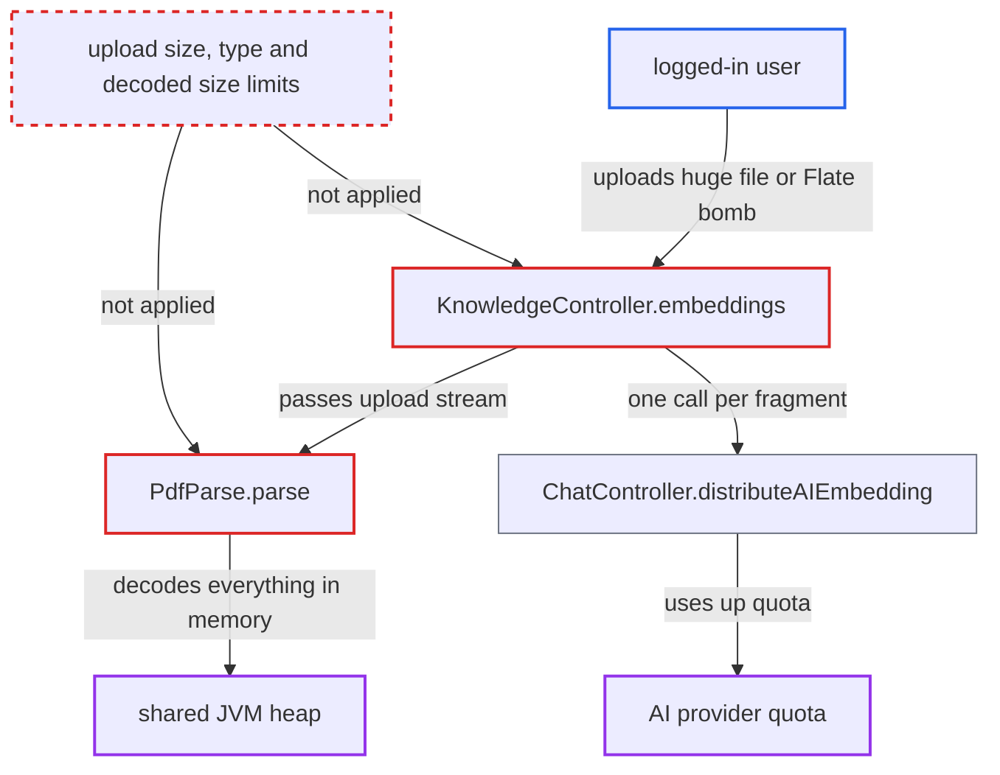

# Knowledge PDF upload parsed fully in heap with no size or decompression limit

| Field | Value |
|---|---|
| ID | `find_01JF3ntuKXU9nMfK8DHf9WaJ` |
| Severity | **High** |
| Status | open |
| CWE | CWE-770 — Resource exhaustion |
| Created | 2026-10-21T22:45:40.794677Z |
| Claude Security | https://claude.ai/security/findings/find_01JF3ntuKXU9nMfK8DHf9WaJ |

## Description

Any logged-in user can take down the whole Chat2DB server by uploading one oversized file or one small PDF that expands hugely when decoded. The upload endpoint `POST /api/ai/knowledge/embeddings` sets no limit on size, page count, decoded size or text length. `PdfParse.parse` loads the whole PDF and its decoded content into the shared JVM heap, and the multipart limits are set to `-1`.

1. **authenticated user** sends a multipart POST with a huge file or a Flate-bomb PDF. The request goes to `/api/ai/knowledge/embeddings`. The bomb is a small PDF whose Flate streams inflate about 1000:1, so a few MB become gigabytes. ([`chat2db-server/chat2db-server-web/chat2db-server-web-api/src/main/java/ai/chat2db/server/web/api/controller/ai/KnowledgeController.java:60-86`](https://github.com/cx-benchmark/chat2db/blob/43aaee8d48736d74ac888dc4a81ddb50d6550638/chat2db-server/chat2db-server-web/chat2db-server-web-api/src/main/java/ai/chat2db/server/web/api/controller/ai/KnowledgeController.java#L60-L86))
2. **Spring multipart handling** accepts the upload of any size. `spring.servlet.multipart.max-file-size` and `max-request-size` are `-1` (unlimited), and `application-release.yml` does not override them. ([`chat2db-server/chat2db-server-web-start/src/main/resources/application.yml:30-33`](https://github.com/cx-benchmark/chat2db/blob/43aaee8d48736d74ac888dc4a81ddb50d6550638/chat2db-server/chat2db-server-web-start/src/main/resources/application.yml#L30-L33))
3. **the handler `KnowledgeController.embeddings`** passes `file.getInputStream()` straight to `PdfParse.parse`. It checks no size, content type or count first. ([`chat2db-server/chat2db-server-web/chat2db-server-web-api/src/main/java/ai/chat2db/server/web/api/controller/ai/KnowledgeController.java:60-86`](https://github.com/cx-benchmark/chat2db/blob/43aaee8d48736d74ac888dc4a81ddb50d6550638/chat2db-server/chat2db-server-web/chat2db-server-web-api/src/main/java/ai/chat2db/server/web/api/controller/ai/KnowledgeController.java#L60-L86))
4. **`PdfParse.parse`** loads the whole document into heap with `PDDocument.load`. In PDFBox `2.0.24` this overload buffers the full stream in a main-memory-only `ScratchFile`, and each Flate content stream is decoded fully into memory when the text stripper reads the page. ([`chat2db-server/chat2db-server-web/chat2db-server-web-api/src/main/java/ai/chat2db/server/web/api/controller/ai/DocParser/PdfParse.java:20-29`](https://github.com/cx-benchmark/chat2db/blob/43aaee8d48736d74ac888dc4a81ddb50d6550638/chat2db-server/chat2db-server-web/chat2db-server-web-api/src/main/java/ai/chat2db/server/web/api/controller/ai/DocParser/PdfParse.java#L20-L29))
5. **`PdfParse.parse`** builds the full extracted text and copies it again. `PDFTextStripper.getText` returns the whole text as one string. `replaceAll` and `split` then make further full-size copies. ([`chat2db-server/chat2db-server-web/chat2db-server-web-api/src/main/java/ai/chat2db/server/web/api/controller/ai/DocParser/PdfParse.java:20-29`](https://github.com/cx-benchmark/chat2db/blob/43aaee8d48736d74ac888dc4a81ddb50d6550638/chat2db-server/chat2db-server-web/chat2db-server-web-api/src/main/java/ai/chat2db/server/web/api/controller/ai/DocParser/PdfParse.java#L20-L29))
6. **the JVM** runs out of heap or stalls under garbage collection. The heap is shared by every user's requests, the embedded H2 store and the live datasource connections. The Docker image runs `java -jar` with no `-Xmx` and has no reverse proxy in front of port 10824. Repeating the request keeps the service down.
7. **the handler `KnowledgeController.embeddings`** makes one synchronous embedding call per `。`-separated fragment. This holds a worker thread and uses provider quota. It happens only when `ai.sql.source` is `CHAT2DBAI` or `FASTCHATAI`. Otherwise `distributeAIEmbedding` returns `null`. ([`chat2db-server/chat2db-server-web/chat2db-server-web-api/src/main/java/ai/chat2db/server/web/api/controller/ai/ChatController.java:782-797`](https://github.com/cx-benchmark/chat2db/blob/43aaee8d48736d74ac888dc4a81ddb50d6550638/chat2db-server/chat2db-server-web/chat2db-server-web-api/src/main/java/ai/chat2db/server/web/api/controller/ai/ChatController.java#L782-L797))

## Assessment

The attacker is any authenticated user of the web or Docker server. The path has no `-a` or `_a` suffix, so the login interceptor applies. No role check or datasource check does. The attacker needs no victim action and no non-default setting. One multipart POST to `/api/ai/knowledge/embeddings` is enough, and it can carry either a very large file or a small Flate-bomb PDF. The embedding fan-out is a second effect and needs `ai.sql.source` set to `CHAT2DBAI` or `FASTCHATAI`. The heap exhaustion happens before that point whatever the setting.

Impact: The attacker can make the whole Chat2DB service fail or stall for every user. That includes access to every configured datasource, and it lasts as long as the attacker keeps sending requests. The embedding fan-out also uses up the configured AI provider's quota. No data is disclosed or modified.

## Recommendation

(1) `KnowledgeController.embeddings` and `PdfParse.parse` process input of any size. The multipart limits are `-1`. PDFBox is set to buffer the document and its decoded streams entirely in main memory, so one request can use up the heap.

Fix criteria: Uploads to `/api/ai/knowledge/embeddings` are rejected above a fixed size and checked for type before parsing. PDF loading runs within a bounded memory budget: a main-memory cap with spill to a temp file, and caps on decoded stream size, page count and extracted text length. A multi-GB upload and a small Flate-bomb PDF are each rejected or processed within a fixed heap budget. Concurrent requests keep working during both tests.

(2) Each extracted fragment triggers a synchronous outbound embedding request. One upload can therefore issue an unbounded number of provider calls and hold a worker thread for all of them.

Fix criteria: The number of embedding calls per upload is capped, or the calls are batched into a bounded number of requests. A PDF with far more `。`-separated fragments than the cap produces a bounded number of provider calls or is rejected.

## Evidence

**https://github.com/cx-benchmark/chat2db**

- [`chat2db-server/chat2db-server-web/chat2db-server-web-api/src/main/java/ai/chat2db/server/web/api/controller/ai/DocParser/PdfParse.java:20-29`](https://github.com/cx-benchmark/chat2db/blob/43aaee8d48736d74ac888dc4a81ddb50d6550638/chat2db-server/chat2db-server-web/chat2db-server-web-api/src/main/java/ai/chat2db/server/web/api/controller/ai/DocParser/PdfParse.java#L20-L29)
- [`chat2db-server/chat2db-server-web/chat2db-server-web-api/src/main/java/ai/chat2db/server/web/api/controller/ai/KnowledgeController.java:60-86`](https://github.com/cx-benchmark/chat2db/blob/43aaee8d48736d74ac888dc4a81ddb50d6550638/chat2db-server/chat2db-server-web/chat2db-server-web-api/src/main/java/ai/chat2db/server/web/api/controller/ai/KnowledgeController.java#L60-L86)
- [`chat2db-server/chat2db-server-web-start/src/main/resources/application.yml:30-33`](https://github.com/cx-benchmark/chat2db/blob/43aaee8d48736d74ac888dc4a81ddb50d6550638/chat2db-server/chat2db-server-web-start/src/main/resources/application.yml#L30-L33)
- [`chat2db-server/chat2db-server-web/chat2db-server-web-api/src/main/java/ai/chat2db/server/web/api/controller/ai/ChatController.java:782-797`](https://github.com/cx-benchmark/chat2db/blob/43aaee8d48736d74ac888dc4a81ddb50d6550638/chat2db-server/chat2db-server-web/chat2db-server-web-api/src/main/java/ai/chat2db/server/web/api/controller/ai/ChatController.java#L782-L797)

