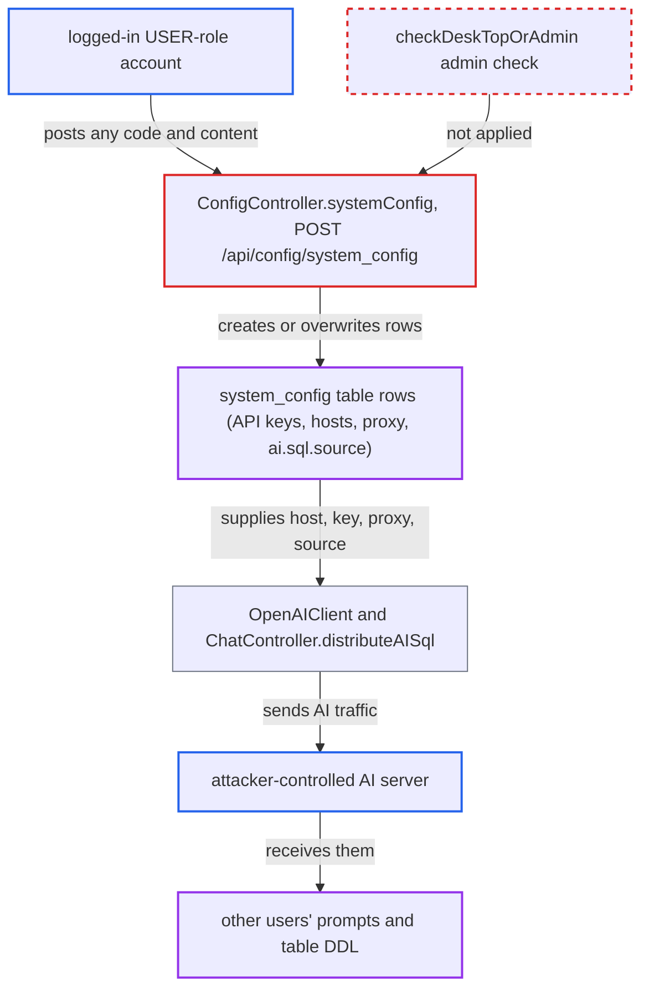

# Missing admin check on POST /api/config/system_config lets any user rewrite AI/system config

| Field | Value |
|---|---|
| ID | `find_016tGht2nLWv2pmQnVzm4RnD` |
| Severity | **High** |
| Status | open |
| CWE | CWE-862 — Missing Authorization |
| Created | 2026-10-21T22:44:56.523693Z |
| Claude Security | https://claude.ai/security/findings/find_016tGht2nLWv2pmQnVzm4RnD |

## Description

Any logged-in user with the USER role can overwrite the instance-wide AI and system settings. That includes provider API keys, base URLs and the proxy. They can send every other user's AI questions and table DDL to a server they control and feed back their own SQL suggestions. The handler `ConfigController.systemConfig()` never calls `PermissionUtils.checkDeskTopOrAdmin()`.

1. **attacker with a USER-role account** posts config rows to `POST /api/config/system_config`. The handler takes any `code` and `content` and never calls `PermissionUtils.checkDeskTopOrAdmin()`, so the write succeeds for any logged-in user. ([`chat2db-server/chat2db-server-web/chat2db-server-web-api/src/main/java/ai/chat2db/server/web/api/controller/config/ConfigController.java:47-57`](https://github.com/cx-benchmark/chat2db/blob/43aaee8d48736d74ac888dc4a81ddb50d6550638/chat2db-server/chat2db-server-web/chat2db-server-web-api/src/main/java/ai/chat2db/server/web/api/controller/config/ConfigController.java#L47-L57))
2. **web server interceptors** let the request through on a valid session alone. The role interceptor covers only `/api/admin/**` and `/admin/**`, so `/api/config/**` needs only a login. ([`chat2db-server/chat2db-server-web-start/src/main/java/ai/chat2db/server/web/start/config/config/Chat2dbWebMvcConfigurer.java:172-185`](https://github.com/cx-benchmark/chat2db/blob/43aaee8d48736d74ac888dc4a81ddb50d6550638/chat2db-server/chat2db-server-web-start/src/main/java/ai/chat2db/server/web/start/config/config/Chat2dbWebMvcConfigurer.java#L172-L185))
3. **attacker** sets `chatgpt.apiHost` to a server they control, then writes `chatgpt.apiKey`. Writing `chatgpt.apiKey` makes the endpoint call `OpenAIClient.refresh()`, which rebuilds the shared OpenAI client from the stored host, key and proxy rows. ([`chat2db-server/chat2db-server-web/chat2db-server-web-api/src/main/java/ai/chat2db/server/web/api/controller/ai/openai/client/OpenAIClient.java:65-103`](https://github.com/cx-benchmark/chat2db/blob/43aaee8d48736d74ac888dc4a81ddb50d6550638/chat2db-server/chat2db-server-web/chat2db-server-web-api/src/main/java/ai/chat2db/server/web/api/controller/ai/openai/client/OpenAIClient.java#L65-L103))
4. **attacker** sets `ai.sql.source` to `OPENAI`. `ChatController.distributeAISql()` reads `ai.sql.source` on every AI request and picks the provider client from it. ([`chat2db-server/chat2db-server-web/chat2db-server-web-api/src/main/java/ai/chat2db/server/web/api/controller/ai/ChatController.java:220-262`](https://github.com/cx-benchmark/chat2db/blob/43aaee8d48736d74ac888dc4a81ddb50d6550638/chat2db-server/chat2db-server-web/chat2db-server-web-api/src/main/java/ai/chat2db/server/web/api/controller/ai/ChatController.java#L220-L262))
5. **another user of the AI assistant** sends a prompt that goes to the attacker's server. The prompt holds the user's question and the `SHOW CREATE TABLE` DDL of tables on their own datasources, and the attacker's reply is streamed back as a SQL suggestion. ([`chat2db-server/chat2db-server-web/chat2db-server-web-api/src/main/java/ai/chat2db/server/web/api/controller/ai/ChatController.java:220-262`](https://github.com/cx-benchmark/chat2db/blob/43aaee8d48736d74ac888dc4a81ddb50d6550638/chat2db-server/chat2db-server-web/chat2db-server-web-api/src/main/java/ai/chat2db/server/web/api/controller/ai/ChatController.java#L220-L262))

## Assessment

The attacker needs any authenticated USER-role account on the internet-facing web/Docker server (`chat2db-server-web-start`). In that server the login interceptor only requires a session. The role interceptor covers only `/api/admin/**` and `/admin/**`, and the class-level `@ConnectionInfoAspect` does nothing for `SystemConfigRequest`. The attacker needs no other setting. Other users must then use the AI assistant as they normally do. Other providers are also exposed: `RestAIClient` is a lazy singleton built from the `rest.ai.url` and `rest.ai.apiKey` rows on first use. If it has not been used yet in the running process, the attacker-written URL is used.

Impact: The attacker takes over admin-only, instance-wide configuration: all AI provider keys, endpoints and proxy settings. All AI traffic goes to them, including questions, users' SQL and the schema DDL of other users' datasources. They also control the SQL suggestions served to every user. They can break AI features by overwriting keys, but the server keeps running.

## Recommendation

`POST /api/config/system_config` writes any row of the shared `system_config` table without checking that the caller is an administrator or the desktop default user. The sibling `/system_config/ai` enforces that check on the same rows.

Fix criteria: A USER-role web-mode account calling `POST /api/config/system_config` with any `code` gets a permission-denied result, and no `system_config` row changes. Only admin or desktop callers can write, ideally limited to an allowlist of `code`s. Replay the `chatgpt.apiHost`, `chatgpt.apiKey` and `ai.sql.source` writes as a USER-role account. Confirm that the stored rows and the AI routing are unchanged.

## Evidence

**https://github.com/cx-benchmark/chat2db**

- [`chat2db-server/chat2db-server-web/chat2db-server-web-api/src/main/java/ai/chat2db/server/web/api/controller/config/ConfigController.java:47-57`](https://github.com/cx-benchmark/chat2db/blob/43aaee8d48736d74ac888dc4a81ddb50d6550638/chat2db-server/chat2db-server-web/chat2db-server-web-api/src/main/java/ai/chat2db/server/web/api/controller/config/ConfigController.java#L47-L57)
- [`chat2db-server/chat2db-server-web/chat2db-server-web-api/src/main/java/ai/chat2db/server/web/api/controller/config/ConfigController.java:64-66`](https://github.com/cx-benchmark/chat2db/blob/43aaee8d48736d74ac888dc4a81ddb50d6550638/chat2db-server/chat2db-server-web/chat2db-server-web-api/src/main/java/ai/chat2db/server/web/api/controller/config/ConfigController.java#L64-L66)
- [`chat2db-server/chat2db-server-web-start/src/main/java/ai/chat2db/server/web/start/config/config/Chat2dbWebMvcConfigurer.java:172-185`](https://github.com/cx-benchmark/chat2db/blob/43aaee8d48736d74ac888dc4a81ddb50d6550638/chat2db-server/chat2db-server-web-start/src/main/java/ai/chat2db/server/web/start/config/config/Chat2dbWebMvcConfigurer.java#L172-L185)
- [`chat2db-server/chat2db-server-web/chat2db-server-web-api/src/main/java/ai/chat2db/server/web/api/controller/ai/openai/client/OpenAIClient.java:65-103`](https://github.com/cx-benchmark/chat2db/blob/43aaee8d48736d74ac888dc4a81ddb50d6550638/chat2db-server/chat2db-server-web/chat2db-server-web-api/src/main/java/ai/chat2db/server/web/api/controller/ai/openai/client/OpenAIClient.java#L65-L103)
- [`chat2db-server/chat2db-server-web/chat2db-server-web-api/src/main/java/ai/chat2db/server/web/api/controller/ai/ChatController.java:220-262`](https://github.com/cx-benchmark/chat2db/blob/43aaee8d48736d74ac888dc4a81ddb50d6550638/chat2db-server/chat2db-server-web/chat2db-server-web-api/src/main/java/ai/chat2db/server/web/api/controller/ai/ChatController.java#L220-L262)
- [`chat2db-server/chat2db-server-web/chat2db-server-web-api/src/main/java/ai/chat2db/server/web/api/controller/ai/rest/client/RestAIClient.java:47-93`](https://github.com/cx-benchmark/chat2db/blob/43aaee8d48736d74ac888dc4a81ddb50d6550638/chat2db-server/chat2db-server-web/chat2db-server-web-api/src/main/java/ai/chat2db/server/web/api/controller/ai/rest/client/RestAIClient.java#L47-L93)
- [`chat2db-server/chat2db-server-web/chat2db-server-web-api/src/main/java/ai/chat2db/server/web/api/controller/ai/rest/client/RestAIStreamClient.java:160-170`](https://github.com/cx-benchmark/chat2db/blob/43aaee8d48736d74ac888dc4a81ddb50d6550638/chat2db-server/chat2db-server-web/chat2db-server-web-api/src/main/java/ai/chat2db/server/web/api/controller/ai/rest/client/RestAIStreamClient.java#L160-L170)

