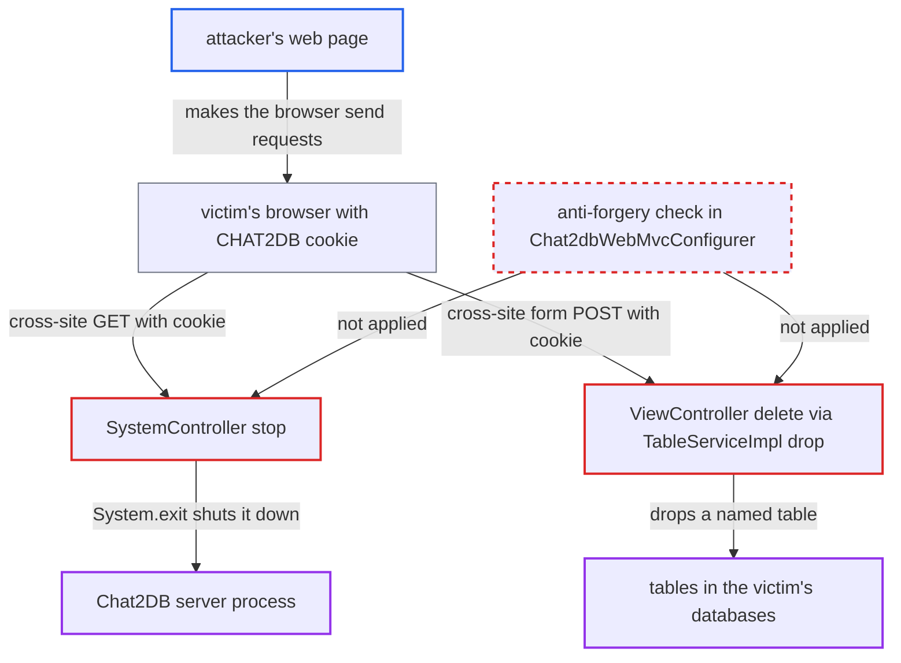

# No CSRF defence on cookie-authenticated web API: cross-site navigation stops server or drops tables

| Field | Value |
|---|---|
| ID | `find_0195ZN2gtQiLT3vSDaKHq2xS` |
| Severity | **High** |
| Status | open |
| CWE | CWE-352 — Cross-Site Request Forgery |
| Created | 2026-10-21T23:06:54.714640Z |
| Claude Security | https://claude.ai/security/findings/find_0195ZN2gtQiLT3vSDaKHq2xS |

## Description

A web page run by an attacker with no account can make any logged-in Chat2DB web user's browser stop the whole server. In Firefox and Safari it can also drop a database table the victim can reach. The server trusts the ambient `CHAT2DB` session cookie and has no anti-forgery check in `Chat2dbWebMvcConfigurer`. Some handlers also change state on GET or bind form fields.

1. **attacker** gets a logged-in Chat2DB user to open an attacker-controlled page. The `CHAT2DB` cookie lasts for the 30-day `timeout` and sets no `SameSite`, `HttpOnly` or `Secure` attribute, so the victim is likely still logged in. ([`chat2db-server/chat2db-server-web-start/src/main/resources/application.yml:53-65`](https://github.com/cx-benchmark/chat2db/blob/43aaee8d48736d74ac888dc4a81ddb50d6550638/chat2db-server/chat2db-server-web-start/src/main/resources/application.yml#L53-L65))
2. **victim's browser** sends the `CHAT2DB` cookie with a request the attacker's page triggers. The web UI relies on the cookie (`credentials: 'include'`, `Chat2db` header kept only in desktop builds), so the cookie alone is the session credential. ([`chat2db-client/src/service/base.ts:86-117`](https://github.com/cx-benchmark/chat2db/blob/43aaee8d48736d74ac888dc4a81ddb50d6550638/chat2db-client/src/service/base.ts#L86-L117))
3. **the request pipeline in `Chat2dbWebMvcConfigurer`** accepts the forged request as the victim's own. It takes identity from `StpUtil.getLoginIdDefaultNull()` and only checks that a session exists, with no anti-forgery token, custom header, or `Origin`/`Referer`/`Sec-Fetch-Site` check. ([`chat2db-server/chat2db-server-web-start/src/main/java/ai/chat2db/server/web/start/config/config/Chat2dbWebMvcConfigurer.java:69-187`](https://github.com/cx-benchmark/chat2db/blob/43aaee8d48736d74ac888dc4a81ddb50d6550638/chat2db-server/chat2db-server-web-start/src/main/java/ai/chat2db/server/web/start/config/config/Chat2dbWebMvcConfigurer.java#L69-L187))
4. **the page, route one: top-level GET** navigates to `/api/system/stop`, so `SystemController.stop` runs. A bare `@RequestMapping("/stop")` accepts GET, and `stop()` calls `SSHManager.close()`, `SpringApplication.exit` and `System.exit(0)`, which ends the server process. ([`chat2db-server/chat2db-server-web/chat2db-server-web-api/src/main/java/ai/chat2db/server/web/api/controller/system/SystemController.java:139-179`](https://github.com/cx-benchmark/chat2db/blob/43aaee8d48736d74ac888dc4a81ddb50d6550638/chat2db-server/chat2db-server-web/chat2db-server-web-api/src/main/java/ai/chat2db/server/web/api/controller/system/SystemController.java#L139-L179))
5. **the page, route two: auto-submitted form POST** posts form fields to `/api/rdb/view/delete`. `ViewController` binds `TableDeleteRequest` from form fields because it has no `@RequestBody`. The form carries `dataSourceId`, `databaseName` and `tableName`. ([`chat2db-server/chat2db-server-web/chat2db-server-web-api/src/main/java/ai/chat2db/server/web/api/controller/rdb/ViewController.java:66-70`](https://github.com/cx-benchmark/chat2db/blob/43aaee8d48736d74ac888dc4a81ddb50d6550638/chat2db-server/chat2db-server-web/chat2db-server-web-api/src/main/java/ai/chat2db/server/web/api/controller/rdb/ViewController.java#L66-L70))
6. **`ConnectionInfoHandler`** opens the named datasource with its stored credentials. `checkPermission` passes because the victim may use that datasource. ([`chat2db-server/chat2db-server-web/chat2db-server-web-api/src/main/java/ai/chat2db/server/web/api/aspect/ConnectionInfoHandler.java:38-100`](https://github.com/cx-benchmark/chat2db/blob/43aaee8d48736d74ac888dc4a81ddb50d6550638/chat2db-server/chat2db-server-web/chat2db-server-web-api/src/main/java/ai/chat2db/server/web/api/aspect/ConnectionInfoHandler.java#L38-L100))
7. **`TableServiceImpl.drop`** runs `DROP TABLE` on the attacker-named table through the database plugin. For example `MysqlDBManage` executes the drop with the `tableName` from the request. ([`chat2db-server/chat2db-server-domain/chat2db-server-domain-core/src/main/java/ai/chat2db/server/domain/core/impl/TableServiceImpl.java:89-93`](https://github.com/cx-benchmark/chat2db/blob/43aaee8d48736d74ac888dc4a81ddb50d6550638/chat2db-server/chat2db-server-domain/chat2db-server-domain-core/src/main/java/ai/chat2db/server/domain/core/impl/TableServiceImpl.java#L89-L93))

## Assessment

The attacker needs no account. The attacker needs a logged-in web or team mode user (admins included) to open a page the attacker controls. The web or Docker server must be reachable by the victim's browser. For the shutdown, the page sends the browser to `https://<chat2db>/api/system/stop`. A top-level GET carries the cookie in every major browser. For the table drop, the page auto-submits a form POST to `/api/rdb/view/delete`. This works in Firefox and Safari with default settings, which apply no Lax default. Chromium sends the cookie on such a POST only within two minutes of login. `/api/rdb/function/delete` and `/api/rdb/procedure/update|delete` are bound the same way. `GET /api/connection/datasource/close` and `/api/connection/console/connect|close` change connection state and can be forged by navigation. `@RequestBody` JSON endpoints cannot be forged this way. A form cannot send `application/json`, and cross-site `fetch` gets no cookie in default modern browsers. An `` tag does not carry the cookie either, because it is a third-party subresource request.

Impact: One forged navigation ends the Chat2DB server process for every user, and the shipped Docker setup has no restart policy, so it stays down until an operator restarts it. Forged GETs can also open or close datasource and console connections. The attacker cannot read responses, so nothing is disclosed.

Subsequent-system impact: Through `/api/rdb/view/delete` and the function and procedure delete handlers, a forged request drops an attacker-named object in any customer database the victim can use, with the stored credentials. The attacker must guess the numeric `dataSourceId` and the object name, and each navigation is one blind attempt. A hit destroys the table and its data.

## Recommendation

(1) The web-mode API authenticates requests only by the ambient `CHAT2DB` cookie. `Chat2dbWebMvcConfigurer` has no anti-forgery mechanism, so requests caused by third-party pages look the same as the user's own.

Fix criteria: Every state-changing request in web mode must carry proof that it comes from the Chat2DB UI, not just the cookie. That proof can be a non-cookie credential such as the `CHAT2DB` header, a synchronizer or double-submit token, or strict `Origin`/`Sec-Fetch-Site` validation. The session cookie is `SameSite=Strict` (or `Lax` with no mutating GETs) and `HttpOnly`. A cross-site top-level GET to `/api/system/stop` and a cross-site form POST to `/api/rdb/view/delete`, both with a valid cookie, are rejected and change nothing.

(2) Destructive handlers accept safe methods or form encodings. `@RequestMapping("/stop")` serves GET, and `/api/connection/datasource/close` and `/console/connect|close` are GET. `/api/rdb/view/delete`, `/function/delete` and `/procedure/update|delete` bind form fields because they lack `@RequestBody`.

Fix criteria: Mutating operations are reachable only through non-safe methods with a JSON body, and `/api/system/stop` is disabled in web mode. `GET /api/system/stop` returns 405 or a refusal. A form-encoded POST to `/api/rdb/view/delete` is rejected (for example with 415) and drops nothing.

## Evidence

**https://github.com/cx-benchmark/chat2db**

- [`chat2db-server/chat2db-server-web-start/src/main/java/ai/chat2db/server/web/start/config/config/Chat2dbWebMvcConfigurer.java:69-187`](https://github.com/cx-benchmark/chat2db/blob/43aaee8d48736d74ac888dc4a81ddb50d6550638/chat2db-server/chat2db-server-web-start/src/main/java/ai/chat2db/server/web/start/config/config/Chat2dbWebMvcConfigurer.java#L69-L187)
- [`chat2db-server/chat2db-server-web/chat2db-server-web-api/src/main/java/ai/chat2db/server/web/api/controller/system/SystemController.java:139-179`](https://github.com/cx-benchmark/chat2db/blob/43aaee8d48736d74ac888dc4a81ddb50d6550638/chat2db-server/chat2db-server-web/chat2db-server-web-api/src/main/java/ai/chat2db/server/web/api/controller/system/SystemController.java#L139-L179)
- [`chat2db-server/chat2db-server-web-start/src/main/resources/application.yml:53-65`](https://github.com/cx-benchmark/chat2db/blob/43aaee8d48736d74ac888dc4a81ddb50d6550638/chat2db-server/chat2db-server-web-start/src/main/resources/application.yml#L53-L65)
- [`chat2db-client/src/service/base.ts:86-117`](https://github.com/cx-benchmark/chat2db/blob/43aaee8d48736d74ac888dc4a81ddb50d6550638/chat2db-client/src/service/base.ts#L86-L117)
- [`chat2db-server/chat2db-server-web/chat2db-server-web-api/src/main/java/ai/chat2db/server/web/api/controller/rdb/ViewController.java:66-70`](https://github.com/cx-benchmark/chat2db/blob/43aaee8d48736d74ac888dc4a81ddb50d6550638/chat2db-server/chat2db-server-web/chat2db-server-web-api/src/main/java/ai/chat2db/server/web/api/controller/rdb/ViewController.java#L66-L70)
- [`chat2db-server/chat2db-server-web/chat2db-server-web-api/src/main/java/ai/chat2db/server/web/api/aspect/ConnectionInfoHandler.java:38-100`](https://github.com/cx-benchmark/chat2db/blob/43aaee8d48736d74ac888dc4a81ddb50d6550638/chat2db-server/chat2db-server-web/chat2db-server-web-api/src/main/java/ai/chat2db/server/web/api/aspect/ConnectionInfoHandler.java#L38-L100)
- [`chat2db-server/chat2db-server-domain/chat2db-server-domain-core/src/main/java/ai/chat2db/server/domain/core/impl/TableServiceImpl.java:89-93`](https://github.com/cx-benchmark/chat2db/blob/43aaee8d48736d74ac888dc4a81ddb50d6550638/chat2db-server/chat2db-server-domain/chat2db-server-domain-core/src/main/java/ai/chat2db/server/domain/core/impl/TableServiceImpl.java#L89-L93)
- [`chat2db-server/chat2db-plugins/chat2db-mysql/src/main/java/ai/chat2db/plugin/mysql/MysqlDBManage.java:215-218`](https://github.com/cx-benchmark/chat2db/blob/43aaee8d48736d74ac888dc4a81ddb50d6550638/chat2db-server/chat2db-plugins/chat2db-mysql/src/main/java/ai/chat2db/plugin/mysql/MysqlDBManage.java#L215-L218)
- [`chat2db-server/chat2db-server-web/chat2db-server-web-api/src/main/java/ai/chat2db/server/web/api/controller/data/source/DataSourceController.java:122-161`](https://github.com/cx-benchmark/chat2db/blob/43aaee8d48736d74ac888dc4a81ddb50d6550638/chat2db-server/chat2db-server-web/chat2db-server-web-api/src/main/java/ai/chat2db/server/web/api/controller/data/source/DataSourceController.java#L122-L161)
- [`chat2db-server/chat2db-server-web-start/src/main/java/ai/chat2db/server/web/start/config/interceptor/CorsFilter.java:27-35`](https://github.com/cx-benchmark/chat2db/blob/43aaee8d48736d74ac888dc4a81ddb50d6550638/chat2db-server/chat2db-server-web-start/src/main/java/ai/chat2db/server/web/start/config/interceptor/CorsFilter.java#L27-L35)
- [`docker/docker-compose.yml:1-9`](https://github.com/cx-benchmark/chat2db/blob/43aaee8d48736d74ac888dc4a81ddb50d6550638/docker/docker-compose.yml#L1-L9)

