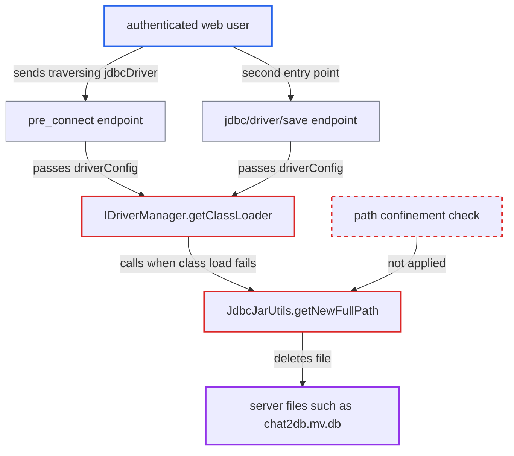

# Path traversal in driverConfig.jdbcDriver lets any user delete arbitrary server files

| Field | Value |
|---|---|
| ID | `find_019bveFcekQhaAMT1ExJ4rDN` |
| Severity | **High** |
| Status | open |
| CWE | CWE-22 — Path traversal |
| Created | 2026-10-21T22:45:36.028112Z |
| Claude Security | https://claude.ai/security/findings/find_019bveFcekQhaAMT1ExJ4rDN |

## Description

Any logged-in web user can delete any file the server process can write. In the shipped Docker image that process is root. The attack sends a `jdbcDriver` value with `..` and a class name that does not exist. `JdbcJarUtils.getFullPath` and `getNewFullPath` append that value to the driver directory without confining it, and the retry code in `IDriverManager.getClassLoader` then deletes the file.

1. **authenticated web user** sends a `pre_connect` request with a traversing driver path. The JSON body has `driverConfig.jdbcDriver` set to `../db/chat2db.mv.db` and `jdbcDriverClass` set to the nonexistent `no.Such`. The endpoint needs only a login, and no datasource-permission check runs. ([`chat2db-server/chat2db-server-web/chat2db-server-web-api/src/main/java/ai/chat2db/server/web/api/controller/data/source/DataSourceController.java:88-92`](https://github.com/cx-benchmark/chat2db/blob/43aaee8d48736d74ac888dc4a81ddb50d6550638/chat2db-server/chat2db-server-web/chat2db-server-web-api/src/main/java/ai/chat2db/server/web/api/controller/data/source/DataSourceController.java#L88-L92))
2. **`DataSourceServiceImpl.preConnect`** passes the request's `driverConfig` to the connection test. The config is used because both `jdbcDriver` and `jdbcDriverClass` are non-blank. It reaches `IDriverManager.getConnection` with no allow-list. ([`chat2db-server/chat2db-server-domain/chat2db-server-domain-core/src/main/java/ai/chat2db/server/domain/core/impl/DataSourceServiceImpl.java:248-265`](https://github.com/cx-benchmark/chat2db/blob/43aaee8d48736d74ac888dc4a81ddb50d6550638/chat2db-server/chat2db-server-domain/chat2db-server-domain-core/src/main/java/ai/chat2db/server/domain/core/impl/DataSourceServiceImpl.java#L248-L265))
3. **`IDriverManager.getClassLoader`** splits `jdbcDriver` on commas and builds a `URLClassLoader` from `getFullPath` for each part. `getFullPath` returns the directory path plus the supplied string, so `..` points outside `~/.chat2db/jdbc-lib/`. ([`chat2db-server/chat2db-spi/src/main/java/ai/chat2db/spi/sql/IDriverManager.java:156-193`](https://github.com/cx-benchmark/chat2db/blob/43aaee8d48736d74ac888dc4a81ddb50d6550638/chat2db-server/chat2db-spi/src/main/java/ai/chat2db/spi/sql/IDriverManager.java#L156-L193))
4. **`IDriverManager.getClassLoader`** calls `getNewFullPath` on every element after `loadClass(jdbcDriverClass)` throws. The class name does not exist, so `ClassNotFoundException` is thrown and the retry branch runs. ([`chat2db-server/chat2db-spi/src/main/java/ai/chat2db/spi/sql/IDriverManager.java:156-193`](https://github.com/cx-benchmark/chat2db/blob/43aaee8d48736d74ac888dc4a81ddb50d6550638/chat2db-server/chat2db-spi/src/main/java/ai/chat2db/spi/sql/IDriverManager.java#L156-L193))
5. **`JdbcJarUtils.getNewFullPath`** deletes the file at the traversed path. It calls `file.delete()` on the concatenated path before it tries to re-download from `https://cdn.chat2db-ai.com/lib/`. The target file is already gone by then. ([`chat2db-server/chat2db-spi/src/main/java/ai/chat2db/spi/util/JdbcJarUtils.java:109-134`](https://github.com/cx-benchmark/chat2db/blob/43aaee8d48736d74ac888dc4a81ddb50d6550638/chat2db-server/chat2db-spi/src/main/java/ai/chat2db/spi/util/JdbcJarUtils.java#L109-L134))

## Assessment

The attacker is any authenticated web user. No admin role is needed, because the ADMIN check covers only `/api/admin/**` and `/admin/**`. The default configuration is vulnerable and no victim action is needed. The main route is `POST /api/connection/datasource/pre_connect`. `jdbcDriver` and `jdbcDriverClass` also arrive in the JSON bodies of datasource `create` and `update`, which reach the same loader. `POST /api/jdbc/driver/save` is a second entry point that calls `IDriverManager.getClassLoader` directly. The same traversal also lets the server class-load a class from any ZIP or JAR on disk and call `newInstance()` on it. That becomes code execution only if the attacker can already place such a file. The report says this adds no code-execution path beyond the unrestricted driver upload.

Impact: The attacker can delete any file the server user can write. Examples are the H2 metadata database `~/.chat2db/db/chat2db.mv.db`, which holds all users, teams, grants and stored datasource credentials, other users' driver JARs, and `/app/chat2db-server-web-start.jar`. Data is lost for every tenant and the service cannot recover on restart. The code gives no read primitive, so no data disclosure is established.

## Recommendation

(1) `JdbcJarUtils.getFullPath` and `getNewFullPath` append a client-supplied string to the driver directory and never check where the result lands. `..` segments therefore escape `~/.chat2db/jdbc-lib/`.

Fix criteria: Every JAR reference used for class loading or deletion resolves, after canonicalisation, to a regular file directly inside the driver directory. Ideally it is a driver registered server-side, either a plugin `DBConfig` entry or an admin-saved `jdbc_driver` row. `pre_connect`, `create`, `update` and `jdbc/driver/save` reject a `jdbcDriver` containing `/`, `\\` or `..` before any file is opened. Tests confirm this.

(2) The delete-and-retry fallback in `IDriverManager.getClassLoader` deletes whatever path the request named whenever the requested class fails to load. A caller therefore controls a file deletion on the server.

Fix criteria: No request can cause deletion of a file whose path it chose. The fallback acts only on server-managed driver files, and only after the confinement check. A `pre_connect` that names an existing non-JAR file and a bogus class leaves that file on disk. A test confirms this.

## Evidence

**https://github.com/cx-benchmark/chat2db**

- [`chat2db-server/chat2db-spi/src/main/java/ai/chat2db/spi/util/JdbcJarUtils.java:109-134`](https://github.com/cx-benchmark/chat2db/blob/43aaee8d48736d74ac888dc4a81ddb50d6550638/chat2db-server/chat2db-spi/src/main/java/ai/chat2db/spi/util/JdbcJarUtils.java#L109-L134)
- [`chat2db-server/chat2db-spi/src/main/java/ai/chat2db/spi/sql/IDriverManager.java:156-193`](https://github.com/cx-benchmark/chat2db/blob/43aaee8d48736d74ac888dc4a81ddb50d6550638/chat2db-server/chat2db-spi/src/main/java/ai/chat2db/spi/sql/IDriverManager.java#L156-L193)
- [`chat2db-server/chat2db-spi/src/main/java/ai/chat2db/spi/sql/IDriverManager.java:137-151`](https://github.com/cx-benchmark/chat2db/blob/43aaee8d48736d74ac888dc4a81ddb50d6550638/chat2db-server/chat2db-spi/src/main/java/ai/chat2db/spi/sql/IDriverManager.java#L137-L151)
- [`chat2db-server/chat2db-server-domain/chat2db-server-domain-core/src/main/java/ai/chat2db/server/domain/core/impl/DataSourceServiceImpl.java:248-265`](https://github.com/cx-benchmark/chat2db/blob/43aaee8d48736d74ac888dc4a81ddb50d6550638/chat2db-server/chat2db-server-domain/chat2db-server-domain-core/src/main/java/ai/chat2db/server/domain/core/impl/DataSourceServiceImpl.java#L248-L265)
- [`chat2db-server/chat2db-server-web/chat2db-server-web-api/src/main/java/ai/chat2db/server/web/api/controller/data/source/DataSourceController.java:88-92`](https://github.com/cx-benchmark/chat2db/blob/43aaee8d48736d74ac888dc4a81ddb50d6550638/chat2db-server/chat2db-server-web/chat2db-server-web-api/src/main/java/ai/chat2db/server/web/api/controller/data/source/DataSourceController.java#L88-L92)
- [`chat2db-server/chat2db-server-domain/chat2db-server-domain-core/src/main/java/ai/chat2db/server/domain/core/impl/JdbcDriverServiceImpl.java:91-102`](https://github.com/cx-benchmark/chat2db/blob/43aaee8d48736d74ac888dc4a81ddb50d6550638/chat2db-server/chat2db-server-domain/chat2db-server-domain-core/src/main/java/ai/chat2db/server/domain/core/impl/JdbcDriverServiceImpl.java#L91-L102)
- [`chat2db-server/chat2db-server-web-start/src/main/java/ai/chat2db/server/web/start/config/config/Chat2dbWebMvcConfigurer.java:160-184`](https://github.com/cx-benchmark/chat2db/blob/43aaee8d48736d74ac888dc4a81ddb50d6550638/chat2db-server/chat2db-server-web-start/src/main/java/ai/chat2db/server/web/start/config/config/Chat2dbWebMvcConfigurer.java#L160-L184)

