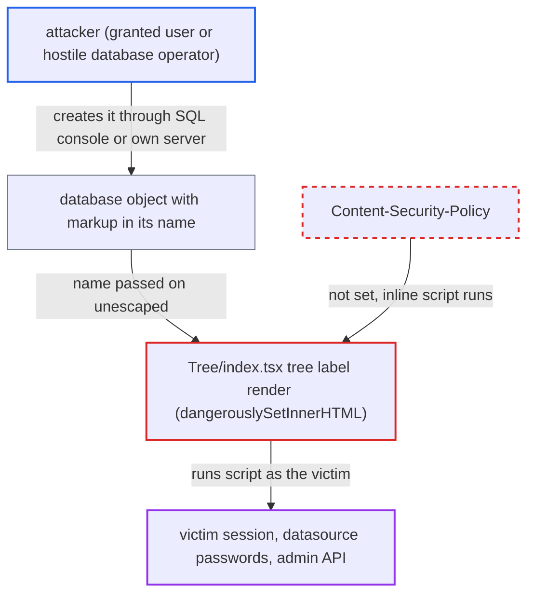

# Stored XSS via database object names rendered as raw HTML in the workspace tree

| Field | Value |
|---|---|
| ID | `find_01HvUvfr1s1W8mKfjDc2a7Hk` |
| Severity | **High** |
| Status | open |
| CWE | CWE-79 — Cross-site scripting |
| Created | 2026-10-21T22:45:29.508722Z |
| Claude Security | https://claude.ai/security/findings/find_01HvUvfr1s1W8mKfjDc2a7Hk |

## Description

A low-privilege user, or the operator of a database a victim connects to, can run script in other Chat2DB users' browsers, admins included. The script can steal the stored passwords of every datasource the victim can see and act with the victim's session. It needs a database object whose name contains HTML. The cause is `Tree/index.tsx:430`, which renders tree node names with `dangerouslySetInnerHTML`.

1. **attacker** creates a database object whose name is an HTML payload. In web/team mode any user granted the shared datasource can run DDL in Chat2DB's SQL console, for example a table named ``. ([`chat2db-server/chat2db-server-domain/chat2db-server-domain-core/src/main/java/ai/chat2db/server/domain/core/impl/DataSourceAccessBusinessServiceImpl.java:35-60`](https://github.com/cx-benchmark/chat2db/blob/43aaee8d48736d74ac888dc4a81ddb50d6550638/chat2db-server/chat2db-server-domain/chat2db-server-domain-core/src/main/java/ai/chat2db/server/domain/core/impl/DataSourceAccessBusinessServiceImpl.java#L35-L60))
2. **backend (`DatabaseServiceImpl.queryAll`, `TableServiceImpl.pageQuery`)** returns the object names unchanged. No HTML encoding is applied to database names from the JDBC driver or table names from the H2 metadata cache. ([`chat2db-server/chat2db-server-domain/chat2db-server-domain-core/src/main/java/ai/chat2db/server/domain/core/impl/DatabaseServiceImpl.java:46-57`](https://github.com/cx-benchmark/chat2db/blob/43aaee8d48736d74ac888dc4a81ddb50d6550638/chat2db-server/chat2db-server-domain/chat2db-server-domain-core/src/main/java/ai/chat2db/server/domain/core/impl/DatabaseServiceImpl.java#L46-L57))
3. **`treeConfig.tsx`** copies each name into the tree node's `name` field. Names of databases, schemas, tables, views, routines, columns, keys and indexes are copied as they are, with no escaping. ([`chat2db-client/src/blocks/Tree/treeConfig.tsx:122-145`](https://github.com/cx-benchmark/chat2db/blob/43aaee8d48736d74ac888dc4a81ddb50d6550638/chat2db-client/src/blocks/Tree/treeConfig.tsx#L122-L145))
4. **victim** opens the shared datasource in the workspace. Selecting a connection loads the database-level names automatically. Table and column names render on routine expand clicks. ([`chat2db-client/src/pages/main/workspace/components/TableList/index.tsx:27-54`](https://github.com/cx-benchmark/chat2db/blob/43aaee8d48736d74ac888dc4a81ddb50d6550638/chat2db-client/src/pages/main/workspace/components/TableList/index.tsx#L27-L54))
5. **`Tree/index.tsx`** writes the node name into the page as HTML. `dangerouslySetInnerHTML={{ __html: treeNodeData.name }}` makes the browser run the payload's `onerror` handler in the Chat2DB origin. ([`chat2db-client/src/blocks/Tree/index.tsx:430`](https://github.com/cx-benchmark/chat2db/blob/43aaee8d48736d74ac888dc4a81ddb50d6550638/chat2db-client/src/blocks/Tree/index.tsx#L430))
6. **injected script** calls the API as the victim and reads datasource credentials. `GET /api/connection/datasource/list` returns the decrypted password of each datasource the victim can see, because `DataSourceWebConverter.dto2vo` keeps `password`. ([`chat2db-server/chat2db-server-domain/chat2db-server-domain-core/src/main/java/ai/chat2db/server/domain/core/converter/DataSourceConverter.java:166`](https://github.com/cx-benchmark/chat2db/blob/43aaee8d48736d74ac888dc4a81ddb50d6550638/chat2db-server/chat2db-server-domain/chat2db-server-domain-core/src/main/java/ai/chat2db/server/domain/core/converter/DataSourceConverter.java#L166))
7. **injected script** sets `localStorage._BaseURL` to persist. `service/base.ts` reads this value on every load, so later API traffic and login submissions go to an attacker host. ([`chat2db-client/src/service/base.ts:52-56`](https://github.com/cx-benchmark/chat2db/blob/43aaee8d48736d74ac888dc4a81ddb50d6550638/chat2db-client/src/service/base.ts#L52-L56))

## Assessment

The attacker is either a low-privilege web/team-mode user granted a shared datasource whose database account can create objects, or the operator of a database a victim connects to (hostile database server). They plant one object with a markup name. Any other user or admin who opens that datasource in the workspace triggers the script, with no further action for database-level names. The server is internet-facing, and the report notes that no Content-Security-Policy is set. Reading the JWT assumes Sa-Token 1.34.0's default `httpOnly=false` for the `CHAT2DB` cookie, but the report says the impact does not depend on that assumption.

Impact: The attacker's script runs as the victim in the Chat2DB origin. It can read plaintext datasource passwords, run SQL on the victim's datasources, and use `/api/admin/**` to create users or grant access when the victim is an admin. It can persist through `localStorage._BaseURL`. Deleting datasources or users is possible but incidental.

Subsequent-system impact: Stolen datasource credentials, and SQL run through the victim's session, reach the customer databases behind Chat2DB. Those databases lie outside Chat2DB's security boundary.

## Recommendation

(1) `Tree/index.tsx:430` treats tree node names, which are untrusted database identifiers, as trusted HTML, so output encoding is lost.

Fix criteria: Tree node labels render as text, so any characters in a database, schema, table, view, routine, column, key or index name show literally. Any future highlighting builds React elements, not HTML strings. To verify, create a MySQL or PostgreSQL table and database named ``. Open and expand the connection with and without a tree search term. The name must show literally and no script may run.

(2) The web app sends no Content-Security-Policy, so any DOM injection can run inline handlers and load remote script. The session cookie is also not HttpOnly.

Fix criteria: Responses that serve the app carry a CSP that forbids inline script and untrusted script origins, and the session cookie is HttpOnly. To verify, check the response headers and confirm that an injected `onerror` handler is blocked.

## Evidence

**https://github.com/cx-benchmark/chat2db**

- [`chat2db-client/src/blocks/Tree/index.tsx:430`](https://github.com/cx-benchmark/chat2db/blob/43aaee8d48736d74ac888dc4a81ddb50d6550638/chat2db-client/src/blocks/Tree/index.tsx#L430)
- [`chat2db-client/src/blocks/Tree/treeConfig.tsx:122-145`](https://github.com/cx-benchmark/chat2db/blob/43aaee8d48736d74ac888dc4a81ddb50d6550638/chat2db-client/src/blocks/Tree/treeConfig.tsx#L122-L145)
- [`chat2db-server/chat2db-server-domain/chat2db-server-domain-core/src/main/java/ai/chat2db/server/domain/core/impl/DatabaseServiceImpl.java:46-57`](https://github.com/cx-benchmark/chat2db/blob/43aaee8d48736d74ac888dc4a81ddb50d6550638/chat2db-server/chat2db-server-domain/chat2db-server-domain-core/src/main/java/ai/chat2db/server/domain/core/impl/DatabaseServiceImpl.java#L46-L57)
- [`chat2db-client/src/pages/main/workspace/components/TableList/index.tsx:27-54`](https://github.com/cx-benchmark/chat2db/blob/43aaee8d48736d74ac888dc4a81ddb50d6550638/chat2db-client/src/pages/main/workspace/components/TableList/index.tsx#L27-L54)
- [`chat2db-server/chat2db-server-domain/chat2db-server-domain-core/src/main/java/ai/chat2db/server/domain/core/impl/DataSourceAccessBusinessServiceImpl.java:35-60`](https://github.com/cx-benchmark/chat2db/blob/43aaee8d48736d74ac888dc4a81ddb50d6550638/chat2db-server/chat2db-server-domain/chat2db-server-domain-core/src/main/java/ai/chat2db/server/domain/core/impl/DataSourceAccessBusinessServiceImpl.java#L35-L60)
- [`chat2db-client/src/blocks/Tree/index.tsx:69-105`](https://github.com/cx-benchmark/chat2db/blob/43aaee8d48736d74ac888dc4a81ddb50d6550638/chat2db-client/src/blocks/Tree/index.tsx#L69-L105)
- [`chat2db-server/chat2db-server-domain/chat2db-server-domain-core/src/main/java/ai/chat2db/server/domain/core/converter/DataSourceConverter.java:166`](https://github.com/cx-benchmark/chat2db/blob/43aaee8d48736d74ac888dc4a81ddb50d6550638/chat2db-server/chat2db-server-domain/chat2db-server-domain-core/src/main/java/ai/chat2db/server/domain/core/converter/DataSourceConverter.java#L166)
- [`chat2db-client/src/service/base.ts:52-56`](https://github.com/cx-benchmark/chat2db/blob/43aaee8d48736d74ac888dc4a81ddb50d6550638/chat2db-client/src/service/base.ts#L52-L56)

