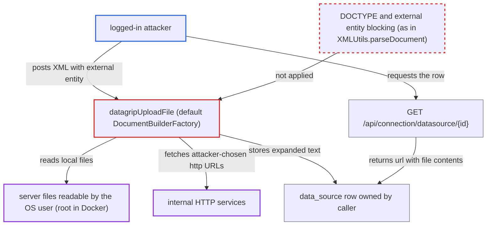

# XXE in DataGrip connection import exposes server files via stored datasource URL

| Field | Value |
|---|---|
| ID | `find_01WvwxiaGxt5QMA93rkcmTkw` |
| Severity | **High** |
| Status | open |
| CWE | CWE-611 — XML external entity injection |
| Created | 2026-10-21T22:45:03.741346Z |
| Claude Security | https://claude.ai/security/findings/find_01WvwxiaGxt5QMA93rkcmTkw |

## Description

A logged-in user of the web or Docker server can read text files from the server's disk as the server's OS user, which is root in the Docker image. The same flaw lets the attacker make the server send HTTP or FTP requests to URLs of their choosing. The cause is `ConverterServiceImpl.datagripUploadFile`, which parses the `text` parameter with a default `DocumentBuilderFactory`, so external entities in the XML are resolved. In-band reads are limited to XML-safe text of 1024 characters or less.

1. **authenticated attacker** posts crafted text to `POST /api/converter/datagrip/upload`. The `text` parameter holds a `<!DOCTYPE>` that declares an entity with a `SYSTEM` identifier such as `file:///etc/passwd`, and a `jdbc-url` element that uses it. Any logged-in web-mode user can reach this path. ([`chat2db-server/chat2db-server-web/chat2db-server-web-api/src/main/java/ai/chat2db/server/web/api/controller/ncx/ConverterController.java:77-80`](https://github.com/cx-benchmark/chat2db/blob/43aaee8d48736d74ac888dc4a81ddb50d6550638/chat2db-server/chat2db-server-web/chat2db-server-web-api/src/main/java/ai/chat2db/server/web/api/controller/ncx/ConverterController.java#L77-L80))
2. **the handler `datagripUploadFile`** accepts the input after two shallow checks. The only checks are that `text` starts with `#DataSourceSettings#` and that a `#BEGIN#` line comes before the XML line, and the payload satisfies both. ([`chat2db-server/chat2db-server-web/chat2db-server-web-api/src/main/java/ai/chat2db/server/web/api/controller/ncx/service/impl/ConverterServiceImpl.java:283-293`](https://github.com/cx-benchmark/chat2db/blob/43aaee8d48736d74ac888dc4a81ddb50d6550638/chat2db-server/chat2db-server-web/chat2db-server-web-api/src/main/java/ai/chat2db/server/web/api/controller/ncx/service/impl/ConverterServiceImpl.java#L283-L293))
3. **the handler `datagripUploadFile`** parses the attacker's XML with `DocumentBuilderFactory.newInstance()` at its defaults. DOCTYPE declarations, external entities and external DTD loading are not disabled, so the parser opens the `file:`, `http:`, `ftp:` or `jar:` target. The hardened `XMLUtils.parseDocument` is not used here. ([`chat2db-server/chat2db-server-web/chat2db-server-web-api/src/main/java/ai/chat2db/server/web/api/controller/ncx/service/impl/ConverterServiceImpl.java:294-302`](https://github.com/cx-benchmark/chat2db/blob/43aaee8d48736d74ac888dc4a81ddb50d6550638/chat2db-server/chat2db-server-web/chat2db-server-web-api/src/main/java/ai/chat2db/server/web/api/controller/ncx/service/impl/ConverterServiceImpl.java#L294-L302))
4. **the handler `datagripUploadFile`** reads `jdbc-url`, `user-name` and `jdbc-driver` with `getTextContent()`. `getTextContent()` returns the entity-expanded text, so the file's contents become the field value. ([`chat2db-server/chat2db-server-web/chat2db-server-web-api/src/main/java/ai/chat2db/server/web/api/controller/ncx/service/impl/ConverterServiceImpl.java:317-320`](https://github.com/cx-benchmark/chat2db/blob/43aaee8d48736d74ac888dc4a81ddb50d6550638/chat2db-server/chat2db-server-web/chat2db-server-web-api/src/main/java/ai/chat2db/server/web/api/controller/ncx/service/impl/ConverterServiceImpl.java#L317-L320))
5. **the handler `datagripUploadFile`** stores the expanded values in a new `data_source` row owned by the caller. The file text is saved through `setUrl(jdbcUrl)`, `setUserName` and `setDriver`. ([`chat2db-server/chat2db-server-web/chat2db-server-web-api/src/main/java/ai/chat2db/server/web/api/controller/ncx/service/impl/ConverterServiceImpl.java:345-351`](https://github.com/cx-benchmark/chat2db/blob/43aaee8d48736d74ac888dc4a81ddb50d6550638/chat2db-server/chat2db-server-web/chat2db-server-web-api/src/main/java/ai/chat2db/server/web/api/controller/ncx/service/impl/ConverterServiceImpl.java#L345-L351))
6. **authenticated attacker** reads the row back through `GET /api/connection/datasource/list` or `/api/connection/datasource/{id}`. The response is a `DataSourceVO` whose `url` field now holds the file contents. ([`chat2db-server/chat2db-server-web/chat2db-server-web-api/src/main/java/ai/chat2db/server/web/api/controller/data/source/DataSourceController.java:171-194`](https://github.com/cx-benchmark/chat2db/blob/43aaee8d48736d74ac888dc4a81ddb50d6550638/chat2db-server/chat2db-server-web/chat2db-server-web-api/src/main/java/ai/chat2db/server/web/api/controller/data/source/DataSourceController.java#L171-L194))

## Assessment

The attacker needs a normal logged-in account on the internet-facing web or Docker server. No admin role and no victim action are needed. The report notes that the path is not in `FRONT_PERMIT_ALL` and is not under `/api/admin/**`. The attacker sends the `text` payload and then reads the stored row back. The report assumes JDK 17 defaults with `javax.xml.accessExternalDTD=all`, because the repo sets no `jdk.xml` or `accessExternal*` property. Files larger than the in-band limit can be pulled by two other routes. One is error-based extraction, since `DefaultExceptionConvertor` returns the full stack trace to the client. The other is an attacker-hosted external DTD. The parser also fetches `http://` system identifiers, so the request works as server-side request forgery (SSRF).

Impact: The attacker can read any text file the server process can read. Examples are `/etc/passwd`, `/etc/shadow`, files under `~/.chat2db`, resources inside the application jar via `jar:file:` URLs, and SSH private-key files that other datasources point to. In-band reads are limited to 1024 characters (the `url` column is `varchar(1024)`) and to content that parses as XML text. Binary files such as the H2 database or `/proc/self/environ` cannot be read this way. The report finds no write or availability impact.

Subsequent-system impact: The server sends HTTP or FTP requests to URLs the attacker chooses. Short text responses, for example from internal HTTP services, are stored and returned in-band. This exposes data from systems on the server's network that the attacker cannot reach directly. It is read access only.

## Recommendation

`datagripUploadFile` parses untrusted request text with a default `DocumentBuilderFactory`. DOCTYPE and external entity declarations in the input are therefore honoured, and the expanded file or URL content is stored and returned to the caller.

Fix criteria: The parser for the DataGrip text rejects DOCTYPE declarations. At minimum it disables external general and parameter entities and external DTD loading, with secure processing on. An input containing `<!DOCTYPE ... SYSTEM "file:///etc/passwd">` fails to parse without any file access. An input with an `http://` system identifier fails to parse without any network access. No `data_source` row is created with the file contents.

## Evidence

**https://github.com/cx-benchmark/chat2db**

- [`chat2db-server/chat2db-server-web/chat2db-server-web-api/src/main/java/ai/chat2db/server/web/api/controller/ncx/service/impl/ConverterServiceImpl.java:294-302`](https://github.com/cx-benchmark/chat2db/blob/43aaee8d48736d74ac888dc4a81ddb50d6550638/chat2db-server/chat2db-server-web/chat2db-server-web-api/src/main/java/ai/chat2db/server/web/api/controller/ncx/service/impl/ConverterServiceImpl.java#L294-L302)
- [`chat2db-server/chat2db-server-web/chat2db-server-web-api/src/main/java/ai/chat2db/server/web/api/controller/ncx/service/impl/ConverterServiceImpl.java:283-293`](https://github.com/cx-benchmark/chat2db/blob/43aaee8d48736d74ac888dc4a81ddb50d6550638/chat2db-server/chat2db-server-web/chat2db-server-web-api/src/main/java/ai/chat2db/server/web/api/controller/ncx/service/impl/ConverterServiceImpl.java#L283-L293)
- [`chat2db-server/chat2db-server-web/chat2db-server-web-api/src/main/java/ai/chat2db/server/web/api/controller/ncx/service/impl/ConverterServiceImpl.java:317-320`](https://github.com/cx-benchmark/chat2db/blob/43aaee8d48736d74ac888dc4a81ddb50d6550638/chat2db-server/chat2db-server-web/chat2db-server-web-api/src/main/java/ai/chat2db/server/web/api/controller/ncx/service/impl/ConverterServiceImpl.java#L317-L320)
- [`chat2db-server/chat2db-server-web/chat2db-server-web-api/src/main/java/ai/chat2db/server/web/api/controller/ncx/service/impl/ConverterServiceImpl.java:345-351`](https://github.com/cx-benchmark/chat2db/blob/43aaee8d48736d74ac888dc4a81ddb50d6550638/chat2db-server/chat2db-server-web/chat2db-server-web-api/src/main/java/ai/chat2db/server/web/api/controller/ncx/service/impl/ConverterServiceImpl.java#L345-L351)
- [`chat2db-server/chat2db-server-web/chat2db-server-web-api/src/main/java/ai/chat2db/server/web/api/controller/ncx/ConverterController.java:77-80`](https://github.com/cx-benchmark/chat2db/blob/43aaee8d48736d74ac888dc4a81ddb50d6550638/chat2db-server/chat2db-server-web/chat2db-server-web-api/src/main/java/ai/chat2db/server/web/api/controller/ncx/ConverterController.java#L77-L80)
- [`chat2db-server/chat2db-server-web/chat2db-server-web-api/src/main/java/ai/chat2db/server/web/api/controller/data/source/DataSourceController.java:171-194`](https://github.com/cx-benchmark/chat2db/blob/43aaee8d48736d74ac888dc4a81ddb50d6550638/chat2db-server/chat2db-server-web/chat2db-server-web-api/src/main/java/ai/chat2db/server/web/api/controller/data/source/DataSourceController.java#L171-L194)
- [`chat2db-server/chat2db-server-domain/chat2db-server-domain-repository/src/main/resources/db/migration/V1_0_0__初始化信息.sql:6`](https://github.com/cx-benchmark/chat2db/blob/43aaee8d48736d74ac888dc4a81ddb50d6550638/chat2db-server/chat2db-server-domain/chat2db-server-domain-repository/src/main/resources/db/migration/V1_0_0__初始化信息.sql#L6)
- [`chat2db-server/chat2db-server-web-start/src/main/java/ai/chat2db/server/web/start/exception/convertor/DefaultExceptionConvertor.java:16-20`](https://github.com/cx-benchmark/chat2db/blob/43aaee8d48736d74ac888dc4a81ddb50d6550638/chat2db-server/chat2db-server-web-start/src/main/java/ai/chat2db/server/web/start/exception/convertor/DefaultExceptionConvertor.java#L16-L20)

