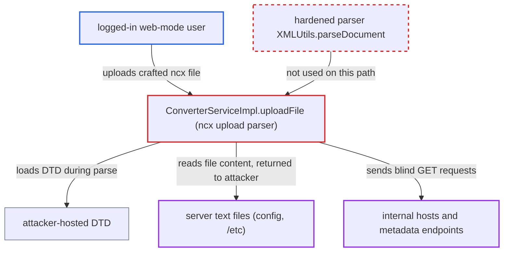

# XXE in Navicat .ncx upload: uploaded XML parsed with default DocumentBuilderFactory

| Field | Value |
|---|---|
| ID | `find_01VYrswokvq8wbJaaikBDzTM` |
| Severity | **High** |
| Status | open |
| CWE | CWE-611 — XML external entity injection |
| Created | 2026-10-21T22:45:29.445269Z |
| Claude Security | https://claude.ai/security/findings/find_01VYrswokvq8wbJaaikBDzTM |

## Description

Any logged-in user of the web-mode server can make it fetch URLs of their choice. They can also read XML-legal text files the server process can read, such as configuration files and `/etc/*`. Binary files such as the H2 store cannot be read. The cause is `ConverterServiceImpl.uploadFile`, which parses the uploaded `.ncx` file with a default `DocumentBuilderFactory` that resolves DOCTYPE, external entities and external DTDs.

1. **logged-in attacker** uploads a crafted `.ncx` file to `POST /api/converter/ncx/upload`. Login is the only gate on `/api/converter/**`, and the admin-role check covers only `/api/admin/**` and `/admin/**`, so a low-privilege user can reach the endpoint. ([`chat2db-server/chat2db-server-web-start/src/main/java/ai/chat2db/server/web/start/config/config/Chat2dbWebMvcConfigurer.java:134-182`](https://github.com/cx-benchmark/chat2db/blob/43aaee8d48736d74ac888dc4a81ddb50d6550638/chat2db-server/chat2db-server-web-start/src/main/java/ai/chat2db/server/web/start/config/config/Chat2dbWebMvcConfigurer.java#L134-L182))
2. **the controller `ConverterController`** accepts the file and passes it to `uploadFile`. The only check is that the original filename ends in `.ncx`. The body is saved as `CONFIG_BASE_PATH/<uuid>.tmp` and its content is not inspected. ([`chat2db-server/chat2db-server-web/chat2db-server-web-api/src/main/java/ai/chat2db/server/web/api/controller/ncx/ConverterController.java:42-53`](https://github.com/cx-benchmark/chat2db/blob/43aaee8d48736d74ac888dc4a81ddb50d6550638/chat2db-server/chat2db-server-web/chat2db-server-web-api/src/main/java/ai/chat2db/server/web/api/controller/ncx/ConverterController.java#L42-L53))
3. **`ConverterServiceImpl.uploadFile`** parses the file with an unhardened `DocumentBuilderFactory`. No `disallow-doctype-decl`, no secure processing and no limit on external entities or DTDs is set, so the DOCTYPE written by the attacker is honoured. ([`chat2db-server/chat2db-server-web/chat2db-server-web-api/src/main/java/ai/chat2db/server/web/api/controller/ncx/service/impl/ConverterServiceImpl.java:104-109`](https://github.com/cx-benchmark/chat2db/blob/43aaee8d48736d74ac888dc4a81ddb50d6550638/chat2db-server/chat2db-server-web/chat2db-server-web-api/src/main/java/ai/chat2db/server/web/api/controller/ncx/service/impl/ConverterServiceImpl.java#L104-L109))
4. **the XML parser** fetches the attacker's `SYSTEM` URL and the DTD it points to, and loads the `file:` entity. The fetch itself is a blind server-side request, and the DTD can wrap file content in an internal entity used in an attribute. ([`chat2db-server/chat2db-server-web/chat2db-server-web-api/src/main/java/ai/chat2db/server/web/api/controller/ncx/service/impl/ConverterServiceImpl.java:104-109`](https://github.com/cx-benchmark/chat2db/blob/43aaee8d48736d74ac888dc4a81ddb50d6550638/chat2db-server/chat2db-server-web/chat2db-server-web-api/src/main/java/ai/chat2db/server/web/api/controller/ncx/service/impl/ConverterServiceImpl.java#L104-L109))
5. **`uploadFile`** reads attribute values such as `Ver`, `Host`, `UserName` and `ConnectionName` with their entities expanded. `Ver` goes to `Double.parseDouble`, which fails and echoes the value. The `Connection` attributes are put in a map for storage. ([`chat2db-server/chat2db-server-web/chat2db-server-web-api/src/main/java/ai/chat2db/server/web/api/controller/ncx/service/impl/ConverterServiceImpl.java:113-137`](https://github.com/cx-benchmark/chat2db/blob/43aaee8d48736d74ac888dc4a81ddb50d6550638/chat2db-server/chat2db-server-web/chat2db-server-web-api/src/main/java/ai/chat2db/server/web/api/controller/ncx/service/impl/ConverterServiceImpl.java#L113-L137))
6. **`DefaultExceptionConvertor`** returns the stack trace, including the leaked content, in `errorDetail`. `uploadFile` wraps every failure in `RuntimeException`, and the converter sends its full stack trace to the caller. ([`chat2db-server/chat2db-server-web-start/src/main/java/ai/chat2db/server/web/start/exception/convertor/DefaultExceptionConvertor.java:16-20`](https://github.com/cx-benchmark/chat2db/blob/43aaee8d48736d74ac888dc4a81ddb50d6550638/chat2db-server/chat2db-server-web-start/src/main/java/ai/chat2db/server/web/start/exception/convertor/DefaultExceptionConvertor.java#L16-L20))
7. **`insertDBConfig`** stores the expanded values in a `data_source` row owned by the caller. The attacker then reads them back through `GET /api/connection/datasource/list`, which returns `alias`, `host`, `port`, `user` and `url`. ([`chat2db-server/chat2db-server-web/chat2db-server-web-api/src/main/java/ai/chat2db/server/web/api/controller/ncx/service/impl/ConverterServiceImpl.java:375-415`](https://github.com/cx-benchmark/chat2db/blob/43aaee8d48736d74ac888dc4a81ddb50d6550638/chat2db-server/chat2db-server-web/chat2db-server-web-api/src/main/java/ai/chat2db/server/web/api/controller/ncx/service/impl/ConverterServiceImpl.java#L375-L415))

## Assessment

The attacker needs a login to a web-mode server and nothing more. Admin rights are not required. The attacker uploads an `.ncx` file with a DOCTYPE that points to an `http://` DTD they host. That DTD defines a `%f` entity for a `file:///...` path and an internal entity `data` holding it, and the file uses `&data;` in `Ver` or in `Host`, `UserName` or `ConnectionName`. The content then comes back in the `errorDetail` stack trace (the `Ver` route) or is stored by `insertDBConfig` and listed by `GET /api/connection/datasource/list`. Another route is an out-of-band leak, where the DTD sends a `file:` parameter entity inside a URL to the attacker's host. A fourth route is an error-based leak through a failing `file:` URI. A blind server-side request needs only a `SYSTEM` URL, such as `http://169.254.169.254/...` or an intranet host. XML forbids direct external entity references in attributes. So the file-read routes need a DTD that the server loads, normally attacker-hosted.

Impact: The attacker can read any XML-legal text file the server process can read, and the Docker image runs as root. Binary files such as the H2 credential store cannot be read this way. Nothing is written, and entity-expansion denial of service is capped by JDK limits.

Subsequent-system impact: The server sends GET requests to attacker-chosen URLs, so it can reach internal services and metadata endpoints behind its network boundary. Only blind requests or limited reads are possible there.

## Recommendation

The uploaded `.ncx` XML is parsed in `ConverterServiceImpl.uploadFile` with a default `DocumentBuilderFactory`. DOCTYPE, external DTDs and external entities written by the uploader are therefore resolved by the server.

Fix criteria: Parsing the `.ncx` upload rejects DOCTYPE declarations. Alternatively it disables external general and parameter entities and external DTD loading, with secure processing on, for example by using the hardened `XMLUtils.parseDocument`. Test it by uploading an `.ncx` that uses an `http://` parameter entity and a `file:///` entity through an external DTD. The parse must fail with no outbound request and no file access. No file content may be stored or returned in `errorDetail`.

## Evidence

**https://github.com/cx-benchmark/chat2db**

- [`chat2db-server/chat2db-server-web/chat2db-server-web-api/src/main/java/ai/chat2db/server/web/api/controller/ncx/service/impl/ConverterServiceImpl.java:104-109`](https://github.com/cx-benchmark/chat2db/blob/43aaee8d48736d74ac888dc4a81ddb50d6550638/chat2db-server/chat2db-server-web/chat2db-server-web-api/src/main/java/ai/chat2db/server/web/api/controller/ncx/service/impl/ConverterServiceImpl.java#L104-L109)
- [`chat2db-server/chat2db-server-web/chat2db-server-web-api/src/main/java/ai/chat2db/server/web/api/controller/ncx/service/impl/ConverterServiceImpl.java:113-137`](https://github.com/cx-benchmark/chat2db/blob/43aaee8d48736d74ac888dc4a81ddb50d6550638/chat2db-server/chat2db-server-web/chat2db-server-web-api/src/main/java/ai/chat2db/server/web/api/controller/ncx/service/impl/ConverterServiceImpl.java#L113-L137)
- [`chat2db-server/chat2db-server-web/chat2db-server-web-api/src/main/java/ai/chat2db/server/web/api/controller/ncx/service/impl/ConverterServiceImpl.java:375-415`](https://github.com/cx-benchmark/chat2db/blob/43aaee8d48736d74ac888dc4a81ddb50d6550638/chat2db-server/chat2db-server-web/chat2db-server-web-api/src/main/java/ai/chat2db/server/web/api/controller/ncx/service/impl/ConverterServiceImpl.java#L375-L415)
- [`chat2db-server/chat2db-server-web/chat2db-server-web-api/src/main/java/ai/chat2db/server/web/api/controller/ncx/ConverterController.java:42-53`](https://github.com/cx-benchmark/chat2db/blob/43aaee8d48736d74ac888dc4a81ddb50d6550638/chat2db-server/chat2db-server-web/chat2db-server-web-api/src/main/java/ai/chat2db/server/web/api/controller/ncx/ConverterController.java#L42-L53)
- [`chat2db-server/chat2db-server-web-start/src/main/java/ai/chat2db/server/web/start/config/config/Chat2dbWebMvcConfigurer.java:134-182`](https://github.com/cx-benchmark/chat2db/blob/43aaee8d48736d74ac888dc4a81ddb50d6550638/chat2db-server/chat2db-server-web-start/src/main/java/ai/chat2db/server/web/start/config/config/Chat2dbWebMvcConfigurer.java#L134-L182)
- [`chat2db-server/chat2db-server-web/chat2db-server-web-api/src/main/java/ai/chat2db/server/web/api/controller/data/source/DataSourceController.java:171-177`](https://github.com/cx-benchmark/chat2db/blob/43aaee8d48736d74ac888dc4a81ddb50d6550638/chat2db-server/chat2db-server-web/chat2db-server-web-api/src/main/java/ai/chat2db/server/web/api/controller/data/source/DataSourceController.java#L171-L177)
- [`chat2db-server/chat2db-server-web-start/src/main/java/ai/chat2db/server/web/start/exception/convertor/DefaultExceptionConvertor.java:16-20`](https://github.com/cx-benchmark/chat2db/blob/43aaee8d48736d74ac888dc4a81ddb50d6550638/chat2db-server/chat2db-server-web-start/src/main/java/ai/chat2db/server/web/start/exception/convertor/DefaultExceptionConvertor.java#L16-L20)
- [`chat2db-server/chat2db-server-web/chat2db-server-web-api/src/main/java/ai/chat2db/server/web/api/util/XMLUtils.java:63-73`](https://github.com/cx-benchmark/chat2db/blob/43aaee8d48736d74ac888dc4a81ddb50d6550638/chat2db-server/chat2db-server-web/chat2db-server-web-api/src/main/java/ai/chat2db/server/web/api/util/XMLUtils.java#L63-L73)

