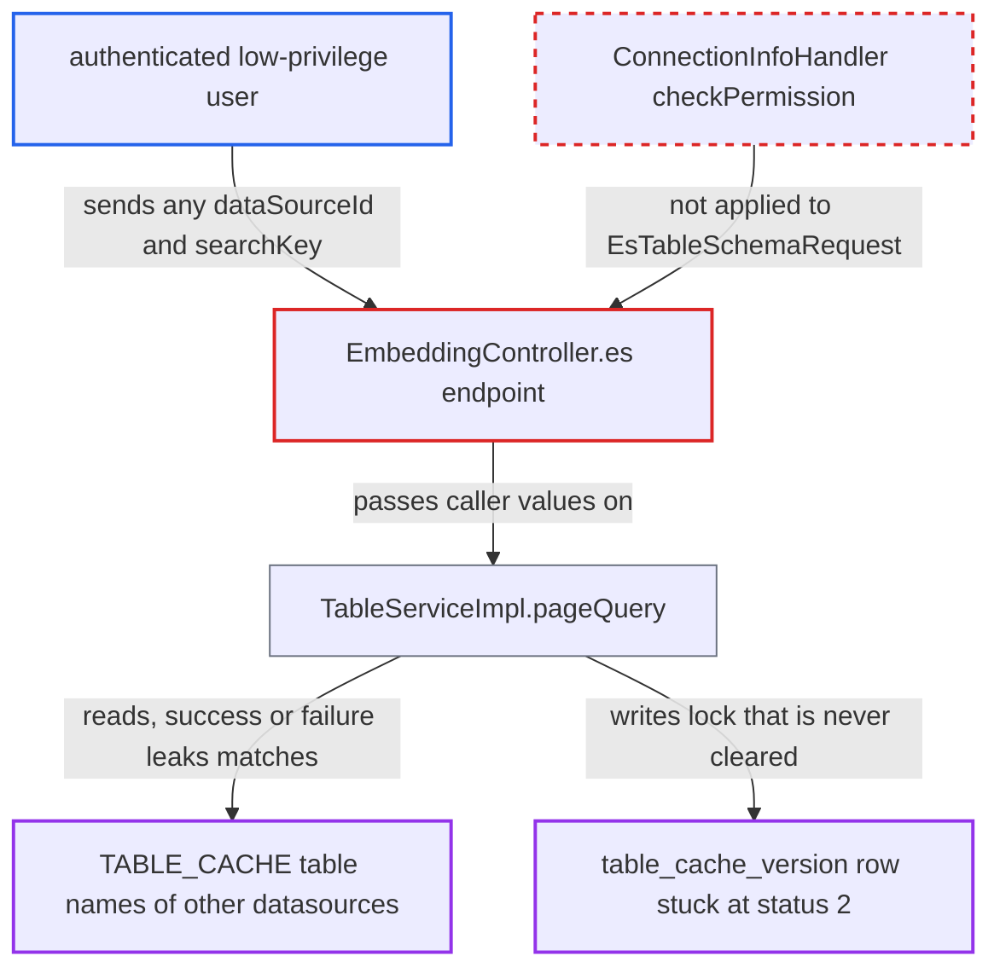

# ES embedding endpoint skips datasource access check: table-name oracle and table-cache poisoning

| Field | Value |
|---|---|
| ID | `find_01QE6nvL1DRUrtWF5jUCRyB7` |
| Severity | **Medium** |
| Status | open |
| CWE | CWE-862 — Missing authorization |
| Created | 2026-10-21T22:46:05.995675Z |
| Claude Security | https://claude.ai/security/findings/find_01QE6nvL1DRUrtWF5jUCRyB7 |

## Description

A logged-in low-privilege user can learn the names of cached tables in datasources they have no grant on. They can also blank the table list that authorized users see for those datasources. The endpoint `/api/ai/embedding/datasource/es` takes its `dataSourceId` through `EsTableSchemaRequest`, a type the `ConnectionInfoHandler` aspect does not recognise, so `checkPermission` never runs. Table DDL is not disclosed.

1. **authenticated low-privilege user** posts to `/api/ai/embedding/datasource/es` with a `dataSourceId` they have no grant on. The handler `EmbeddingController.es` binds `dataSourceId`, `databaseName`, `schemaName` and `searchKey` from the caller into `EsTableSchemaRequest`, and the ids are sequential and easy to guess. ([`chat2db-server/chat2db-server-web/chat2db-server-web-api/src/main/java/ai/chat2db/server/web/api/controller/ai/EmbeddingController.java:163-182`](https://github.com/cx-benchmark/chat2db/blob/43aaee8d48736d74ac888dc4a81ddb50d6550638/chat2db-server/chat2db-server-web/chat2db-server-web-api/src/main/java/ai/chat2db/server/web/api/controller/ai/EmbeddingController.java#L163-L182))
2. **aspect `ConnectionInfoHandler`** lets the call through without checking access. `EsTableSchemaRequest` matches none of the three `instanceof` branches, so `dataSourceAccessBusinessService.checkPermission` is not called and no `Chat2DBContext` is installed. ([`chat2db-server/chat2db-server-web/chat2db-server-web-api/src/main/java/ai/chat2db/server/web/api/aspect/ConnectionInfoHandler.java:38-76`](https://github.com/cx-benchmark/chat2db/blob/43aaee8d48736d74ac888dc4a81ddb50d6550638/chat2db-server/chat2db-server-web/chat2db-server-web-api/src/main/java/ai/chat2db/server/web/api/aspect/ConnectionInfoHandler.java#L38-L76))
3. **`TableServiceImpl.pageQuery`** reads the shared `TABLE_CACHE` when a `table_cache_version` row already exists for the key. The query in `TableCacheMapper.xml` has no version filter, filters only on the caller's ids, and matches `searchKey` with an unescaped `LIKE`; leaving out `databaseName` and `schemaName` searches the whole datasource. ([`chat2db-server/chat2db-server-domain/chat2db-server-domain-repository/src/main/resources/mapper/TableCacheMapper.xml:14-30`](https://github.com/cx-benchmark/chat2db/blob/43aaee8d48736d74ac888dc4a81ddb50d6550638/chat2db-server/chat2db-server-domain/chat2db-server-domain-repository/src/main/resources/mapper/TableCacheMapper.xml#L14-L30))
4. **handler `EmbeddingController.es`** returns success or failure depending on whether any cached table name matched. No match returns success. A match leads to `showCreateTable`, which throws on the missing context, so the caller sees a failure; repeated guesses recover table names piece by piece. ([`chat2db-server/chat2db-server-domain/chat2db-server-domain-core/src/main/java/ai/chat2db/server/domain/core/impl/TableServiceImpl.java:82-84`](https://github.com/cx-benchmark/chat2db/blob/43aaee8d48736d74ac888dc4a81ddb50d6550638/chat2db-server/chat2db-server-domain/chat2db-server-domain-core/src/main/java/ai/chat2db/server/domain/core/impl/TableServiceImpl.java#L82-L84))
5. **`TableServiceImpl.getLock`** commits a `table_cache_version` row with status `"2"` when no row exists for the key. The insert goes through an autocommit session, so it is stored at once. This is also the single priming request that makes the read oracle work for that key. ([`chat2db-server/chat2db-server-domain/chat2db-server-domain-core/src/main/java/ai/chat2db/server/domain/core/impl/TableServiceImpl.java:464-480`](https://github.com/cx-benchmark/chat2db/blob/43aaee8d48736d74ac888dc4a81ddb50d6550638/chat2db-server/chat2db-server-domain/chat2db-server-domain-core/src/main/java/ai/chat2db/server/domain/core/impl/TableServiceImpl.java#L464-L480))
6. **`TableServiceImpl.addDBCache`** throws a null pointer error and leaves the lock row at status `"2"`. With no `Chat2DBContext`, `Chat2DBContext.getConnection()` fails, so the row is never moved to `"1"`. ([`chat2db-server/chat2db-server-domain/chat2db-server-domain-core/src/main/java/ai/chat2db/server/domain/core/impl/TableServiceImpl.java:421-424`](https://github.com/cx-benchmark/chat2db/blob/43aaee8d48736d74ac888dc4a81ddb50d6550638/chat2db-server/chat2db-server-domain/chat2db-server-domain-core/src/main/java/ai/chat2db/server/domain/core/impl/TableServiceImpl.java#L421-L424))
7. **`TableServiceImpl.queryTables`** treats the stuck status `"2"` as version `-1` and returns no tables to authorized users. Nothing was cached, so non-refresh `pageQuery` finds no rows either; the list stays empty until someone sends `refresh=true`, and the frontend default is `refresh: false`. ([`chat2db-server/chat2db-server-domain/chat2db-server-domain-core/src/main/java/ai/chat2db/server/domain/core/impl/TableServiceImpl.java:384-396`](https://github.com/cx-benchmark/chat2db/blob/43aaee8d48736d74ac888dc4a81ddb50d6550638/chat2db-server/chat2db-server-domain/chat2db-server-domain-core/src/main/java/ai/chat2db/server/domain/core/impl/TableServiceImpl.java#L384-L396))

## Assessment

The attacker is an authenticated low-privilege user of the web-mode instance, which the threat model treats as internet-facing. They need no grant on the target datasource. They POST `/api/ai/embedding/datasource/es?dataSourceId=N`. The first call creates the stuck status-2 row for key `tables_dataSourceId_N`. Each later call with `searchKey=<guess>` returns success if no cached table name contains the guess and failure if one does. The caller also controls the `%` and `_` wildcards in the `LIKE`. Aiming at a database or schema key that is not cached yet leaves a stuck lock that empties the table list for its owners. Table names can only be read from datasources whose owner has browsed them, because only then is there a cache.

Impact: The attacker learns the names of cached tables in datasources they were not granted, which breaks isolation between users. They get metadata only: no comments, DDL, row data or credentials. They can also write `table_cache_version` rows under other users' keys and hide tables from authorized users until a manual refresh. Availability is not otherwise affected, because the `addCache` wait loop is bounded at 100×200 ms.

## Recommendation

(1) `EmbeddingController.es` takes a datasource identifier in `EsTableSchemaRequest`, which the `ConnectionInfoHandler` aspect does not recognise. Cache reads and cache-lock writes therefore run without `dataSourceAccessBusinessService.checkPermission`.

Fix criteria: Every handler that receives a `dataSourceId` checks the caller's access to that datasource before any service call that reads or writes datasource-scoped state, or the unused endpoint is removed. A user with no grant on datasource N calls `/api/ai/embedding/datasource/es` with `dataSourceId=N` and gets a permission-denied response whatever `searchKey` they send. No `table_cache_version` row is created.

(2) `TableServiceImpl.addCache` leaves the `table_cache_version` lock in status `"2"` when `addDBCache` throws. One failed refresh then blanks the table listing for every user until someone refreshes manually.

Fix criteria: A failed cache rebuild does not leave the version row in the in-progress state. It is rolled back, or marked failed and retried on the next read. After an exception inside `addDBCache`, the next `queryTables` or `pageQuery` for the same key rebuilds the cache and does not return an empty list.

## Evidence

**https://github.com/cx-benchmark/chat2db**

- [`chat2db-server/chat2db-server-web/chat2db-server-web-api/src/main/java/ai/chat2db/server/web/api/controller/ai/EmbeddingController.java:163-182`](https://github.com/cx-benchmark/chat2db/blob/43aaee8d48736d74ac888dc4a81ddb50d6550638/chat2db-server/chat2db-server-web/chat2db-server-web-api/src/main/java/ai/chat2db/server/web/api/controller/ai/EmbeddingController.java#L163-L182)
- [`chat2db-server/chat2db-server-web/chat2db-server-web-api/src/main/java/ai/chat2db/server/web/api/http/request/EsTableSchemaRequest.java:12-29`](https://github.com/cx-benchmark/chat2db/blob/43aaee8d48736d74ac888dc4a81ddb50d6550638/chat2db-server/chat2db-server-web/chat2db-server-web-api/src/main/java/ai/chat2db/server/web/api/http/request/EsTableSchemaRequest.java#L12-L29)
- [`chat2db-server/chat2db-server-web/chat2db-server-web-api/src/main/java/ai/chat2db/server/web/api/aspect/ConnectionInfoHandler.java:38-76`](https://github.com/cx-benchmark/chat2db/blob/43aaee8d48736d74ac888dc4a81ddb50d6550638/chat2db-server/chat2db-server-web/chat2db-server-web-api/src/main/java/ai/chat2db/server/web/api/aspect/ConnectionInfoHandler.java#L38-L76)
- [`chat2db-server/chat2db-server-domain/chat2db-server-domain-core/src/main/java/ai/chat2db/server/domain/core/impl/TableServiceImpl.java:315-348`](https://github.com/cx-benchmark/chat2db/blob/43aaee8d48736d74ac888dc4a81ddb50d6550638/chat2db-server/chat2db-server-domain/chat2db-server-domain-core/src/main/java/ai/chat2db/server/domain/core/impl/TableServiceImpl.java#L315-L348)
- [`chat2db-server/chat2db-server-domain/chat2db-server-domain-repository/src/main/resources/mapper/TableCacheMapper.xml:14-30`](https://github.com/cx-benchmark/chat2db/blob/43aaee8d48736d74ac888dc4a81ddb50d6550638/chat2db-server/chat2db-server-domain/chat2db-server-domain-repository/src/main/resources/mapper/TableCacheMapper.xml#L14-L30)
- [`chat2db-server/chat2db-server-domain/chat2db-server-domain-core/src/main/java/ai/chat2db/server/domain/core/impl/TableServiceImpl.java:82-84`](https://github.com/cx-benchmark/chat2db/blob/43aaee8d48736d74ac888dc4a81ddb50d6550638/chat2db-server/chat2db-server-domain/chat2db-server-domain-core/src/main/java/ai/chat2db/server/domain/core/impl/TableServiceImpl.java#L82-L84)
- [`chat2db-server/chat2db-server-domain/chat2db-server-domain-core/src/main/java/ai/chat2db/server/domain/core/impl/TableServiceImpl.java:464-480`](https://github.com/cx-benchmark/chat2db/blob/43aaee8d48736d74ac888dc4a81ddb50d6550638/chat2db-server/chat2db-server-domain/chat2db-server-domain-core/src/main/java/ai/chat2db/server/domain/core/impl/TableServiceImpl.java#L464-L480)
- [`chat2db-server/chat2db-server-domain/chat2db-server-domain-core/src/main/java/ai/chat2db/server/domain/core/impl/TableServiceImpl.java:421-424`](https://github.com/cx-benchmark/chat2db/blob/43aaee8d48736d74ac888dc4a81ddb50d6550638/chat2db-server/chat2db-server-domain/chat2db-server-domain-core/src/main/java/ai/chat2db/server/domain/core/impl/TableServiceImpl.java#L421-L424)
- [`chat2db-server/chat2db-server-domain/chat2db-server-domain-core/src/main/java/ai/chat2db/server/domain/core/impl/TableServiceImpl.java:384-396`](https://github.com/cx-benchmark/chat2db/blob/43aaee8d48736d74ac888dc4a81ddb50d6550638/chat2db-server/chat2db-server-domain/chat2db-server-domain-core/src/main/java/ai/chat2db/server/domain/core/impl/TableServiceImpl.java#L384-L396)

