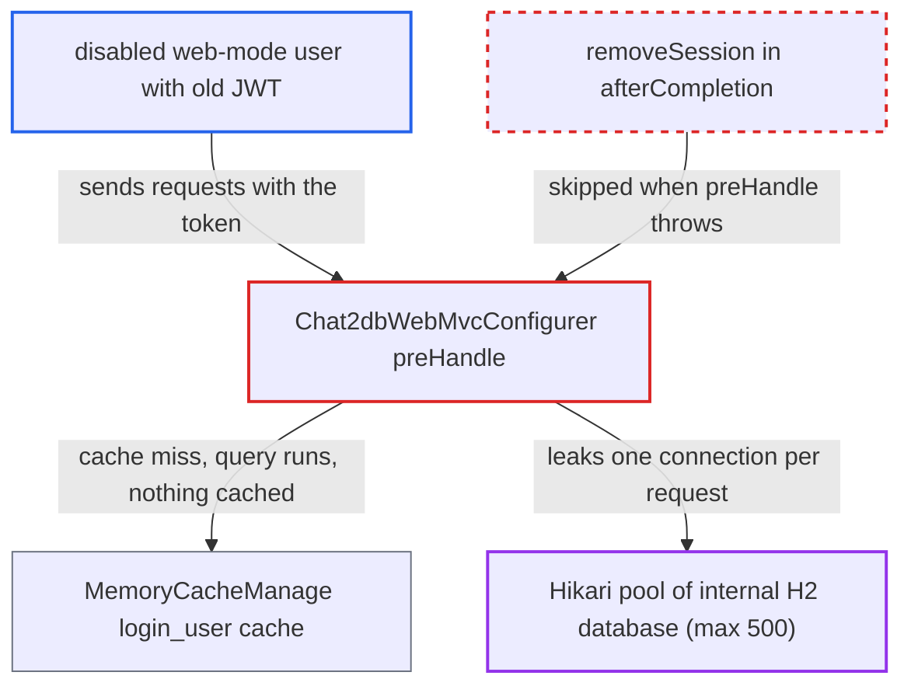

# Login interceptor leaks a pooled H2 connection on every request with a disabled user's token

| Field | Value |
|---|---|
| ID | `find_01DzMUapHiyU2VFPqNCt7ygf` |
| Severity | **Medium** |
| Status | open |
| CWE | CWE-772 — Resource leak |
| Created | 2026-10-21T23:01:29.370065Z |
| Claude Security | https://claude.ai/security/findings/find_01DzMUapHiyU2VFPqNCt7ygf |

## Description

A web-mode user whose account an admin disabled can make the Chat2db server stop working for everyone. Each request with their old token leaks one database connection, and about 500 requests use up the pool. It needs the token's `login_user_<id>` cache entry to be absent. The cause is that `Chat2dbWebMvcConfigurer.preHandle` throws before `Dbutils.removeSession()` can run.

1. **disabled user** sends a request with a still-valid `CHAT2DB` token. The token is a stateless JWT with a 30-day timeout, and the `StpUtil.logout()` call in the interceptor does not revoke it. ([`chat2db-server/chat2db-server-web-start/src/main/java/ai/chat2db/server/web/start/config/oauth/SaTokenConfigure.java:15-20`](https://github.com/cx-benchmark/chat2db/blob/43aaee8d48736d74ac888dc4a81ddb50d6550638/chat2db-server/chat2db-server-web-start/src/main/java/ai/chat2db/server/web/start/config/oauth/SaTokenConfigure.java#L15-L20))
2. **the interceptor in `Chat2dbWebMvcConfigurer`** calls `Dbutils.setSession()` at the start of `preHandle`. This puts a MyBatis `SqlSession` in a `ThreadLocal`. The session does not hold a connection yet. ([`chat2db-server/chat2db-server-web-start/src/main/java/ai/chat2db/server/web/start/config/config/Chat2dbWebMvcConfigurer.java:74-119`](https://github.com/cx-benchmark/chat2db/blob/43aaee8d48736d74ac888dc4a81ddb50d6550638/chat2db-server/chat2db-server-web-start/src/main/java/ai/chat2db/server/web/start/config/config/Chat2dbWebMvcConfigurer.java#L74-L119))
3. **the `MemoryCacheManage.computeIfAbsent` lambda** calls `userService.query()` on a cache miss for `login_user_<id>`. `DbhubUserMapper.selectById` runs on the thread-local session. That checks out a HikariCP connection, which the session keeps until `close()`. ([`chat2db-server/chat2db-server-domain/chat2db-server-domain-core/src/main/java/ai/chat2db/server/domain/core/impl/UserServiceImpl.java:52-68`](https://github.com/cx-benchmark/chat2db/blob/43aaee8d48736d74ac888dc4a81ddb50d6550638/chat2db-server/chat2db-server-domain/chat2db-server-domain-core/src/main/java/ai/chat2db/server/domain/core/impl/UserServiceImpl.java#L52-L68))
4. **the cache lambda** throws `BusinessException("oauth.invalidUserName")` because `status` is not `VALID`. The throw leaves `preHandle` by exception, so nothing is cached and the next request with the same token repeats the query. ([`chat2db-server/chat2db-server-domain/chat2db-server-domain-core/src/main/java/ai/chat2db/server/domain/core/cache/MemoryCacheManage.java:24-59`](https://github.com/cx-benchmark/chat2db/blob/43aaee8d48736d74ac888dc4a81ddb50d6550638/chat2db-server/chat2db-server-domain/chat2db-server-domain-core/src/main/java/ai/chat2db/server/domain/core/cache/MemoryCacheManage.java#L24-L59))
5. **Spring's `HandlerExecutionChain`** skips `afterCompletion` for this interceptor. An interceptor's index is recorded only after its `preHandle` returns. `removeSession()` is called only from `afterCompletion`, so the session is never closed. ([`chat2db-server/chat2db-server-web-start/src/main/java/ai/chat2db/server/web/start/config/config/Chat2dbWebMvcConfigurer.java:121-127`](https://github.com/cx-benchmark/chat2db/blob/43aaee8d48736d74ac888dc4a81ddb50d6550638/chat2db-server/chat2db-server-web-start/src/main/java/ai/chat2db/server/web/start/config/config/Chat2dbWebMvcConfigurer.java#L121-L127))
6. **`Dbutils.setSession()`** overwrites the old session on the next request on that thread. The previous session is dropped without being closed, so its connection is never returned to the pool. ([`chat2db-server/chat2db-server-domain/chat2db-server-domain-repository/src/main/java/ai/chat2db/server/domain/repository/Dbutils.java:46-57`](https://github.com/cx-benchmark/chat2db/blob/43aaee8d48736d74ac888dc4a81ddb50d6550638/chat2db-server/chat2db-server-domain/chat2db-server-domain-repository/src/main/java/ai/chat2db/server/domain/repository/Dbutils.java#L46-L57))
7. **HikariCP pool** runs out of connections after about 500 leaked ones. The pool maximum is 500 and no leak detection is enabled. Later metadata-database queries wait for the connection timeout and then fail. ([`chat2db-server/chat2db-server-domain/chat2db-server-domain-repository/src/main/java/ai/chat2db/server/domain/repository/Dbutils.java:140-158`](https://github.com/cx-benchmark/chat2db/blob/43aaee8d48736d74ac888dc4a81ddb50d6550638/chat2db-server/chat2db-server-domain/chat2db-server-domain-repository/src/main/java/ai/chat2db/server/domain/repository/Dbutils.java#L140-L158))

## Assessment

The attacker is a web-mode user whose account an admin later disabled and who kept the `CHAT2DB` JWT issued at login. The token stays valid for 30 days. The `login_user_<id>` cache entry must be absent. That happens after 10 minutes without access (`expireAfterAccess`) or after a restart. The attacker then sends about 500 requests with the token to any path that is not excluded. The admin disabling the account and the cold cache are outside the attacker's control. While the entry is cached, the disabled user still gets through, which the report treats as a separate revocation problem. The desktop module's interceptor has the same structure, but its lambda cannot throw.

Impact: Once the 500-connection pool is used up, every request that touches the internal H2 metadata database waits for the Hikari connection timeout and then fails. This covers login and datasource listing for all users, until the process restarts. No data is read or changed.

## Recommendation

A `SqlSession` opened in `preHandle` is closed only in that interceptor's `afterCompletion`. Spring does not call `afterCompletion` when that same `preHandle` throws. `Dbutils.setSession` also overwrites a still-open session without closing it.

Fix criteria: The thread-local `SqlSession` is closed on every exit path of the request, including an exception from `preHandle`. A new session never silently replaces an open one. To verify, send repeated requests with a disabled user's token after its cache entry has expired. The Hikari active-connection count must stay flat, and the server must keep serving other users.

## Evidence

**https://github.com/cx-benchmark/chat2db**

- [`chat2db-server/chat2db-server-web-start/src/main/java/ai/chat2db/server/web/start/config/config/Chat2dbWebMvcConfigurer.java:74-119`](https://github.com/cx-benchmark/chat2db/blob/43aaee8d48736d74ac888dc4a81ddb50d6550638/chat2db-server/chat2db-server-web-start/src/main/java/ai/chat2db/server/web/start/config/config/Chat2dbWebMvcConfigurer.java#L74-L119)
- [`chat2db-server/chat2db-server-web-start/src/main/java/ai/chat2db/server/web/start/config/config/Chat2dbWebMvcConfigurer.java:121-127`](https://github.com/cx-benchmark/chat2db/blob/43aaee8d48736d74ac888dc4a81ddb50d6550638/chat2db-server/chat2db-server-web-start/src/main/java/ai/chat2db/server/web/start/config/config/Chat2dbWebMvcConfigurer.java#L121-L127)
- [`chat2db-server/chat2db-server-domain/chat2db-server-domain-core/src/main/java/ai/chat2db/server/domain/core/impl/UserServiceImpl.java:52-68`](https://github.com/cx-benchmark/chat2db/blob/43aaee8d48736d74ac888dc4a81ddb50d6550638/chat2db-server/chat2db-server-domain/chat2db-server-domain-core/src/main/java/ai/chat2db/server/domain/core/impl/UserServiceImpl.java#L52-L68)
- [`chat2db-server/chat2db-server-domain/chat2db-server-domain-repository/src/main/java/ai/chat2db/server/domain/repository/Dbutils.java:46-57`](https://github.com/cx-benchmark/chat2db/blob/43aaee8d48736d74ac888dc4a81ddb50d6550638/chat2db-server/chat2db-server-domain/chat2db-server-domain-repository/src/main/java/ai/chat2db/server/domain/repository/Dbutils.java#L46-L57)
- [`chat2db-server/chat2db-server-domain/chat2db-server-domain-repository/src/main/java/ai/chat2db/server/domain/repository/Dbutils.java:140-158`](https://github.com/cx-benchmark/chat2db/blob/43aaee8d48736d74ac888dc4a81ddb50d6550638/chat2db-server/chat2db-server-domain/chat2db-server-domain-repository/src/main/java/ai/chat2db/server/domain/repository/Dbutils.java#L140-L158)
- [`chat2db-server/chat2db-server-domain/chat2db-server-domain-core/src/main/java/ai/chat2db/server/domain/core/cache/MemoryCacheManage.java:24-59`](https://github.com/cx-benchmark/chat2db/blob/43aaee8d48736d74ac888dc4a81ddb50d6550638/chat2db-server/chat2db-server-domain/chat2db-server-domain-core/src/main/java/ai/chat2db/server/domain/core/cache/MemoryCacheManage.java#L24-L59)
- [`chat2db-server/chat2db-server-web-start/src/main/java/ai/chat2db/server/web/start/config/oauth/SaTokenConfigure.java:15-20`](https://github.com/cx-benchmark/chat2db/blob/43aaee8d48736d74ac888dc4a81ddb50d6550638/chat2db-server/chat2db-server-web-start/src/main/java/ai/chat2db/server/web/start/config/oauth/SaTokenConfigure.java#L15-L20)

