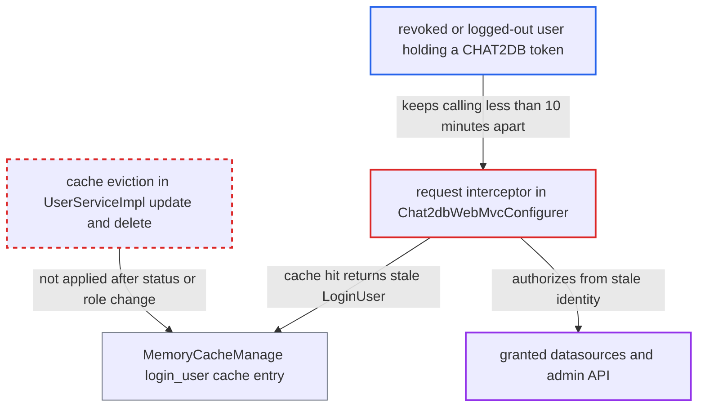

# Logout, password reset and user disablement or demotion do not revoke active sessions

| Field | Value |
|---|---|
| ID | `find_01Y8gnxoUPYURG66uzMbEVnn` |
| Severity | **Medium** |
| Status | open |
| CWE | CWE-613 — Insufficient session expiration |
| Created | 2026-10-21T22:47:13.898193Z |
| Claude Security | https://claude.ai/security/findings/find_01Y8gnxoUPYURG66uzMbEVnn |

## Description

A user whose account an administrator has disabled, demoted or deleted can keep using the app. A token taken before logout or a password reset also keeps working. The attacker needs a valid `CHAT2DB` token and must keep calling the API less than 10 minutes apart. The cause is that `UserServiceImpl.update` and `delete` never clear the cached `LoginUser`, and the 30-day stateless JWT cannot be revoked.

1. **the web-mode server** issues a self-contained JWT as the `CHAT2DB` token. `SaTokenConfigure` uses `StpLogicJwtForStateless`, so the server keeps no record of issued tokens and nothing can invalidate one, and `sa-token.timeout: 2592000` makes each token valid for 30 days. ([`chat2db-server/chat2db-server-web-start/src/main/java/ai/chat2db/server/web/start/config/oauth/SaTokenConfigure.java:15-20`](https://github.com/cx-benchmark/chat2db/blob/43aaee8d48736d74ac888dc4a81ddb50d6550638/chat2db-server/chat2db-server-web-start/src/main/java/ai/chat2db/server/web/start/config/oauth/SaTokenConfigure.java#L15-L20))
2. **the team user** keeps calling any API, such as `GET /api/oauth/user`, less than 10 minutes apart. The `login_user_<id>` cache uses `expireAfterAccess(10, MINUTES)`, so every hit resets the timer and an active user never causes a cache miss. ([`chat2db-server/chat2db-server-domain/chat2db-server-domain-core/src/main/java/ai/chat2db/server/domain/core/cache/MemoryCacheManage.java:24-29`](https://github.com/cx-benchmark/chat2db/blob/43aaee8d48736d74ac888dc4a81ddb50d6550638/chat2db-server/chat2db-server-domain/chat2db-server-domain-core/src/main/java/ai/chat2db/server/domain/core/cache/MemoryCacheManage.java#L24-L29))
3. **the administrator** disables, demotes, deletes or resets the password of the account through `UserServiceImpl.update` or `delete`. These methods only write the database rows. They do not evict the cached `login_user_<id>` entry, and a password reset does not invalidate issued tokens. ([`chat2db-server/chat2db-server-domain/chat2db-server-domain-core/src/main/java/ai/chat2db/server/domain/core/impl/UserServiceImpl.java:115-156`](https://github.com/cx-benchmark/chat2db/blob/43aaee8d48736d74ac888dc4a81ddb50d6550638/chat2db-server/chat2db-server-domain/chat2db-server-domain-core/src/main/java/ai/chat2db/server/domain/core/impl/UserServiceImpl.java#L115-L156))
4. **the request interceptor in `Chat2dbWebMvcConfigurer`** loads `LoginUser` from `MemoryCacheManage.computeIfAbsent` and gets a cache hit. The `status == VALID` check, the deleted-user check and the `admin` computation sit inside the loader, so on a hit the stale `LoginUser` is accepted unchecked. ([`chat2db-server/chat2db-server-web-start/src/main/java/ai/chat2db/server/web/start/config/config/Chat2dbWebMvcConfigurer.java:90-118`](https://github.com/cx-benchmark/chat2db/blob/43aaee8d48736d74ac888dc4a81ddb50d6550638/chat2db-server/chat2db-server-web-start/src/main/java/ai/chat2db/server/web/start/config/config/Chat2dbWebMvcConfigurer.java#L90-L118))
5. **the revoked user** keeps the stale `admin` flag and keeps access to `/api/admin/**`. This applies to a demoted or deleted secondary administrator. The `/api/admin/**` authorization reads `loginUser.getAdmin()` from the cached context. ([`chat2db-server/chat2db-server-web-start/src/main/java/ai/chat2db/server/web/start/config/config/Chat2dbWebMvcConfigurer.java:171-185`](https://github.com/cx-benchmark/chat2db/blob/43aaee8d48736d74ac888dc4a81ddb50d6550638/chat2db-server/chat2db-server-web-start/src/main/java/ai/chat2db/server/web/start/config/config/Chat2dbWebMvcConfigurer.java#L171-L185))
6. **`DataSourceAccessBusinessServiceImpl.checkPermission`** still lets the revoked user open the datasources they were granted. The method trusts the cached identity, and `update()` leaves a disabled user's grant rows in place. ([`chat2db-server/chat2db-server-domain/chat2db-server-domain-core/src/main/java/ai/chat2db/server/domain/core/impl/DataSourceAccessBusinessServiceImpl.java:35-49`](https://github.com/cx-benchmark/chat2db/blob/43aaee8d48736d74ac888dc4a81ddb50d6550638/chat2db-server/chat2db-server-domain/chat2db-server-domain-core/src/main/java/ai/chat2db/server/domain/core/impl/DataSourceAccessBusinessServiceImpl.java#L35-L49))

## Assessment

The attacker is an authenticated web-mode (`chat2db-server-web-start`) team user who already holds a `CHAT2DB` JWT. Their account is then disabled, demoted or deleted by an administrator through `POST /api/admin/user/update` or `DELETE /api/admin/user/{id}`. Staying active is the only timing condition, and the attacker controls it. A second route needs no cache: a token captured before the user's `POST /api/oauth/logout_a` keeps working. Capture can happen through the credentialed-CORS token read, a shared machine or logs. The same holds after an administrator's password reset. Once the cache entry has expired, a disabled or deleted account is rejected. A logged-out or password-reset account whose row is still `VALID` is admitted again on its old token.

Impact: A revoked account keeps its consoles, saved SQL, private datasources and every shared datasource it was granted, limited to what it held before revocation. A demoted or deleted secondary administrator also keeps the whole `/api/admin/**` surface (users, teams, grants), but that case needs administrator rights before the attack.

Subsequent-system impact: Retained grants still pass `DataSourceAccessBusinessServiceImpl.checkPermission`. The revoked account can keep opening connections and running arbitrary SQL with the stored credentials against the customer databases it was granted. It can read and modify their data after its access was supposedly cut off.

## Recommendation

(1) `UserServiceImpl.update` and `delete` change the stored status, role and password, or remove the user, but leave the in-memory `login_user_<id>` entry in place. The change never reaches an active session.

Fix criteria: After any change to a user's status or role, or deletion of the user, that user's cached authorization data is discarded. The very next request re-reads the account. It is rejected if the account is INVALID or gone, and downgraded if the user was demoted. Test by disabling, demoting and deleting a user who is polling the API. Confirm that their next request is denied or loses admin access.

(2) Session validity is held only in a stateless 30-day JWT that the server cannot revoke. `logout_a` only deletes the cookie, and a password reset leaves outstanding tokens valid. The interceptor checks status and role only through a cache that refreshes on access (`expireAfterAccess`), so an active user extends their own stale authorization indefinitely.

Fix criteria: The server can reject a token before it expires. Logout invalidates the presented token. Tokens issued before a password reset, disablement or deletion are rejected, for example through a server-side session store or a per-user token version or issued-before timestamp checked on each request. Staleness of `status`, `roleCode`/`admin` and existence is bounded independently of the user's own activity. Test that a token replayed after `POST /api/oauth/logout_a` or after a password reset is refused with `common.needLoggedIn`.

## Evidence

**https://github.com/cx-benchmark/chat2db**

- [`chat2db-server/chat2db-server-web-start/src/main/java/ai/chat2db/server/web/start/config/config/Chat2dbWebMvcConfigurer.java:90-118`](https://github.com/cx-benchmark/chat2db/blob/43aaee8d48736d74ac888dc4a81ddb50d6550638/chat2db-server/chat2db-server-web-start/src/main/java/ai/chat2db/server/web/start/config/config/Chat2dbWebMvcConfigurer.java#L90-L118)
- [`chat2db-server/chat2db-server-web-start/src/main/java/ai/chat2db/server/web/start/config/oauth/SaTokenConfigure.java:15-20`](https://github.com/cx-benchmark/chat2db/blob/43aaee8d48736d74ac888dc4a81ddb50d6550638/chat2db-server/chat2db-server-web-start/src/main/java/ai/chat2db/server/web/start/config/oauth/SaTokenConfigure.java#L15-L20)
- [`chat2db-server/chat2db-server-web-start/src/main/java/ai/chat2db/server/web/start/controller/oauth/OauthController.java:89-93`](https://github.com/cx-benchmark/chat2db/blob/43aaee8d48736d74ac888dc4a81ddb50d6550638/chat2db-server/chat2db-server-web-start/src/main/java/ai/chat2db/server/web/start/controller/oauth/OauthController.java#L89-L93)
- [`chat2db-server/chat2db-server-domain/chat2db-server-domain-core/src/main/java/ai/chat2db/server/domain/core/impl/UserServiceImpl.java:115-156`](https://github.com/cx-benchmark/chat2db/blob/43aaee8d48736d74ac888dc4a81ddb50d6550638/chat2db-server/chat2db-server-domain/chat2db-server-domain-core/src/main/java/ai/chat2db/server/domain/core/impl/UserServiceImpl.java#L115-L156)
- [`chat2db-server/chat2db-server-domain/chat2db-server-domain-core/src/main/java/ai/chat2db/server/domain/core/cache/MemoryCacheManage.java:24-29`](https://github.com/cx-benchmark/chat2db/blob/43aaee8d48736d74ac888dc4a81ddb50d6550638/chat2db-server/chat2db-server-domain/chat2db-server-domain-core/src/main/java/ai/chat2db/server/domain/core/cache/MemoryCacheManage.java#L24-L29)
- [`chat2db-server/chat2db-server-web-start/src/main/resources/application.yml:53-60`](https://github.com/cx-benchmark/chat2db/blob/43aaee8d48736d74ac888dc4a81ddb50d6550638/chat2db-server/chat2db-server-web-start/src/main/resources/application.yml#L53-L60)
- [`chat2db-server/chat2db-server-web-start/src/main/java/ai/chat2db/server/web/start/config/config/Chat2dbWebMvcConfigurer.java:171-185`](https://github.com/cx-benchmark/chat2db/blob/43aaee8d48736d74ac888dc4a81ddb50d6550638/chat2db-server/chat2db-server-web-start/src/main/java/ai/chat2db/server/web/start/config/config/Chat2dbWebMvcConfigurer.java#L171-L185)
- [`chat2db-server/chat2db-server-domain/chat2db-server-domain-core/src/main/java/ai/chat2db/server/domain/core/impl/DataSourceAccessBusinessServiceImpl.java:35-49`](https://github.com/cx-benchmark/chat2db/blob/43aaee8d48736d74ac888dc4a81ddb50d6550638/chat2db-server/chat2db-server-domain/chat2db-server-domain-core/src/main/java/ai/chat2db/server/domain/core/impl/DataSourceAccessBusinessServiceImpl.java#L35-L49)

