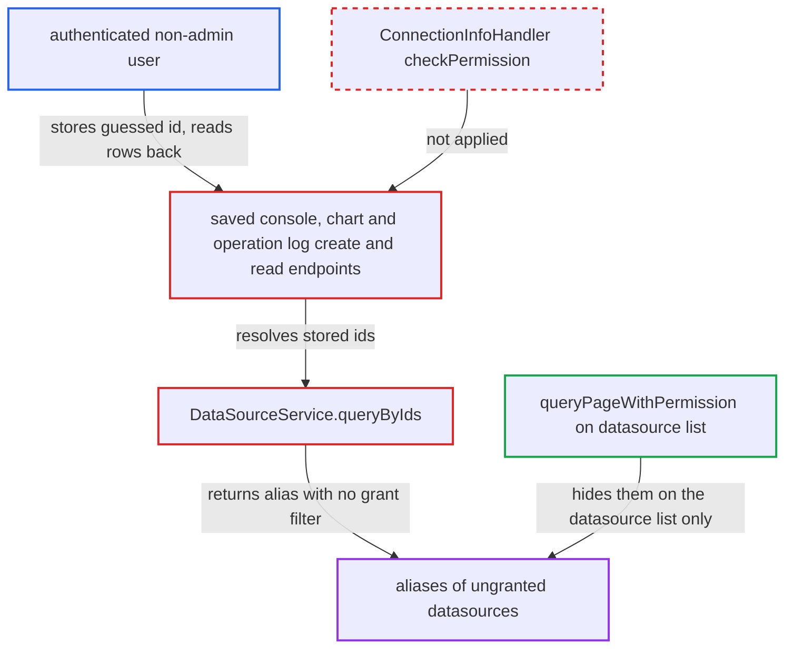

# Saved console/chart/log backfill discloses aliases of ungranted datasources

| Field | Value |
|---|---|
| ID | `find_01YTzsQ9TEHTC1wQUsTp5xY4` |
| Severity | **Medium** |
| Status | open |
| CWE | CWE-639 — Insecure direct object reference |
| Created | 2026-10-21T22:42:00.345736Z |
| Claude Security | https://claude.ai/security/findings/find_01YTzsQ9TEHTC1wQUsTp5xY4 |

## Description

Any logged-in non-admin user of the web/team server can learn which datasource ids exist and what their aliases are, including other users' private datasources. Only existence and alias text leak, not credentials or database contents. The attack works because the saved-console, chart and operation-log services store a client-supplied `dataSourceId` and look up its alias with `DataSourceService.queryByIds`, which applies no owner or grant filter.

1. **authenticated non-admin user** sends a create request with a guessed `dataSourceId`. The request goes to `POST /api/operation/saved/create`, `POST /api/chart/create` or `POST /api/operation/log/create`, and the id is a guess because ids are sequential. ([`chat2db-server/chat2db-server-web/chat2db-server-web-api/src/main/java/ai/chat2db/server/web/api/controller/operation/saved/OperationSavedController.java:40-90`](https://github.com/cx-benchmark/chat2db/blob/43aaee8d48736d74ac888dc4a81ddb50d6550638/chat2db-server/chat2db-server-web/chat2db-server-web-api/src/main/java/ai/chat2db/server/web/api/controller/operation/saved/OperationSavedController.java#L40-L90))
2. **the controllers and `ConnectionInfoHandler`** let the request through without a datasource grant check. The only grant check, `checkPermission`, runs from an advice whose pointcut covers only classes annotated `@ConnectionInfoAspect`, and these controllers are not annotated. ([`chat2db-server/chat2db-server-web/chat2db-server-web-api/src/main/java/ai/chat2db/server/web/api/aspect/ConnectionInfoHandler.java:38-49`](https://github.com/cx-benchmark/chat2db/blob/43aaee8d48736d74ac888dc4a81ddb50d6550638/chat2db-server/chat2db-server-web/chat2db-server-web-api/src/main/java/ai/chat2db/server/web/api/aspect/ConnectionInfoHandler.java#L38-L49))
3. **`OperationServiceImpl.createWithPermission`** stores the client-supplied `dataSourceId` on a row owned by the caller. Only `userId` is forced to the caller. The chart and log create paths do the same. ([`chat2db-server/chat2db-server-domain/chat2db-server-domain-core/src/main/java/ai/chat2db/server/domain/core/impl/OperationServiceImpl.java:61-68`](https://github.com/cx-benchmark/chat2db/blob/43aaee8d48736d74ac888dc4a81ddb50d6550638/chat2db-server/chat2db-server-domain/chat2db-server-domain-core/src/main/java/ai/chat2db/server/domain/core/impl/OperationServiceImpl.java#L61-L68))
4. **authenticated non-admin user** reads back their own rows. The leaking reads are `GET /api/operation/saved/list`, `GET /api/chart/{id}`, `GET /api/chart/listByIds` and `GET /api/operation/log/list`. ([`chat2db-server/chat2db-server-web/chat2db-server-web-api/src/main/java/ai/chat2db/server/web/api/controller/operation/saved/OperationSavedController.java:40-90`](https://github.com/cx-benchmark/chat2db/blob/43aaee8d48736d74ac888dc4a81ddb50d6550638/chat2db-server/chat2db-server-web/chat2db-server-web-api/src/main/java/ai/chat2db/server/web/api/controller/operation/saved/OperationSavedController.java#L40-L90))
5. **`OperationServiceImpl.getDataSourceInfo`** resolves each stored id with `dataSourceService.queryByIds` and copies the `alias` into `dataSourceName`. `queryByIds` ends in `selectBatchIds` with no user or grant predicate, unlike `queryPageWithPermission`. `ChartServiceImpl.setDataSourceInfo` and `OperationLogServiceImpl.queryPage` do the same lookup. ([`chat2db-server/chat2db-server-domain/chat2db-server-domain-core/src/main/java/ai/chat2db/server/domain/core/impl/OperationServiceImpl.java:161-183`](https://github.com/cx-benchmark/chat2db/blob/43aaee8d48736d74ac888dc4a81ddb50d6550638/chat2db-server/chat2db-server-domain/chat2db-server-domain-core/src/main/java/ai/chat2db/server/domain/core/impl/OperationServiceImpl.java#L161-L183))
6. **the web converters** set `connectable` to `dataSourceName != null` in the response. This gives the attacker a clear signal whether the guessed id exists, next to the alias itself. ([`chat2db-server/chat2db-server-web/chat2db-server-web-api/src/main/java/ai/chat2db/server/web/api/controller/operation/saved/converter/OperationWebConverter.java:56-59`](https://github.com/cx-benchmark/chat2db/blob/43aaee8d48736d74ac888dc4a81ddb50d6550638/chat2db-server/chat2db-server-web/chat2db-server-web-api/src/main/java/ai/chat2db/server/web/api/controller/operation/saved/converter/OperationWebConverter.java#L56-L59))

## Assessment

The attacker is any authenticated non-admin user of the web/team server, which the report says is internet-facing. No victim action is needed. They create a console, chart or log row with a guessed `dataSourceId`, then read it back through one of the list or get endpoints. Repeating this over ids enumerates every datasource alias on the server. `GET /api/operation/saved/{id}` does not leak, because `queryExistent(OperationQueryParam)` does not backfill. `OperationServiceImpl.find` does backfill, but only for internal permission checks.

Impact: The attacker learns whether any datasource id exists and its alias, including private datasources of other users. Aliases are free text and often name a host, environment or purpose. The report says URLs, hosts, credentials and data are not returned on this path, and nothing is modified.

## Recommendation

`OperationServiceImpl`, `ChartServiceImpl` and `OperationLogServiceImpl` fill in `dataSourceName` by resolving a client-supplied `dataSourceId` through `DataSourceService.queryByIds`, which applies no owner or grant filter. Their create paths also accept a `dataSourceId` the caller has no grant for.

Fix criteria: A non-admin user's console, chart and log responses do not reveal the alias or existence of a datasource they neither own nor hold a user or team grant for. Either names are resolved only through a grant-aware lookup that uses the same predicate as `checkPermission` and `selectPageWithPermission`, or create and update reject an inaccessible `dataSourceId`. Test: create a console, chart or log with another user's private datasource id. The response must show `dataSourceName` null and `connectable` false, or the create must be refused.

## Evidence

**https://github.com/cx-benchmark/chat2db**

- [`chat2db-server/chat2db-server-domain/chat2db-server-domain-core/src/main/java/ai/chat2db/server/domain/core/impl/OperationServiceImpl.java:161-183`](https://github.com/cx-benchmark/chat2db/blob/43aaee8d48736d74ac888dc4a81ddb50d6550638/chat2db-server/chat2db-server-domain/chat2db-server-domain-core/src/main/java/ai/chat2db/server/domain/core/impl/OperationServiceImpl.java#L161-L183)
- [`chat2db-server/chat2db-server-domain/chat2db-server-domain-core/src/main/java/ai/chat2db/server/domain/core/impl/OperationServiceImpl.java:61-68`](https://github.com/cx-benchmark/chat2db/blob/43aaee8d48736d74ac888dc4a81ddb50d6550638/chat2db-server/chat2db-server-domain/chat2db-server-domain-core/src/main/java/ai/chat2db/server/domain/core/impl/OperationServiceImpl.java#L61-L68)
- [`chat2db-server/chat2db-server-web/chat2db-server-web-api/src/main/java/ai/chat2db/server/web/api/controller/operation/saved/OperationSavedController.java:40-90`](https://github.com/cx-benchmark/chat2db/blob/43aaee8d48736d74ac888dc4a81ddb50d6550638/chat2db-server/chat2db-server-web/chat2db-server-web-api/src/main/java/ai/chat2db/server/web/api/controller/operation/saved/OperationSavedController.java#L40-L90)
- [`chat2db-server/chat2db-server-web/chat2db-server-web-api/src/main/java/ai/chat2db/server/web/api/aspect/ConnectionInfoHandler.java:38-49`](https://github.com/cx-benchmark/chat2db/blob/43aaee8d48736d74ac888dc4a81ddb50d6550638/chat2db-server/chat2db-server-web/chat2db-server-web-api/src/main/java/ai/chat2db/server/web/api/aspect/ConnectionInfoHandler.java#L38-L49)
- [`chat2db-server/chat2db-server-domain/chat2db-server-domain-core/src/main/java/ai/chat2db/server/domain/core/impl/ChartServiceImpl.java:60-68`](https://github.com/cx-benchmark/chat2db/blob/43aaee8d48736d74ac888dc4a81ddb50d6550638/chat2db-server/chat2db-server-domain/chat2db-server-domain-core/src/main/java/ai/chat2db/server/domain/core/impl/ChartServiceImpl.java#L60-L68)
- [`chat2db-server/chat2db-server-domain/chat2db-server-domain-core/src/main/java/ai/chat2db/server/domain/core/impl/ChartServiceImpl.java:166-176`](https://github.com/cx-benchmark/chat2db/blob/43aaee8d48736d74ac888dc4a81ddb50d6550638/chat2db-server/chat2db-server-domain/chat2db-server-domain-core/src/main/java/ai/chat2db/server/domain/core/impl/ChartServiceImpl.java#L166-L176)
- [`chat2db-server/chat2db-server-domain/chat2db-server-domain-core/src/main/java/ai/chat2db/server/domain/core/impl/OperationLogServiceImpl.java:53-89`](https://github.com/cx-benchmark/chat2db/blob/43aaee8d48736d74ac888dc4a81ddb50d6550638/chat2db-server/chat2db-server-domain/chat2db-server-domain-core/src/main/java/ai/chat2db/server/domain/core/impl/OperationLogServiceImpl.java#L53-L89)
- [`chat2db-server/chat2db-server-domain/chat2db-server-domain-core/src/main/java/ai/chat2db/server/domain/core/impl/DataSourceServiceImpl.java:213-245`](https://github.com/cx-benchmark/chat2db/blob/43aaee8d48736d74ac888dc4a81ddb50d6550638/chat2db-server/chat2db-server-domain/chat2db-server-domain-core/src/main/java/ai/chat2db/server/domain/core/impl/DataSourceServiceImpl.java#L213-L245)
- [`chat2db-server/chat2db-server-web/chat2db-server-web-api/src/main/java/ai/chat2db/server/web/api/controller/operation/saved/converter/OperationWebConverter.java:56-59`](https://github.com/cx-benchmark/chat2db/blob/43aaee8d48736d74ac888dc4a81ddb50d6550638/chat2db-server/chat2db-server-web/chat2db-server-web-api/src/main/java/ai/chat2db/server/web/api/controller/operation/saved/converter/OperationWebConverter.java#L56-L59)

