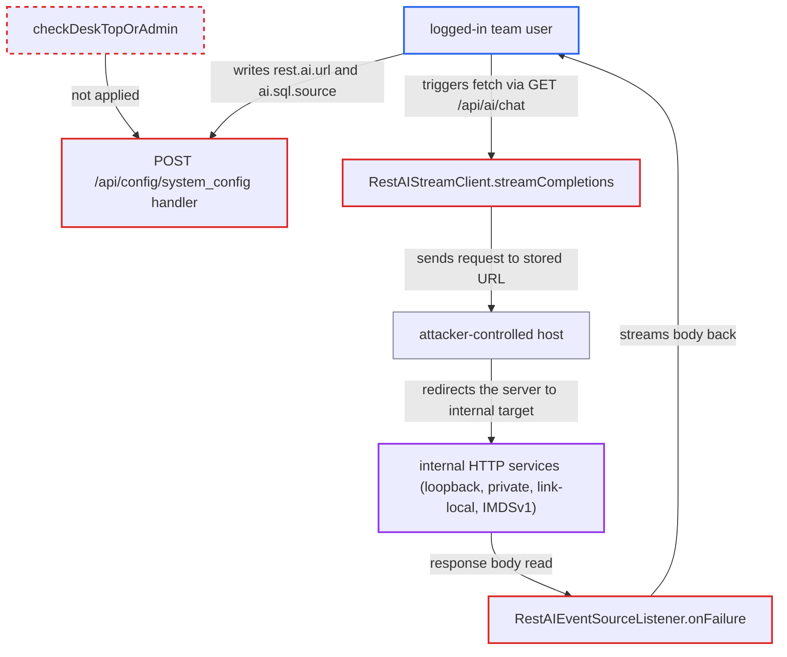

# Server-side request forgery with response echo through configurable REST AI endpoint URL

| Field | Value |
|---|---|
| ID | `find_01VhxVfdZwkmwiG8zTL4PsYT` |
| Severity | **Medium** |
| Status | open |
| CWE | CWE-918 — Server-Side Request Forgery |
| Created | 2026-10-21T22:48:54.072162Z |
| Claude Security | https://claude.ai/security/findings/find_01VhxVfdZwkmwiG8zTL4PsYT |

## Description

A logged-in low-privilege team user can make the Chat2DB server fetch any internal HTTP address and read the full response. Instances with an unauthenticated internal service or AWS IMDSv1 are exposed. The attack works while REST AI has not been used since startup, which is the default. The cause is that `RestAIStreamClient.streamCompletions` uses the stored `rest.ai.url` unchecked and follows redirects, and `RestAIEventSourceListener.onFailure` returns the response body to the caller. The generic config endpoint also lets any user write that URL.

1. **the attacker (logged-in team user)** writes `ai.sql.source=RESTAI` and `rest.ai.url=http://attacker/r` through `POST /api/config/system_config`. This generic writer stores any `code`/`content` row and does not call `checkDeskTopOrAdmin()`, unlike the sibling `/system_config/ai`. ([`chat2db-server/chat2db-server-web/chat2db-server-web-api/src/main/java/ai/chat2db/server/web/api/controller/config/ConfigController.java:47-57`](https://github.com/cx-benchmark/chat2db/blob/43aaee8d48736d74ac888dc4a81ddb50d6550638/chat2db-server/chat2db-server-web/chat2db-server-web-api/src/main/java/ai/chat2db/server/web/api/controller/config/ConfigController.java#L47-L57))
2. **the attacker** calls `GET /api/ai/chat` with their own `dataSourceId`, a `message` and a `uid` header. The controller reads `ai.sql.source` on every request and, when it is `RESTAI`, runs `chatWithRestAi` with the caller's `SseEmitter`. The permission check only covers the caller's own datasource. ([`chat2db-server/chat2db-server-web/chat2db-server-web-api/src/main/java/ai/chat2db/server/web/api/controller/ai/ChatController.java:220-273`](https://github.com/cx-benchmark/chat2db/blob/43aaee8d48736d74ac888dc4a81ddb50d6550638/chat2db-server/chat2db-server-web/chat2db-server-web-api/src/main/java/ai/chat2db/server/web/api/controller/ai/ChatController.java#L220-L273))
3. **the singleton `RestAIClient`** is built from the `rest.ai.url`, `rest.ai.apiKey` and `rest.ai.model` rows on first use. It is only built once and only refreshed by the admin-gated save. The attacker's URL therefore takes effect if REST AI has not been used since startup, which is the default because `ai.sql.source` defaults to `CHAT2DB`AI. ([`chat2db-server/chat2db-server-web/chat2db-server-web-api/src/main/java/ai/chat2db/server/web/api/controller/ai/rest/client/RestAIClient.java:47-87`](https://github.com/cx-benchmark/chat2db/blob/43aaee8d48736d74ac888dc4a81ddb50d6550638/chat2db-server/chat2db-server-web/chat2db-server-web-api/src/main/java/ai/chat2db/server/web/api/controller/ai/rest/client/RestAIClient.java#L47-L87))
4. **the method `streamCompletions`** sends the request to the stored URL and follows redirects. The URL goes straight into `new Request.Builder().url(apiHost)` with no scheme, host or address check. The attacker's host answers with a 302 or 303 redirect, and OkHttp then sends a GET to the internal target of the attacker's choice. ([`chat2db-server/chat2db-server-web/chat2db-server-web-api/src/main/java/ai/chat2db/server/web/api/controller/ai/rest/client/RestAIStreamClient.java:160-170`](https://github.com/cx-benchmark/chat2db/blob/43aaee8d48736d74ac888dc4a81ddb50d6550638/chat2db-server/chat2db-server-web/chat2db-server-web-api/src/main/java/ai/chat2db/server/web/api/controller/ai/rest/client/RestAIStreamClient.java#L160-L170))
5. **the listener `RestAIEventSourceListener.onFailure`** reads the upstream body and streams it to the caller as `"Rest AI Error:" + bodyString`. okhttp-sse 4.x calls `onFailure` with the open response for every non-2xx answer and for every 2xx answer that is not `text/event-stream`. The attacker therefore receives the full body of the internal resource. ([`chat2db-server/chat2db-server-web/chat2db-server-web-api/src/main/java/ai/chat2db/server/web/api/controller/ai/rest/listener/RestAIEventSourceListener.java:91-123`](https://github.com/cx-benchmark/chat2db/blob/43aaee8d48736d74ac888dc4a81ddb50d6550638/chat2db-server/chat2db-server-web/chat2db-server-web-api/src/main/java/ai/chat2db/server/web/api/controller/ai/rest/listener/RestAIEventSourceListener.java#L91-L123))

## Assessment

The attacker is a logged-in low-privilege team user on the internet-facing web or Docker server. They first create a private datasource, so the chat request passes the datasource permission check. The attack needs REST AI not to have been used since the last startup, which holds by default. If it has been used, the report does not say that the URL can still be changed. The attacker points the URL at a host they control, and that host replies with a 302 or 303 redirect. OkHttp drops the `Authorization` header on a cross-host redirect, and the attacker cannot add headers of their own. Header-gated metadata services (IMDSv2, GCP, Azure) are therefore out of reach. AWS IMDSv1 and unauthenticated internal HTTP services are exposed.

Impact: The Chat2DB server becomes an HTTP proxy for the attacker, who can make it fetch URLs from its own network position and read the responses. On the first hop the server also sends the stored `rest.ai.apiKey` as a Bearer token to the attacker's host. The server's own database and files are not read through this path.

Subsequent-system impact: Any HTTP service the server can reach can be read in full through the relayed body. This includes loopback, RFC1918 and link-local addresses, internal consoles and AWS IMDSv1 instance credentials. The attacker can also send GET requests, or POSTs with the fixed prompt JSON, which allows limited state change. Header-gated services cannot be reached.

## Recommendation

(1) `RestAIStreamClient` uses a stored URL with no restriction on scheme or destination address, and it follows redirects. The server can therefore be pointed at loopback, private and link-local targets.

Fix criteria: Outbound REST AI requests reach only permitted destinations. A scheme and host policy is enforced, and loopback, private, link-local and metadata addresses are rejected after DNS resolution and on every redirect hop, or redirects are disabled. The check runs at request time. Setting `rest.ai.url` to `http://127.0.0.1:10824/...` causes no request to that target. Setting it to a host that redirects to `169.254.169.254` also causes no request to the internal target.

(2) `RestAIEventSourceListener.onFailure` sends the raw upstream response body to the end user. Any outbound request therefore lets the caller read the whole response.

Fix criteria: Upstream bodies are not returned verbatim on failure. The caller gets a generic error and the details stay in server-side logs. With the REST AI URL pointed at a non-SSE endpoint, none of that endpoint's content appears in the `/api/ai/chat` stream.

(3) A non-admin can write `rest.ai.url` and `ai.sql.source` through the generic `POST /api/config/system_config` endpoint, which has no role check. The attacker therefore chooses the URL.

Fix criteria: Only desktop-mode or admin users can write AI provider settings, through any endpoint. A USER-role account that calls `POST /api/config/system_config` for `rest.ai.url` is refused.

## Evidence

**https://github.com/cx-benchmark/chat2db**

- [`chat2db-server/chat2db-server-web/chat2db-server-web-api/src/main/java/ai/chat2db/server/web/api/controller/ai/rest/client/RestAIStreamClient.java:160-170`](https://github.com/cx-benchmark/chat2db/blob/43aaee8d48736d74ac888dc4a81ddb50d6550638/chat2db-server/chat2db-server-web/chat2db-server-web-api/src/main/java/ai/chat2db/server/web/api/controller/ai/rest/client/RestAIStreamClient.java#L160-L170)
- [`chat2db-server/chat2db-server-web/chat2db-server-web-api/src/main/java/ai/chat2db/server/web/api/controller/ai/rest/listener/RestAIEventSourceListener.java:91-123`](https://github.com/cx-benchmark/chat2db/blob/43aaee8d48736d74ac888dc4a81ddb50d6550638/chat2db-server/chat2db-server-web/chat2db-server-web-api/src/main/java/ai/chat2db/server/web/api/controller/ai/rest/listener/RestAIEventSourceListener.java#L91-L123)
- [`chat2db-server/chat2db-server-web/chat2db-server-web-api/src/main/java/ai/chat2db/server/web/api/controller/ai/rest/client/RestAIClient.java:47-87`](https://github.com/cx-benchmark/chat2db/blob/43aaee8d48736d74ac888dc4a81ddb50d6550638/chat2db-server/chat2db-server-web/chat2db-server-web-api/src/main/java/ai/chat2db/server/web/api/controller/ai/rest/client/RestAIClient.java#L47-L87)
- [`chat2db-server/chat2db-server-web/chat2db-server-web-api/src/main/java/ai/chat2db/server/web/api/controller/ai/ChatController.java:220-273`](https://github.com/cx-benchmark/chat2db/blob/43aaee8d48736d74ac888dc4a81ddb50d6550638/chat2db-server/chat2db-server-web/chat2db-server-web-api/src/main/java/ai/chat2db/server/web/api/controller/ai/ChatController.java#L220-L273)
- [`chat2db-server/chat2db-server-web/chat2db-server-web-api/src/main/java/ai/chat2db/server/web/api/controller/config/ConfigController.java:47-57`](https://github.com/cx-benchmark/chat2db/blob/43aaee8d48736d74ac888dc4a81ddb50d6550638/chat2db-server/chat2db-server-web/chat2db-server-web-api/src/main/java/ai/chat2db/server/web/api/controller/config/ConfigController.java#L47-L57)
- [`chat2db-server/chat2db-server-web-start/src/main/java/ai/chat2db/server/web/start/config/config/Chat2dbWebMvcConfigurer.java:170-185`](https://github.com/cx-benchmark/chat2db/blob/43aaee8d48736d74ac888dc4a81ddb50d6550638/chat2db-server/chat2db-server-web-start/src/main/java/ai/chat2db/server/web/start/config/config/Chat2dbWebMvcConfigurer.java#L170-L185)

