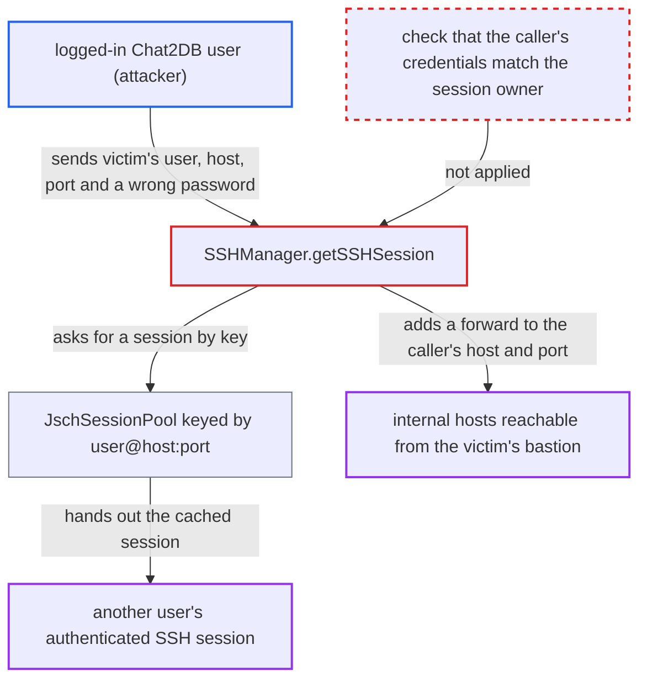

# Shared SSH session pool keyed by user@host:port lets any user hijack others' authenticated sessions

| Field | Value |
|---|---|
| ID | `find_01XnHNgWoWEqPjWLArLUffLq` |
| Severity | **Low** |
| Status | open |
| CWE | CWE-488 — Exposure to wrong session |
| Created | 2026-10-21T22:52:15.816990Z |
| Claude Security | https://claude.ai/security/findings/find_01XnHNgWoWEqPjWLArLUffLq |

## Description

A logged-in Chat2DB user can borrow another user's authenticated SSH session without knowing that user's password or key. The attacker can disconnect that session and, in some states, route database connections through it to internal hosts. It needs another user's SSH datasource to have connected since start-up, and the attacker must know or guess its SSH user, host and port. The cause is `SSHManager.getSSHSession`, which gets sessions from a shared pool that, per the report's assumption about hutool 5.8.20, is keyed only by `user@host:port`.

1. **another Chat2DB user** connects a datasource that uses SSH. `DefaultDBManage.getConnection` keeps the authenticated session on the `ConnectInfo`, and `ConnectInfo.close()` only removes the local forward and never disconnects, so the session stays open in the pool. ([`chat2db-server/chat2db-spi/src/main/java/ai/chat2db/spi/sql/ConnectInfo.java:563-584`](https://github.com/cx-benchmark/chat2db/blob/43aaee8d48736d74ac888dc4a81ddb50d6550638/chat2db-server/chat2db-spi/src/main/java/ai/chat2db/spi/sql/ConnectInfo.java#L563-L584))
2. **attacker** posts an `SSHInfo` with the victim's SSH user, host and port and a wrong password. Any logged-in user can send arbitrary `SSHInfo` to `/api/connection/ssh/pre_connect` or `/api/connection/datasource/pre_connect`. ([`chat2db-server/chat2db-server-web/chat2db-server-web-api/src/main/java/ai/chat2db/server/web/api/controller/data/source/DataSourceController.java:88-114`](https://github.com/cx-benchmark/chat2db/blob/43aaee8d48736d74ac888dc4a81ddb50d6550638/chat2db-server/chat2db-server-web/chat2db-server-web-api/src/main/java/ai/chat2db/server/web/api/controller/data/source/DataSourceController.java#L88-L114))
3. **`SSHManager.getSSHSession`** returns the victim's pooled session. `JschUtil.getSession` finds a connected session under the same `user@host:port` key and ignores the password or key, so the SSH server never sees the attacker's credentials. ([`chat2db-server/chat2db-spi/src/main/java/ai/chat2db/spi/ssh/SSHManager.java:33-71`](https://github.com/cx-benchmark/chat2db/blob/43aaee8d48736d74ac888dc4a81ddb50d6550638/chat2db-server/chat2db-spi/src/main/java/ai/chat2db/spi/ssh/SSHManager.java#L33-L71))
4. **the handler for `ssh/pre_connect`** reports success and then disconnects the shared session. The success confirms the victim's session is live, and the `finally` block then tears down the victim's tunnel. ([`chat2db-server/chat2db-server-web/chat2db-server-web-api/src/main/java/ai/chat2db/server/web/api/controller/data/source/DataSourceController.java:88-114`](https://github.com/cx-benchmark/chat2db/blob/43aaee8d48736d74ac888dc4a81ddb50d6550638/chat2db-server/chat2db-server-web/chat2db-server-web-api/src/main/java/ai/chat2db/server/web/api/controller/data/source/DataSourceController.java#L88-L114))
5. **`ConnectionPool.close`** leaves a session connected with no forward. It calls `ConnectInfo.close()` when the reference count has not reached zero, for example with concurrent requests on the same key, and this removes the forward named by that request's `localPort`. ([`chat2db-server/chat2db-spi/src/main/java/ai/chat2db/spi/sql/ConnectionPool.java:122-150`](https://github.com/cx-benchmark/chat2db/blob/43aaee8d48736d74ac888dc4a81ddb50d6550638/chat2db-server/chat2db-spi/src/main/java/ai/chat2db/spi/sql/ConnectionPool.java#L122-L150))
6. **`SSHManager.getSSHSession`** adds a forward on the shared session to the attacker's `rHost:rPort`. This happens on a cache hit when the session has no forward. The attacker's datasource sets `ssh.localPort` to the victim's forward port, and its JDBC URL succeeds without the tunnel. ([`chat2db-server/chat2db-spi/src/main/java/ai/chat2db/spi/ssh/SSHManager.java:33-71`](https://github.com/cx-benchmark/chat2db/blob/43aaee8d48736d74ac888dc4a81ddb50d6550638/chat2db-server/chat2db-spi/src/main/java/ai/chat2db/spi/ssh/SSHManager.java#L33-L71))
7. **the JDBC driver** connects to `127.0.0.1:<localPort>` and so travels over the victim's SSH session. `JdbcUtils.testConnect` rewrites the URL to the local forward, so the connection leaves the victim's bastion toward the attacker's chosen host and port. ([`chat2db-server/chat2db-spi/src/main/java/ai/chat2db/spi/util/JdbcUtils.java:145-193`](https://github.com/cx-benchmark/chat2db/blob/43aaee8d48736d74ac888dc4a81ddb50d6550638/chat2db-server/chat2db-spi/src/main/java/ai/chat2db/spi/util/JdbcUtils.java#L145-L193))

## Assessment

The attacker is an authenticated low-privilege user of the internet-facing Chat2DB server. Another user's SSH datasource must have connected since start-up. The attacker must know or guess that datasource's SSH user, host and port. Entry points are `/api/connection/ssh/pre_connect`, `/api/connection/datasource/pre_connect`, or a private datasource made with `/api/connection/datasource/create`, which a non-admin can do. Disconnecting the victim needs only `ssh/pre_connect` with a wrong password. Adding a forward needs the cached session to be connected but have no forward. The attacker can force that state with concurrent requests on a datasource whose `localPort` names the victim's port.

Impact: The attacker can learn which `user@host:port` sessions are live, add forwards on them and disconnect them, which cuts other users' tunnelled database connections. The pool reopens a session on the victim's next request. The report says no stored data is read or changed directly.

Subsequent-system impact: Through the victim's bastion, the attacker gets TCP reach, under the victim's SSH identity, to any host and port the bastion can reach, driven through a JDBC driver. This allows internal port probing from driver errors. It also allows SQL access to any internal database for which the attacker holds that database's own credentials. It is limited by the need for those credentials and by the session being torn down after a failed probe.

## Recommendation

(1) SSH sessions are cached process-wide by `user@host:port` through hutool `JschUtil.getSession`. A later caller's credentials are never checked, so another user's authenticated session is returned to them.

Fix criteria: A session is reused only by the datasource and login user whose credentials opened it, or a fresh session is opened for each connection. Sending another datasource's SSH user, host and port with a wrong password through `ssh/pre_connect`, `datasource/pre_connect` or a new datasource gives an SSH authentication failure, not a cached session.

(2) Session lifetime has no owner. Test paths disconnect a shared session they did not open, and `ConnectInfo.close()` removes forwards without closing the session, which leaves sessions connected with no owner.

Fix criteria: Each session's lifetime is tied to the connection that owns it. Closing or testing a connection affects only its own forward and session, never a tunnel another user's connection is using. One user's test-connect cannot disconnect, or remove forwards from, another user's active tunnel.

## Evidence

**https://github.com/cx-benchmark/chat2db**

- [`chat2db-server/chat2db-spi/src/main/java/ai/chat2db/spi/ssh/SSHManager.java:33-71`](https://github.com/cx-benchmark/chat2db/blob/43aaee8d48736d74ac888dc4a81ddb50d6550638/chat2db-server/chat2db-spi/src/main/java/ai/chat2db/spi/ssh/SSHManager.java#L33-L71)
- [`chat2db-server/chat2db-spi/src/main/java/ai/chat2db/spi/util/JdbcUtils.java:145-193`](https://github.com/cx-benchmark/chat2db/blob/43aaee8d48736d74ac888dc4a81ddb50d6550638/chat2db-server/chat2db-spi/src/main/java/ai/chat2db/spi/util/JdbcUtils.java#L145-L193)
- [`chat2db-server/chat2db-spi/src/main/java/ai/chat2db/spi/jdbc/DefaultDBManage.java:50-104`](https://github.com/cx-benchmark/chat2db/blob/43aaee8d48736d74ac888dc4a81ddb50d6550638/chat2db-server/chat2db-spi/src/main/java/ai/chat2db/spi/jdbc/DefaultDBManage.java#L50-L104)
- [`chat2db-server/chat2db-spi/src/main/java/ai/chat2db/spi/sql/ConnectInfo.java:563-584`](https://github.com/cx-benchmark/chat2db/blob/43aaee8d48736d74ac888dc4a81ddb50d6550638/chat2db-server/chat2db-spi/src/main/java/ai/chat2db/spi/sql/ConnectInfo.java#L563-L584)
- [`chat2db-server/chat2db-spi/src/main/java/ai/chat2db/spi/sql/ConnectionPool.java:122-150`](https://github.com/cx-benchmark/chat2db/blob/43aaee8d48736d74ac888dc4a81ddb50d6550638/chat2db-server/chat2db-spi/src/main/java/ai/chat2db/spi/sql/ConnectionPool.java#L122-L150)
- [`chat2db-server/chat2db-server-web/chat2db-server-web-api/src/main/java/ai/chat2db/server/web/api/controller/data/source/DataSourceController.java:88-114`](https://github.com/cx-benchmark/chat2db/blob/43aaee8d48736d74ac888dc4a81ddb50d6550638/chat2db-server/chat2db-server-web/chat2db-server-web-api/src/main/java/ai/chat2db/server/web/api/controller/data/source/DataSourceController.java#L88-L114)
- [`chat2db-server/chat2db-server-domain/chat2db-server-domain-core/src/main/java/ai/chat2db/server/domain/core/impl/DataSourceServiceImpl.java:92-110`](https://github.com/cx-benchmark/chat2db/blob/43aaee8d48736d74ac888dc4a81ddb50d6550638/chat2db-server/chat2db-server-domain/chat2db-server-domain-core/src/main/java/ai/chat2db/server/domain/core/impl/DataSourceServiceImpl.java#L92-L110)
- [`chat2db-server/pom.xml:115-117`](https://github.com/cx-benchmark/chat2db/blob/43aaee8d48736d74ac888dc4a81ddb50d6550638/chat2db-server/pom.xml#L115-L117)

