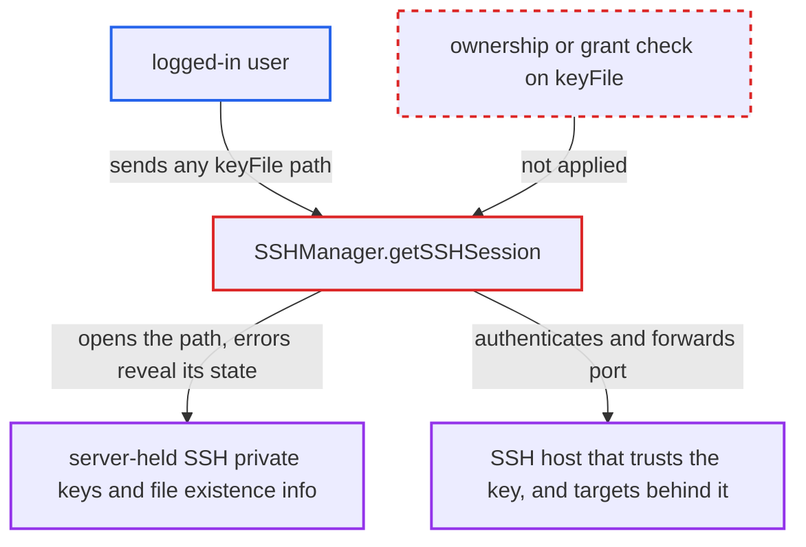

# SSH keyFile is a server filesystem path: users reuse server-held keys and probe files

| Field | Value |
|---|---|
| ID | `find_01A4c1uddrJHTab2xCQkDTvZ` |
| Severity | **Low** |
| Status | open |
| CWE | CWE-73 — External control of file path |
| Created | 2026-10-21T22:50:18.544169Z |
| Claude Security | https://claude.ai/security/findings/find_01A4c1uddrJHTab2xCQkDTvZ |

## Description

Any logged-in web-mode user can make the server open any file path they name as an SSH private key. They can learn whether a path exists, is readable, is a directory or is a key. If the operator has put private keys on the server, they can also use those keys to authenticate to SSH hosts without being granted the datasource. File contents are never returned. The cause is that `SSHManager.getSSHSession` passes the request's `keyFile` unchanged to `JschUtil.getSession`, with no check tying the path to the caller.

1. **logged-in user** sends a request with `keyFile` set to a server path. The user calls `POST /api/connection/ssh/pre_connect`, or `datasource/pre_connect`, `create` or `update` with `ssh.use=true`, and the only gate is being logged in. ([`chat2db-server/chat2db-server-web-start/src/main/java/ai/chat2db/server/web/start/config/config/Chat2dbWebMvcConfigurer.java:134-168`](https://github.com/cx-benchmark/chat2db/blob/43aaee8d48736d74ac888dc4a81ddb50d6550638/chat2db-server/chat2db-server-web-start/src/main/java/ai/chat2db/server/web/start/config/config/Chat2dbWebMvcConfigurer.java#L134-L168))
2. **the controller for `/api/connection/ssh/pre_connect`** maps `SSHTestRequest` to `SSHInfo` and calls `SSHManager.getSSHSession`. No datasource or permission check runs, because `SSHTestRequest` is not a `DataSourceBaseRequest`-type parameter. ([`chat2db-server/chat2db-server-web/chat2db-server-web-api/src/main/java/ai/chat2db/server/web/api/controller/data/source/DataSourceController.java:100-114`](https://github.com/cx-benchmark/chat2db/blob/43aaee8d48736d74ac888dc4a81ddb50d6550638/chat2db-server/chat2db-server-web/chat2db-server-web-api/src/main/java/ai/chat2db/server/web/api/controller/data/source/DataSourceController.java#L100-L114))
3. **`SSHManager.getSSHSession`** passes `ssh.getKeyFile()` unchanged as `privateKeyPath` to `JschUtil.getSession`. hutool calls `JSch.addIdentity(path, passphrase)`, which reads the file before any network connection is made. ([`chat2db-server/chat2db-spi/src/main/java/ai/chat2db/spi/ssh/SSHManager.java:33-71`](https://github.com/cx-benchmark/chat2db/blob/43aaee8d48736d74ac888dc4a81ddb50d6550638/chat2db-server/chat2db-spi/src/main/java/ai/chat2db/spi/ssh/SSHManager.java#L33-L71))
4. **JSch** authenticates to the caller's `hostName:port` with that key and sets up a local forward to `rHost:rPort`. If the key is valid and the host trusts it, the attacker gets a tunnel to a target behind that host. ([`chat2db-server/chat2db-spi/src/main/java/ai/chat2db/spi/ssh/SSHManager.java:33-71`](https://github.com/cx-benchmark/chat2db/blob/43aaee8d48736d74ac888dc4a81ddb50d6550638/chat2db-server/chat2db-spi/src/main/java/ai/chat2db/spi/ssh/SSHManager.java#L33-L71))
5. **error handling** returns the full stack trace or deepest cause message to the client when the attempt fails. JSch puts `FileNotFoundException`, `Permission denied`, `Is a directory` or `invalid privatekey` text into the message, which reveals the state of the path. ([`chat2db-server/chat2db-server-web-start/src/main/java/ai/chat2db/server/web/start/exception/convertor/BusinessExceptionConvertor.java:16-19`](https://github.com/cx-benchmark/chat2db/blob/43aaee8d48736d74ac888dc4a81ddb50d6550638/chat2db-server/chat2db-server-web-start/src/main/java/ai/chat2db/server/web/start/exception/convertor/BusinessExceptionConvertor.java#L16-L19))

## Assessment

The attacker is any logged-in user in web mode, which the report treats as internet-facing. In web mode the only gate on `/api/connection/**` is being logged in, and admin checks cover only `/api/admin/**`. For the file probe, the attacker sends `POST /api/connection/ssh/pre_connect` with `keyFile` set to a path and reads the error detail. This needs nothing else. To abuse a key, a private key must already be on the server, which the report says operators place there for team tunnels. The attacker points `hostName` at their own sshd, so the server offers that key. Alternatively they point it at a bastion that trusts the key and use `datasource/pre_connect` with `ssh.use=true` to tunnel JDBC to any `rHost:rPort`. `datasource/pre_connect`, `create` and `update` accept the same object. The shipped Docker image has no `USER`, so it runs as root and the probe covers every file in the container, including `/root/.ssh` and mounted volumes.

Impact: The attacker can tell whether any path on the server exists, is readable, is a directory or is a key file. They can also use server-held SSH private keys meant for datasources they were not granted. Key bytes and other file contents are never returned, and the report finds no integrity or availability impact on the Chat2DB host.

Subsequent-system impact: SSH hosts that trust a server-held key accept the attacker as that key's identity. The code opens only a session and a local port forward, so the attacker gets TCP reach to internal `rHost:rPort` targets behind the bastion, used through JDBC drivers. Services there still need their own credentials, so the impact is limited.

## Recommendation

(1) `SSHInfo.keyFile` from the HTTP request is used as a local filesystem path for the SSH identity. The client chooses which server-side file the server reads and authenticates with, and nothing checks ownership or grant.

Fix criteria: In web mode the private key arrives as content stored per datasource, or is chosen from a server-managed key store tied to the datasource and the caller's grant. It is never a free-form server path. `/ssh/pre_connect` and `datasource/pre_connect` with `keyFile` set to `/etc/passwd` or another datasource's key path are refused without touching the filesystem.

(2) SSH and connection failures are returned to the client with the full stack trace and the cause messages. This exposes JSch's file-access errors.

Fix criteria: The client gets a generic error and the detail is logged on the server. A missing, unreadable, directory or non-key `keyFile` gives the same client response.

## Evidence

**https://github.com/cx-benchmark/chat2db**

- [`chat2db-server/chat2db-spi/src/main/java/ai/chat2db/spi/ssh/SSHManager.java:33-71`](https://github.com/cx-benchmark/chat2db/blob/43aaee8d48736d74ac888dc4a81ddb50d6550638/chat2db-server/chat2db-spi/src/main/java/ai/chat2db/spi/ssh/SSHManager.java#L33-L71)
- [`chat2db-server/chat2db-server-web/chat2db-server-web-api/src/main/java/ai/chat2db/server/web/api/controller/data/source/DataSourceController.java:100-114`](https://github.com/cx-benchmark/chat2db/blob/43aaee8d48736d74ac888dc4a81ddb50d6550638/chat2db-server/chat2db-server-web/chat2db-server-web-api/src/main/java/ai/chat2db/server/web/api/controller/data/source/DataSourceController.java#L100-L114)
- [`chat2db-server/chat2db-spi/src/main/java/ai/chat2db/spi/util/JdbcUtils.java:155-174`](https://github.com/cx-benchmark/chat2db/blob/43aaee8d48736d74ac888dc4a81ddb50d6550638/chat2db-server/chat2db-spi/src/main/java/ai/chat2db/spi/util/JdbcUtils.java#L155-L174)
- [`chat2db-server/chat2db-server-web-start/src/main/java/ai/chat2db/server/web/start/exception/convertor/BusinessExceptionConvertor.java:16-19`](https://github.com/cx-benchmark/chat2db/blob/43aaee8d48736d74ac888dc4a81ddb50d6550638/chat2db-server/chat2db-server-web-start/src/main/java/ai/chat2db/server/web/start/exception/convertor/BusinessExceptionConvertor.java#L16-L19)
- [`chat2db-client/src/components/ConnectionEdit/config/dataSource.ts:103-111`](https://github.com/cx-benchmark/chat2db/blob/43aaee8d48736d74ac888dc4a81ddb50d6550638/chat2db-client/src/components/ConnectionEdit/config/dataSource.ts#L103-L111)
- [`chat2db-server/chat2db-server-web-start/src/main/java/ai/chat2db/server/web/start/config/config/Chat2dbWebMvcConfigurer.java:134-168`](https://github.com/cx-benchmark/chat2db/blob/43aaee8d48736d74ac888dc4a81ddb50d6550638/chat2db-server/chat2db-server-web-start/src/main/java/ai/chat2db/server/web/start/config/config/Chat2dbWebMvcConfigurer.java#L134-L168)
- [`docker/Dockerfile:1-12`](https://github.com/cx-benchmark/chat2db/blob/43aaee8d48736d74ac888dc4a81ddb50d6550638/docker/Dockerfile#L1-L12)

