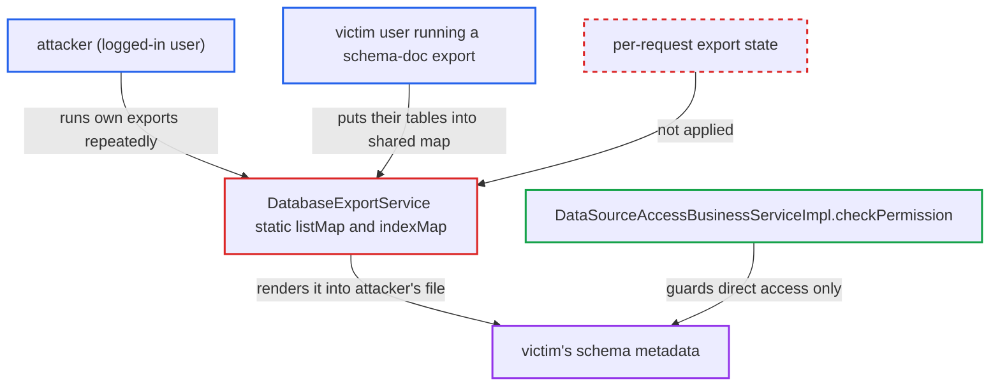

# Static shared maps in schema-doc export leak schema metadata between concurrent users

| Field | Value |
|---|---|
| ID | `find_01ABLqPfvdfJhiLCw4zCohQe` |
| Severity | **Low** |
| Status | open |
| CWE | CWE-488 — Data exposure to wrong session |
| Created | 2026-10-21T22:46:45.936417Z |
| Claude Security | https://claude.ai/security/findings/find_01ABLqPfvdfJhiLCw4zCohQe |

## Description

A logged-in user can receive another user's database schema metadata in their own exported document. This covers database, table and column names, types and comments, from datasources the attacker has no grant for. It needs another user to run a schema-doc export at the same moment. The cause is that `DatabaseExportService` keeps export data in `public static` maps, `listMap` and `indexMap`, shared by all requests.

1. **the class `DatabaseExportService`** holds export data in JVM-wide static maps. `listMap` and `indexMap` are `public static` and unsynchronized, so every export instance created by reflection shares them. ([`chat2db-server/chat2db-server-web/chat2db-server-web-api/src/main/java/ai/chat2db/server/web/api/controller/rdb/doc/DatabaseExportService.java:53-57`](https://github.com/cx-benchmark/chat2db/blob/43aaee8d48736d74ac888dc4a81ddb50d6550638/chat2db-server/chat2db-server-web/chat2db-server-web-api/src/main/java/ai/chat2db/server/web/api/controller/rdb/doc/DatabaseExportService.java#L53-L57))
2. **the attacker** keeps calling `POST /api/export/export_doc` for a datasource they control. The export runs on the common ForkJoin pool, and many or wide tables make the window between `init()` and `export()` longer. ([`chat2db-server/chat2db-server-web/chat2db-server-web-api/src/main/java/ai/chat2db/server/web/api/controller/task/biz/TaskBizService.java:109-146`](https://github.com/cx-benchmark/chat2db/blob/43aaee8d48736d74ac888dc4a81ddb50d6550638/chat2db-server/chat2db-server-web/chat2db-server-web-api/src/main/java/ai/chat2db/server/web/api/controller/task/biz/TaskBizService.java#L109-L146))
3. **a victim user** runs a schema-doc export at the same time, through `POST /api/export/export_doc` or `POST /api/rdb/doc/export`. The victim's `dataAssemble` calls `listMap.put` for their tables into the same shared map, and their `clear()` calls also wipe the attacker's entries. ([`chat2db-server/chat2db-server-web/chat2db-server-web-api/src/main/java/ai/chat2db/server/web/api/controller/rdb/doc/DatabaseExportService.java:99-149`](https://github.com/cx-benchmark/chat2db/blob/43aaee8d48736d74ac888dc4a81ddb50d6550638/chat2db-server/chat2db-server-web/chat2db-server-web-api/src/main/java/ai/chat2db/server/web/api/controller/rdb/doc/DatabaseExportService.java#L99-L149))
4. **the renderer, for example `ExportHtmlService`** reads `listMap` and writes every entry into the attacker's document. It snapshots whatever the map holds at that moment, including the victim's entries. The Markdown, PDF, Word and Excel renderers read the map the same way. ([`chat2db-server/chat2db-server-web/chat2db-server-web-api/src/main/java/ai/chat2db/server/web/api/controller/rdb/doc/export/ExportHtmlService.java:42-43`](https://github.com/cx-benchmark/chat2db/blob/43aaee8d48736d74ac888dc4a81ddb50d6550638/chat2db-server/chat2db-server-web/chat2db-server-web-api/src/main/java/ai/chat2db/server/web/api/controller/rdb/doc/export/ExportHtmlService.java#L42-L43))
5. **the attacker** downloads the finished file through `/api/task/download/{id}`. Download is limited to the task's owner, but the file is the attacker's own, so this check does not stop the leak. ([`chat2db-server/chat2db-server-web/chat2db-server-web-api/src/main/java/ai/chat2db/server/web/api/controller/task/TaskController.java:44-54`](https://github.com/cx-benchmark/chat2db/blob/43aaee8d48736d74ac888dc4a81ddb50d6550638/chat2db-server/chat2db-server-web/chat2db-server-web-api/src/main/java/ai/chat2db/server/web/api/controller/task/TaskController.java#L44-L54))

## Assessment

The attacker is an authenticated low-privilege user. They create or use their own datasource and keep calling `POST /api/export/export_doc` for it. Many or wide tables slow the renumbering loop at lines 143-149 and keep the window open. They download each file through `/api/task/download/{id}`. A leak happens only when another user's schema-doc export runs `dataAssemble` inside that window. That export can come through `POST /api/export/export_doc` or the synchronous `POST /api/rdb/doc/export`. The attacker has to win a race against a victim doing a routine export. The bundled web UI in `chat2db-client/src` calls neither endpoint, so another user must use the schema-doc export API directly.

Impact: The attacker can read the victim's database name, table names and comments. They can also read each column's name, type, length, nullability, default value, decimal places and comment. This gets around the per-datasource check in `DataSourceAccessBusinessServiceImpl.checkPermission`. The victim's document can also lose tables or contain the attacker's, and the other export can fail with `ConcurrentModificationException`. Row data and credentials are never in these maps. Index definitions are not exposed in shipped code, because both callers pass `new ExportOptions()` and `isExportIndex` defaults to `FALSE`.

## Recommendation

Per-request export data is held in JVM-global static collections, `DatabaseExportService.listMap` and `indexMap`. Concurrent exports by different users read, overwrite and clear each other's data. This breaks per-user datasource isolation.

Fix criteria: Export state is scoped to one request, in instance or local fields. No shared mutable static collections remain on the export path, including the static header strings set in `init()`. Two overlapping exports for datasources owned by different users are run through both `/api/export/export_doc` and `/api/rdb/doc/export`. Each output contains only its own database's tables. Neither export fails.

## Evidence

**https://github.com/cx-benchmark/chat2db**

- [`chat2db-server/chat2db-server-web/chat2db-server-web-api/src/main/java/ai/chat2db/server/web/api/controller/rdb/doc/DatabaseExportService.java:53-57`](https://github.com/cx-benchmark/chat2db/blob/43aaee8d48736d74ac888dc4a81ddb50d6550638/chat2db-server/chat2db-server-web/chat2db-server-web-api/src/main/java/ai/chat2db/server/web/api/controller/rdb/doc/DatabaseExportService.java#L53-L57)
- [`chat2db-server/chat2db-server-web/chat2db-server-web-api/src/main/java/ai/chat2db/server/web/api/controller/rdb/doc/DatabaseExportService.java:99-149`](https://github.com/cx-benchmark/chat2db/blob/43aaee8d48736d74ac888dc4a81ddb50d6550638/chat2db-server/chat2db-server-web/chat2db-server-web-api/src/main/java/ai/chat2db/server/web/api/controller/rdb/doc/DatabaseExportService.java#L99-L149)
- [`chat2db-server/chat2db-server-web/chat2db-server-web-api/src/main/java/ai/chat2db/server/web/api/controller/rdb/doc/export/ExportHtmlService.java:42-43`](https://github.com/cx-benchmark/chat2db/blob/43aaee8d48736d74ac888dc4a81ddb50d6550638/chat2db-server/chat2db-server-web/chat2db-server-web-api/src/main/java/ai/chat2db/server/web/api/controller/rdb/doc/export/ExportHtmlService.java#L42-L43)
- [`chat2db-server/chat2db-server-web/chat2db-server-web-api/src/main/java/ai/chat2db/server/web/api/controller/task/biz/TaskBizService.java:109-146`](https://github.com/cx-benchmark/chat2db/blob/43aaee8d48736d74ac888dc4a81ddb50d6550638/chat2db-server/chat2db-server-web/chat2db-server-web-api/src/main/java/ai/chat2db/server/web/api/controller/task/biz/TaskBizService.java#L109-L146)
- [`chat2db-server/chat2db-server-web/chat2db-server-web-api/src/main/java/ai/chat2db/server/web/api/controller/rdb/RdbDocController.java:84-89`](https://github.com/cx-benchmark/chat2db/blob/43aaee8d48736d74ac888dc4a81ddb50d6550638/chat2db-server/chat2db-server-web/chat2db-server-web-api/src/main/java/ai/chat2db/server/web/api/controller/rdb/RdbDocController.java#L84-L89)
- [`chat2db-server/chat2db-server-web/chat2db-server-web-api/src/main/java/ai/chat2db/server/web/api/controller/task/TaskController.java:44-54`](https://github.com/cx-benchmark/chat2db/blob/43aaee8d48736d74ac888dc4a81ddb50d6550638/chat2db-server/chat2db-server-web/chat2db-server-web-api/src/main/java/ai/chat2db/server/web/api/controller/task/TaskController.java#L44-L54)
- [`chat2db-server/chat2db-server-domain/chat2db-server-domain-core/src/main/java/ai/chat2db/server/domain/core/impl/DataSourceAccessBusinessServiceImpl.java:35-62`](https://github.com/cx-benchmark/chat2db/blob/43aaee8d48736d74ac888dc4a81ddb50d6550638/chat2db-server/chat2db-server-domain/chat2db-server-domain-core/src/main/java/ai/chat2db/server/domain/core/impl/DataSourceAccessBusinessServiceImpl.java#L35-L62)
- [`chat2db-server/chat2db-server-web/chat2db-server-web-api/src/main/java/ai/chat2db/server/web/api/controller/rdb/doc/conf/ExportOptions.java:19`](https://github.com/cx-benchmark/chat2db/blob/43aaee8d48736d74ac888dc4a81ddb50d6550638/chat2db-server/chat2db-server-web/chat2db-server-web-api/src/main/java/ai/chat2db/server/web/api/controller/rdb/doc/conf/ExportOptions.java#L19)

